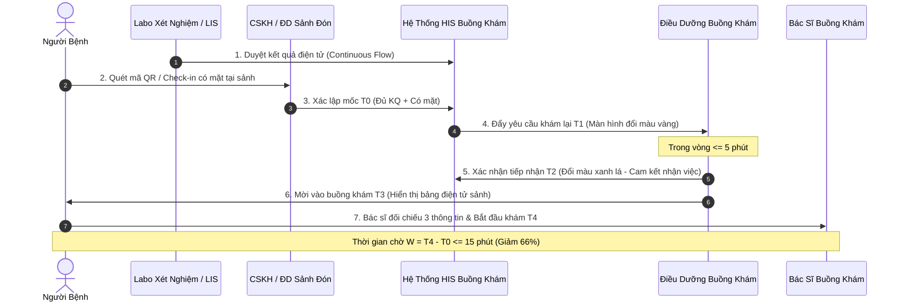

# BÀI TẬP BUỔI 2: CHUỖI GIÁ TRỊ, LUỒNG NGƯỜI BỆNH & PHÂN ĐỊNH TRÁCH NHIỆM
## KHÓA ĐÀO TẠO QUẢN TRỊ BỆNH VIỆN THEO PHƯƠNG PHÁP FMFT AIOS/LSE
### BỘ BIỂU MẪU QUẢN TRỊ BỆNH VIỆN (VERSION 2.0 – PSD/FMFT INSTITUTE)
**Đơn vị thực hiện:** Nhóm 8 (Hệ thống Y tế Thanh Vũ Medic – Đại diện: Cơ sở 3 Cà Mau)  
**Nhóm trưởng:** Nguyễn Kim Nhang | **Chủ trì kỹ thuật:** Huỳnh Trường Thanh Tâm & Huỳnh Tấn Kiệt  

---

# M02 BẢN ĐỒ CHUỖI GIÁ TRỊ VÀ BÀN GIAO (VSM & HANDOFF)

*Sử dụng ở chuyên đề 3. Dùng phiếu này để xác định ý nghĩa từng bước, chuẩn hóa bàn giao và xóa bỏ lãng phí chờ đợi. Lập riêng bản hiện trạng và bản đề xuất.*

- **Tên luồng và nhóm người bệnh:** Luồng khám kết luận người bệnh ngoại trú sau khi có đủ kết quả Cận lâm sàng thường quy (Mã luồng: `TV3-KB-01`).
- **Điểm đầu và điểm cuối:**
  - **$T_0$:** Thời điểm đồng thời có **đủ kết quả hợp lệ theo chỉ định** trên hệ thống và **đã xác nhận người bệnh có mặt, sẵn sàng khám lại** tại khu vực chờ (lấy thời điểm muộn hơn của hai sự kiện).
  - **$T_4$:** Thời điểm Bác sĩ **thực sự bắt đầu khám kết luận** cho người bệnh (không tính lúc điều dưỡng gọi tên, mở bệnh án hay kết thúc khám).
  - **Thời gian chờ toàn luồng đoạn ưu tiên:** $W = T_4 - T_0$.
- **Trường hợp loại trừ và nhánh ưu tiên chuyên môn:**
  - *Loại trừ:* Khám ngoài giờ, cấp cứu, bệnh nhân nhi, luồng khám chuyên gia hẹn trước, bệnh nhân cần làm thêm kỹ thuật chuyên sâu kéo dài (CT-Scanner có cản quang, nội soi tiền mê, sinh thiết), ca hội chẩn liên viện, người bệnh tự ý bỏ về hoặc vắng mặt khi gọi.
  - *Nhánh ưu tiên chuyên môn (Fast-track lâm sàng):* Bệnh nhân có dấu hiệu sinh tồn bất thường hoặc kết quả xét nghiệm thuộc giá trị báo động nguy kịch (Critical Value Alert) được kích hoạt quy trình cấp cứu ngay lập tức, chuyển thẳng buồng cấp cứu/phòng khám ưu tiên, tuyệt đối không chờ theo thứ tự hàng khám thông thường.
- **Nguồn dữ liệu thời gian và kỳ khảo sát:** Bộ dữ liệu quan sát hành trình ngoại trú CS3 tuần 19–25/10/2026 kết hợp dữ liệu log hệ thống HIS/LIS/PACS.

---

## 1. BẢN ĐỒ HIỆN TRẠNG (CURRENT STATE VSM)

*Khảo sát 20 lượt ngoại trú điển hình: Thời gian chờ trung bình $W = 45$ phút; lượt dài nhất 85 phút; $P90 = 63$ phút.*

| **Bước và đơn vị** | **Đầu vào và đầu ra** | **Xử lý và chờ** | **Người nhận bàn giao** |
|:---:|---|---|---|
| **1. Xác minh điều kiện** *(Điều dưỡng sảnh / CSKH)* | - Đầu vào: Người bệnh đã làm xong CLS, ngồi chờ tại sảnh. - Đầu ra: Kết quả giấy được in ra và trả cho người bệnh. | - Xử lý: 2 phút (tìm và phát phiếu kết quả giấy). - Chờ: **10 – 15 phút** (chờ gom đủ tập kết quả từ phòng xét nghiệm đưa ra). | Người bệnh tự cầm kết quả; chưa có người nhận trách nhiệm bàn giao chính thức. |
| **2. Chuyển thông tin** *(Người bệnh / Điều dưỡng)* | - Đầu vào: Kết quả giấy cầm tay. - Đầu ra: Kết quả được nộp vào khay trước cửa buồng khám. | - Xử lý: 2 phút (di chuyển và đặt sổ vào khay). - Chờ: **8 – 12 phút** (người bệnh đi ăn sáng, đi vệ sinh hoặc ngồi chờ người khác nộp giùm). | Điều dưỡng buồng khám; hồ sơ nằm trong khay chưa được phân loại. |
| **3. Tiếp nhận buồng khám** *(Điều dưỡng buồng khám)* | - Đầu vào: Chồng kết quả giấy trong khay. - Đầu ra: Bệnh nhân được xếp vào danh sách chờ vào khám. | - Xử lý: 2 phút (lấy hồ sơ, tra cứu trên máy tính). - Chờ: **15 – 25 phút** (Bác sĩ bên trong không biết có bệnh nhân nộp hồ sơ; Điều dưỡng chưa gọi vì chờ Bác sĩ khám xong ca trước). | Điều dưỡng phụ trách buồng khám; chưa có cam kết thời gian tiếp nhận. |
| **4. Gọi người bệnh** *(Điều dưỡng buồng khám)* | - Đầu vào: Bệnh nhân đến lượt khám lại. - Đầu ra: Người bệnh có mặt trước cửa buồng khám. | - Xử lý: 1 phút (phát loa hoặc gọi tên). - Chờ: **5 – 10 phút** (gọi nhiều lần do người bệnh ngồi xa, ồn ào tại sảnh chờ). | Người bệnh bước vào buồng khám. |
| **5. Bắt đầu khám kết luận** *(Bác sĩ phòng khám)* | - Đầu vào: Bệnh nhân ngồi vào bàn khám, nộp kết quả giấy. - Đầu ra: Bác sĩ bắt đầu hỏi bệnh, đọc kết quả và tư vấn ($T_4$). | - Xử lý: 7 – 10 phút (thăm khám, giải thích, kê đơn). - Chờ: 0 phút. | Bác sĩ hoàn thành khám, hướng dẫn người bệnh sang bước nhận thuốc. |

> **Nhận diện điểm nghẽn (Bottlenecks) hiện trạng:**  
> - Điểm nghẽn lớn nhất nằm ở **Bước 2 và Bước 3** (chiếm tới 65% tổng thời gian chờ $W$): Đứt gãy bàn giao thông tin giữa Labo Xét nghiệm và Buồng khám Bác sĩ. Bác sĩ ngồi chờ bệnh nhân nhưng không biết bên ngoài đã có kết quả; người bệnh cầm kết quả giấy ngồi chờ bên ngoài nhưng không biết khi nào được gọi vào!

---

## 2. BẢN ĐỒ ĐỀ XUẤT (FUTURE STATE VSM – FMFT LEAN FLOW)

*Mô hình luồng chảy liên tục kết hợp cảnh báo tự động trên hệ thống HIS (Áp dụng từ 05/11/2026).*

| **Bước và đơn vị** | **Đầu vào và đầu ra** | **Xử lý và chờ chuẩn hóa (SOP)** | **Người nhận bàn giao & Cam kết** |
|:---:|---|---|---|
| **1. Xác lập mốc $T_0$** *(Điều dưỡng sảnh / CSKH)* | - Đầu vào: LIS/PACS hoàn tất duyệt kết quả điện tử. - Đầu ra: Xác nhận bệnh nhân có mặt tại sảnh $\rightarrow$ Tạo mốc $T_0$ trên HIS. | - Xử lý: $\le 1$ phút (quét mã vạch thẻ khám hoặc tra cứu nhanh trên App/HIS). - Chờ: **0 phút** (không chờ in giấy). | Điều dưỡng sảnh xác lập; hệ thống tự động ghi nhận $T_0$. |
| **2. Gửi yêu cầu $T_1$** *(Tự động qua HIS)* | - Đầu vào: Mốc $T_0$ được kích hoạt. - Đầu ra: Danh sách chờ khám lại buồng khám nhận yêu cầu $T_1$. | - Xử lý: Tức thời ($\le 10$ giây qua mạng nội bộ). - Chờ: **$\le 2$ phút** từ $T_0$. | Màn hình Điều dưỡng buồng khám hiển thị cảnh báo hàng chờ mới. |
| **3. Tiếp nhận bàn giao $T_2$** *(Điều dưỡng buồng khám)* | - Đầu vào: Yêu cầu $T_1$ trên màn hình. - Đầu ra: Click "Tiếp nhận" $\rightarrow$ Xác lập mốc $T_2$. | - Xử lý: 30 giây (kiểm tra hồ sơ và phòng khám dự kiến). - Quy tắc cam kết: **$T_2 - T_1 \le 5$ phút**. | Điều dưỡng buồng khám chính thức nhận trách nhiệm điều phối lượt khám. |
| **4. Xếp và gọi $T_3$** *(Điều dưỡng buồng khám)* | - Đầu vào: Lượt khám đã tiếp nhận $T_2$. - Đầu ra: Mời bệnh nhân vào cửa phòng khám, tạo mốc $T_3$. | - Xử lý: 1 phút (bấm chuông tự động + bảng điện tử gọi số). - Chờ: **$\le 5$ phút** (theo nhịp Takt Time buồng khám). | Người bệnh được điều hướng thẳng vào buồng khám. |
| **5. Bắt đầu khám $T_4$** *(Bác sĩ phòng khám)* | - Đầu vào: Đúng người bệnh, đúng hồ sơ bệnh án điện tử. - Đầu ra: Bác sĩ click "Bắt đầu khám", tạo mốc $T_4$. | - Xử lý chuyên môn: **Duy trì tối thiểu 7 – 10 phút/ca** (khám lâm sàng, tư vấn đơn thuốc). - Chờ: **0 phút**. | Bác sĩ hoàn thành khám và chuyển đơn sang Dược/Thanh toán. |

---

## 3. QUY TẮC BÀN GIAO VÀ KIỂM SOÁT 6 KỊCH BẢN NGOẠI LỆ

### 3.1. Thông tin tối thiểu và điều kiện tiếp nhận bàn giao
- **Phiếu bàn giao điện tử (e-Handover Ticket) bắt buộc gồm:**
  1. Mã số người bệnh (PID) và Mã lượt khám ngoại trú.
  2. 03 thông tin định danh: Họ và tên, Năm sinh, Giới tính.
  3. Phòng khám chuyên khoa và Bác sĩ dự kiến kết luận.
  4. Trạng thái kết quả cận lâm sàng: Đã duyệt 100% trên phần mềm (kèm ghi chú có/không có kết quả bất thường).
  5. Mốc thời gian $T_0$ (thời điểm đủ điều kiện) và $T_1$ (thời điểm gửi yêu cầu).
- **Quy tắc bàn giao có hiệu lực:** *"Đã gửi không có nghĩa là Đã nhận"*. Bàn giao chỉ hoàn tất khi Điều dưỡng buồng khám click xác nhận $T_2$ trên hệ thống. Nếu sau **05 phút** chưa có xác nhận $T_2$, hệ thống tự động kích hoạt tuyến leo thang (Escalation Path):
  - *Phút thứ 3:* Phát âm thanh cảnh báo màu vàng trên màn hình buồng khám.
  - *Phút thứ 5:* Gửi thông báo đến điện thoại Điều dưỡng trưởng khoa khám và Điều dưỡng điều phối sảnh để can thiệp trực tiếp.

### 3.2. Bảng quy chuẩn xử lý 6 kịch bản ngoại lệ trong vận hành

| **Kịch bản ngoại lệ** | **Nguy cơ sai hỏng** | **Quy trình xử lý chuẩn hóa (SOP)** | **Bằng chứng và Người chịu trách nhiệm** |
|:---:|---|---|---|
| **1. Thiếu kết quả hoặc thiếu mốc $T_0$** | Bác sĩ kết luận khi chưa đủ căn cứ; tính sai thời gian $W$. | Tuyệt đối không cho vào buồng khám. Giữ trạng thái "Chờ kết quả"; CSKH liên hệ Labo kiểm tra tiến độ chạy mẫu. Chưa tính thời gian $W$. | Ghi log trạng thái trên HIS; **CN. Lê Minh Mẫn** (Labo) & CSKH xác minh. |
| **2. Sai người bệnh hoặc sai lượt khám** | Nhầm lẫn bệnh án, nguy cơ sai sót đơn thuốc nghiêm trọng. | Dừng ngay quy trình bàn giao; đối chiếu lại vòng đeo tay/CCCD và mã PID; lập biên bản suýt sự cố (Near-miss). | Báo cáo QLCL; **ĐD. Huỳnh Thị Nga** (Khoa Khám) kiểm tra lập biên bản. |
| **3. Trùng yêu cầu khám lại** | Ảo hóa hàng đợi, kéo dài thời gian chờ ảo trên dashboard. | Hệ thống tự động phát hiện mã PID trùng lặp và tự động hợp nhất; giữ nguyên mốc thời gian $T_0$ ban đầu. | Log hệ thống HIS; **Võ Lê Chương** (Tổ CNTT) kiểm soát. |
| **4. Kết quả xét nghiệm bị sửa đổi hoặc chỉ định bổ sung** | Bác sĩ ra quyết định dựa trên số liệu cũ chưa chuẩn. | Hệ thống tự động khóa trạng thái khám; cảnh báo pop-up đỏ cho Bác sĩ; chuyển sang luồng hội chẩn hoặc chờ kết quả bổ sung. | Bác sĩ điều trị ký xác nhận cập nhật; **BS. Huỳnh Tấn Kiệt** giám sát. |
| **5. Mất kết nối mạng HIS / LIS** | Gián đoạn toàn bộ luồng thông tin điện tử. | Kích hoạt ngay quy trình dự phòng thủ công (Manual Fallback): Dùng sổ bàn giao giấy có ký nhận; gọi điện thoại nội bộ giữa Labo và Buồng khám. | Sổ bàn giao có kiểm soát; **Võ Lê Chương** (CNTT) xử lý đường truyền trong $\le 15$ phút. |
| **6. Người bệnh vắng mặt hoặc chuyển đổi buồng khám** | Tắc hàng đợi buồng khám, gọi tên không ai vào. | Điều dưỡng đánh dấu "Vắng mặt tạm thời"; tự động chuyển lượt xuống vị trí thứ 3 trong hàng đợi; CSKH sảnh hỗ trợ định vị bệnh nhân. | Cập nhật trạng thái trên HIS; CSKH gọi điện thoại nếu quá 15 phút không thấy mặt. |

---

# M03 MA TRẬN TRÁCH NHIỆM VÀ THẨM QUYỀN (RACI MATRIX)

*Sử dụng ở chuyên đề 4. Phân định rõ: **R** (Responsible - Người thực hiện), **A** (Accountable - Người chịu trách nhiệm giải trình cuối cùng, DUY NHẤT 1 người), **C** (Consulted - Người được tham vấn ý kiến), **I** (Informed - Người được thông báo kết quả).*

## 1. MA TRẬN RACI CHO QUY TRÌNH LIÊN KHOA KHÁM KẾT LUẬN NGOẠI TRÚ

| **STT** | **Đầu việc trọng yếu trong chuỗi giá trị** | **Ban Giám Đốc** *(Phúc/Dũng)* | **Khối Lâm sàng** *(BS Buồng khám)* | **Chủ quy trình** *(Kiệt KHTH / Tâm PTKH)* | **ĐD Khoa Khám** *(Nga ĐĐT)* | **Khối CLS** *(Mẫn XN / Toại CĐHA)* | **Tổ CNTT** *(Chương/Duy)* | **Ban Kiểm Soát & QLCL** |
|:---:|---|:---:|:---:|:---:|:---:|:---:|:---:|:---:|
| **1** | Xác lập mục tiêu TAT ngoại trú $\le 90$p và phê duyệt ngân sách/SOP | **A** | C | R | C | C | I | I |
| **2** | Giữ vững chuẩn mực an toàn lâm sàng, đối chiếu 3 định danh và tư vấn $\ge 7$p | I | **A / R** | C | R | I | I | C |
| **3** | Phân luồng dòng chảy liên tục (Continuous Flow) trả kết quả xét nghiệm | I | I | C | C | **A / R** | C | I |
| **4** | Điều phối sảnh chờ, đón tiếp và quét xác lập mốc $T_0$ | I | I | **A** *(Tâm)* | R *(CSKH)* | I | I | I |
| **5** | Tiếp nhận bàn giao $T_2 \le 5$ phút và gọi người bệnh vào buồng khám $T_3$ | I | C | C | **A / R** | I | I | I |
| **6** | Cấu hình tính năng đổi màu trạng thái và cảnh báo $T_2$ trễ hạn trên HIS | I | I | C | C | C | **A / R** | I |
| **7** | Giám sát dữ liệu nhật ký thời gian thực và kích hoạt CAPA khi có sai lệch | I | I | R | C | C | I | **A** *(BKS)* |
| **8** | Xử lý các tình huống ngoại lệ, sự cố y khoa và nguy cơ chuyên môn | C | **A** *(BS Dũng)* | R | R | R | I | C |

---

## 2. PHIẾU PHÂN QUYỀN VÀ THẨM QUYỀN (DOA) CHO ĐẦU VIỆC TRỌNG YẾU

- **Tên đầu việc trọng yếu:** *"Quyết định phân luồng Fast-track và điều phối bệnh nhân vào buồng khám lại thời gian thực"*
- **Người chịu trách nhiệm giải trình cuối cùng (Chữ A):** **Huỳnh Trường Thanh Tâm** (Phó phòng PTKH / Thư ký Ban Kiểm Soát KPI) phối hợp cùng **ĐD. Huỳnh Thị Nga** (Điều dưỡng Trưởng Khoa Khám).
- **Quyền quyết định được giao và giới hạn:**
  - *Được quyền:* Chủ động điều chuyển bệnh nhân mạn tính ổn định sang buồng khám dự phòng khi hàng chờ buồng chính vượt quá 7 người; yêu cầu Điều dưỡng buồng khám ưu tiên tiếp nhận ca có nguy cơ trễ hạn.
  - *Giới hạn (Tuyệt đối không có quyền):* Không can thiệp vào chỉ định chuyên môn của Bác sĩ; không tự ý thay đổi thứ tự ưu tiên của ca cấp cứu hoặc ca có kết quả bất thường.
- **Nguồn lực và dữ liệu được truy cập:**
  - Toàn quyền truy cập Real-time Dashboard hàng đợi khám bệnh trên hệ thống HIS và phân hệ CSKH.
  - Sử dụng đội ngũ 11 nhân sự CSKH/Lễ tân trong ca trực sáng làm nhiệm vụ điều phối luồng (Care Navigators).
- **Quy tắc leo thang (Escalation Rule):**
  - Khi hàng chờ buồng khám $> 10$ người hoặc thời gian chờ vượt quá 30 phút mà các buồng khám đều kín tải: Leo thang ngay lên **BS. Huỳnh Tấn Kiệt** (Trưởng phòng KHTH) để mở buồng khám tăng cường.
  - Kênh liên lạc: Nhóm Zalo Điều hành nội bộ Cơ sở 3 và Hotline nội bộ máy lẻ 102.
- **Bằng chứng xác minh hoàn thành:** Nhật ký phân luồng hàng ngày trên hệ thống HIS; biên bản giao ban nhanh 10 phút cuối ca sáng. Người xác minh: Ban Kiểm soát KPI và Phòng Quản lý chất lượng.
