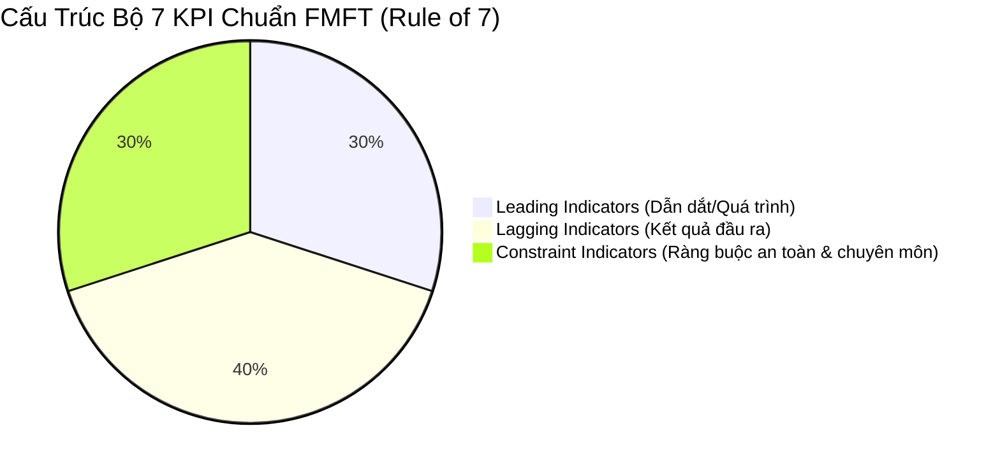

# BÀI TẬP BUỔI 3 (SƠ THẢO): KPI, DASHBOARD ĐIỀU HÀNH & QUẢN TRỊ RỦI RO / AN TOÀN NGƯỜI BỆNH
## KHÓA ĐÀO TẠO QUẢN TRỊ BỆNH VIỆN THEO PHƯƠNG PHÁP FMFT AIOS/LSE
### BỘ BIỂU MẪU QUẢN TRỊ BỆNH VIỆN (VERSION 2.0 – PSD/FMFT INSTITUTE)
**Đơn vị thực hiện:** Nhóm 8 (Hệ thống Y tế Thanh Vũ Medic – Đại diện: Cơ sở 3 Cà Mau)  
**Nhóm trưởng:** Nguyễn Kim Nhang | **Chủ trì kỹ thuật:** Huỳnh Trường Thanh Tâm & Huỳnh Tấn Kiệt  

---

# M04 TỪ ĐIỂN CHỈ SỐ KPI (KPI DICTIONARY)

*Sử dụng ở chuyên đề 5. Xây dựng theo nguyên tắc **Rule of 7** của phương pháp luận FMFT: Tối đa 7 chỉ số trọng yếu, phân bổ cân bằng giữa **Leading (Dẫn dắt/Quá trình - 30%)**, **Lagging (Kết quả/Độ trễ - 40%)** và **Constraint (Ràng buộc an toàn/Chất lượng - 30%)** để chống bẫy tối ưu hóa cục bộ (Silo Effect).*



## BẢNG TỪ ĐIỂN 7 CHỈ SỐ KPI ĐIỀU HÀNH LUỒNG NGOẠI TRÚ

| STT | Mã KPI | Tên chỉ số & Phân loại | Công thức tính & Đơn vị đo | Nguồn dữ liệu kiểm chứng | Tần suất đo | Chủ sở hữu (Chữ A) | Ngưỡng Xanh (Đạt) | Ngưỡng Vàng (Cảnh báo) | Ngưỡng Đỏ (Nguy hiểm) |
|:---:|---|---|---|---|:---:|---|:---:|:---:|:---:|
| **1** | `KPI-01` | **Tỷ lệ xác nhận bàn giao đúng hạn**<br/>*(Leading - Quá trình)* | $\frac{\text{Số lượt xác nhận } T_2 - T_1 \le 5\text{p}}{\text{Tổng số lượt gửi yêu cầu } T_1} \times 100\%$ | Log thời gian thực trên HIS | Hàng ngày | **ĐD. Huỳnh Thị Nga** (Khoa Khám) | $\ge 95\%$ | $90\% - 94.9\%$ | $< 90\%$ |
| **2** | `KPI-02` | **Tỷ lệ trả kết quả CLS dòng liên tục**<br/>*(Leading - Quá trình)* | $\frac{\text{Số mẻ trả kết quả } \le 15\text{p/đợt}}{\text{Tổng số đợt trả kết quả ca sáng}} \times 100\%$ | Nhật ký xuất kết quả LIS/PACS | Hàng ngày | **CN. Lê Minh Mẫn** (Trưởng Labo XN) | $\ge 90\%$ | $80\% - 89.9\%$ | $< 80\%$ |
| **3** | `KPI-03` | **Tỷ lệ CSKH định vị NB tại sảnh**<br/>*(Leading - Quá trình)* | $\frac{\text{Số lượt NB quét mã check-in } T_0}{\text{Tổng số NB đã hoàn tất CLS}} \times 100\%$ | Log phân hệ CSKH / Lễ tân | Hàng ngày | **Tạ Minh Phước** (Tổ trưởng PTKH) | $\ge 98\%$ | $95\% - 97.9\%$ | $< 95\%$ |
| **4** | `KPI-04` | **Thời gian chờ khám lại trung bình ($W$)**<br/>*(Lagging - Kết quả)* | Trung bình $W = T_4 - T_0$ của các lượt khám hợp lệ trong ngày (Phút) | Dữ liệu HIS trích xuất tự động | Hàng ngày | **BS. Huỳnh Tấn Kiệt** (Trưởng KHTH) | $\le 15$ phút | $16 - 25$ phút | $> 25$ phút |
| **5** | `KPI-05` | **Chỉ số thời gian chờ phân vị 90 ($P90$)**<br/>*(Lagging - Kết quả)* | Giá trị thời gian $W$ tại phân vị thứ 90 trong ngày (`PERCENTILE.INC`) | Dữ liệu HIS trích xuất tự động | Hàng tuần | **Huỳnh Trường Thanh Tâm** (BKS KPI) | $\le 25$ phút | $26 - 40$ phút | $> 40$ phút |
| **6** | `KPI-06` | **Thời gian Bác sĩ khám lâm sàng & tư vấn**<br/>*(Constraint - Ràng buộc chuyên môn)* | Thời gian Bác sĩ thực sự thăm khám và giải thích bệnh cho 01 ca (Phút) | Bấm giờ ngẫu nhiên & log hoàn tất bệnh án | Hàng tuần | **BS. CKII. Nguyễn Văn Dũng** (GĐ Chuyên môn) | $\ge 7$ phút | $5 - 6.9$ phút | $< 5$ phút *(Ép tốc độ)* |
| **7** | `KPI-07` | **Tỷ lệ tuân thủ đối chiếu 3 định danh**<br/>*(Constraint - An toàn người bệnh)* | $\frac{\text{Số lượt đối chiếu đủ Tên, Tuổi, PID}}{\text{Tổng số lượt Bác sĩ bắt đầu khám } T_4} \times 100\%$ | Giám sát QLCL & Camera buồng khám | Hàng tháng | **Tổ Quản lý chất lượng** (QLCL) | **100%** | $98\% - 99.9\%$ | $< 98\%$ |

---

# M05 ĐẶC TẢ DASHBOARD ĐIỀU HÀNH THỜI GIAN THỰC (AIOS EWS)

*Sử dụng ở chuyên đề 5. Xây dựng hệ thống điều hành dự báo sớm (Early Warning System) có con người kiểm soát (Human-in-the-loop).*

## 1. MÔ TẢ GIAO DIỆN & CƠ CHẾ CẢNH BÁO MÀU (VISUAL MANAGEMENT)

```
+---------------------------------------------------------------------------------------------------+
|  AIOS REAL-TIME DASHBOARD - PKĐK THANH VŨ MEDIC CÀ MAU (07:30 - 10:00)                             |
+------------------------------------+----------------------------------+---------------------------+
| TỔNG LƯỢT ĐÃ ĐĂNG KÝ: 412 CA       | ĐANG CHỜ KHÁM LẠI: 18 CA         | TAT NGOẠI TRÚ TB: 82 PHÚT |
+------------------------------------+----------------------------------+---------------------------+
| BUỒNG KHÁM NỘI 1: 3 ca (XANH - 8p) | BUỒNG KHÁM NỘI 2: 7 ca (VÀNG-18p)| BUỒNG NỘI 3: 11 ca (ĐỎ-32p)|
| [ĐD Tiếp nhận: 100%]               | [ĐD Tiếp nhận: 92%]              | [CẢNH BÁO: Quá tải hàng!] |
+------------------------------------+----------------------------------+---------------------------+
| LABO XÉT NGHIỆM: Đang chạy 25 mẫu  | SIÊU ÂM: Hàng chờ 6 ca           | X-QUANG: Hàng chờ 4 ca    |
+------------------------------------+----------------------------------+---------------------------+
```

1. **Quy tắc 3 trạng thái màu hiển thị:**
   - 🟢 **Màu Xanh lá (Bình thường - Flowing):** Hàng chờ buồng khám $\le 5$ người; thời gian chờ $W \le 15$ phút; tỷ lệ xác nhận $T_2 \ge 95\%$. Hệ thống vận hành mượt mà theo đúng nhịp Takt Time.
   - 🟡 **Màu Vàng (Cảnh báo chú ý - Watchful):** Hàng chờ từ $6 – 10$ người; thời gian chờ $W$ từ $16 – 25$ phút; có ít nhất 1 yêu cầu bàn giao quá 5 phút chưa bấm $T_2$.  
     $\rightarrow$ *Hành động kích hoạt:* Hệ thống gửi tin nhắn thông báo nội bộ cho Điều dưỡng trưởng Khoa Khám và CSKH sảnh để rà soát hỗ trợ phân làn ngay.
   - 🔴 **Màu Đỏ (Báo động tắc nghẽn - Bottleneck Alert):** Hàng chờ $> 10$ người; thời gian chờ $W > 25$ phút; hoặc phát hiện ca có kết quả bất thường (Critical Value Alert) chưa được tiếp nhận quá 3 phút.  
     $\rightarrow$ *Hành động kích hoạt khẩn cấp:* Telegram Bot bắn thông báo khẩn cấp cho Ban Giám Đốc và Trưởng phòng KHTH; mở ngay buồng khám dự phòng số 4; chuyển nhân sự CSKH sang hướng dẫn người bệnh.

2. **Cơ chế phân quyền dữ liệu (Role-based Data Access):**
   - *Ban Giám Đốc & Ban Kiểm Soát:* Xem toàn bộ chỉ số vĩ mô, biểu đồ xu hướng, tỷ lệ đạt KPI và cảnh báo đỏ toàn viện.
   - *Trưởng khoa / Bác sĩ buồng khám:* Xem chi tiết danh sách bệnh nhân buồng mình, tiền sử cận lâm sàng và thời gian chờ từng ca.
   - *Điều dưỡng buồng khám / CSKH:* Thao tác click xác nhận $T_0$, $T_2$, gọi số $T_3$, không có quyền sửa đổi kết quả xét nghiệm hay thông tin bệnh án.

---

# M06 PHIẾU PHÂN TÍCH RỦI RO RCA VÀ KẾ HOẠCH CAPA

*Sử dụng ở chuyên đề 6. Phân tích nguyên nhân gốc rễ (Root Cause Analysis - RCA) và lập kế hoạch hành động khắc phục phòng ngừa (Corrective and Preventive Action - CAPA) cho sự cố đứt gãy luồng thông tin.*

- **Quy trình & Bước phân tích:** Quy trình khám kết luận ngoại trú – Bước 2 & 3: Bàn giao kết quả cận lâm sàng giữa Labo Xét nghiệm và Buồng khám Bác sĩ.
- **Sự cố mô phỏng phân tích:** *Người bệnh N.V.A (65 tuổi, tiền sử đái tháo đường type 2) có kết quả xét nghiệm đường huyết lúc đói hạ thấp nghiêm trọng (Glycemia = 2.4 mmol/L - Giá trị báo động nguy kịch Critical Value) nhưng phải ngồi chờ ngoài sảnh 52 phút mà Bác sĩ buồng khám không hay biết do chưa được bàn giao hồ sơ.*
- **Hậu quả tiềm tàng:** Người bệnh có nguy cơ hôn mê do hạ đường huyết ngay tại sảnh chờ; đe dọa trực tiếp an toàn tính mạng người bệnh và gây khủng hoảng uy tín bệnh viện.

---

## 1. MA TRẬN PHÂN TÍCH 5 TẠI SAO (5 WHYS ROOT CAUSE ANALYSIS)

```
[ Hiện tượng: Bệnh nhân có kết quả nguy kịch chờ 52 phút không được khám ]
    │
    ▼ Tại sao 1: Bác sĩ buồng khám không biết bệnh nhân đã có kết quả?
    └──► Vì kết quả giấy vẫn nằm ở khay trả kết quả ngoài sảnh, chưa chuyển vào phòng.
    │
    ▼ Tại sao 2: KTV Xét nghiệm không báo ngay cho Bác sĩ điều trị?
    └──► Vì KTV bận chạy mẻ xét nghiệm tiếp theo, quy trình cũ chỉ quy định "in ra giấy và trả ra bàn tiếp đón".
    │
    ▼ Tại sao 3: Hệ thống phần mềm HIS/LIS không tự động phát chuông cảnh báo?
    └──► Vì tính năng "Critical Value Pop-up Alert" chưa được cấu hình kích hoạt trên màn hình buồng khám.
    │
    ▼ Tại sao 4: Không có nhân viên CSKH hoặc Điều dưỡng sảnh phát hiện bệnh nhân mệt mỏi?
    └──► Vì sảnh quá đông đúc đầu giờ sáng, nhân viên phải ngồi giải thích kết quả cho nhiều người cùng lúc.
    │
    ▼ Tại sao 5 (NGUYÊN NHÂN GỐC RỄ - ROOT CAUSE):
    └──► THIẾU QUY TRÌNH BÀN GIAO CÓ XÁC NHẬN (CLOSED-LOOP HANDOFF) VÀ THIẾU TÍNH NĂNG CẢNH BÁO TỰ ĐỘNG THỜI GIAN THỰC GIỮA CẬN LÂM SÀNG VỚI LÂM SÀNG!
```

---

## 2. KẾ HOẠCH HÀNH ĐỘNG KHẮC PHỤC VÀ PHÒNG NGỪA (CAPA ACTION PLAN)

| STT | Hành động khắc phục / phòng ngừa (CAPA) | Loại hành động | Người chủ trì (Owner) | Thời hạn hoàn thành | Tiêu chí nghiệm thu hiệu quả (Verification) |
|:---:|---|:---:|---|:---:|---|
| **1** | **Xử trí cấp cứu tức thời:** Ban hành hướng dẫn khẩn cấp: Mọi kết quả Glycemia $< 3.0$ mmol/L phải được KTV gọi điện thoại trực tiếp cho Bác sĩ buồng khám trong vòng $\le 2$ phút. | Khắc phục ngay | **CN. Lê Minh Mẫn** (Trưởng Labo XN) | 29/10/2026 *(Đã kích hoạt)* | 100% ca nguy kịch có nhật ký cuộc gọi đối chiếu. |
| **2** | **Cấu hình Pop-up cảnh báo đỏ trên HIS:** Cài đặt tính năng tự động khóa màn hình và hiện cửa sổ cảnh báo âm thanh đỏ tại buồng khám khi có kết quả Critical Value. | Phòng ngừa hệ thống | **Võ Lê Chương** (Tổ CNTT) | 03/11/2026 | Thử nghiệm 10 ca giả định đạt phản hồi trong 10 giây. |
| **3** | **Đảo nhịp nhân sự PTKH trực sảnh:** Bố trí 2 nhân sự CSKH chuyên trách "Care Navigator" rà soát người cao tuổi có dấu hiệu mệt mỏi tại sảnh chờ để đo đường huyết mao mạch hoặc phát bánh ngọt. | Phòng ngừa vận hành | **Huỳnh Trường Thanh Tâm** (PTKH) | 01/11/2026 | Không còn trường hợp bệnh nhân hạ đường huyết tại sảnh. |
| **4** | **Kiểm toán tuân thủ định kỳ:** Ban Kiểm soát KPI phối hợp QLCL trích xuất ngẫu nhiên 30 ca có giá trị cận lâm sàng bất thường mỗi tuần để đối chiếu thời gian từ lúc có kết quả đến lúc Bác sĩ xử trí. | Kiểm soát giám sát | **Ban Kiểm Soát KPI** & QLCL | Bắt đầu từ 08/11/2026 | Tỷ lệ trễ hạn cảnh báo $= 0\%$. |

---

## 3. KẾT LUẬN & ĐỀ XUẤT CHO BUỔI 3

1. Bộ 3 biểu mẫu **M04 (Từ điển KPI)**, **M05 (Đặc tả Dashboard)** và **M06 (Phiếu rủi ro RCA/CAPA)** tạo thành chiếc "kiềng 3 chân" vững chắc đảm bảo quy trình cải tiến luồng LSE tại Cơ sở 3 Cà Mau vừa đạt hiệu quả tốc độ, vừa giữ vững an toàn sinh mệnh người bệnh.
2. Đề xuất Ban Giám Đốc Cơ sở 3 phê duyệt danh mục 7 KPI cốt lõi và giao Tổ CNTT hoàn tất cấu hình Dashboard AIOS trước ngày 05/11/2026 để chuẩn bị cho giai đoạn thử nghiệm 4 tuần theo kế hoạch đào tạo.
