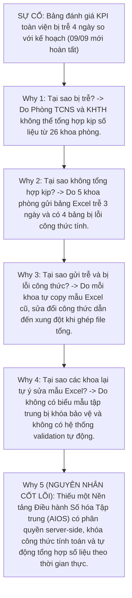
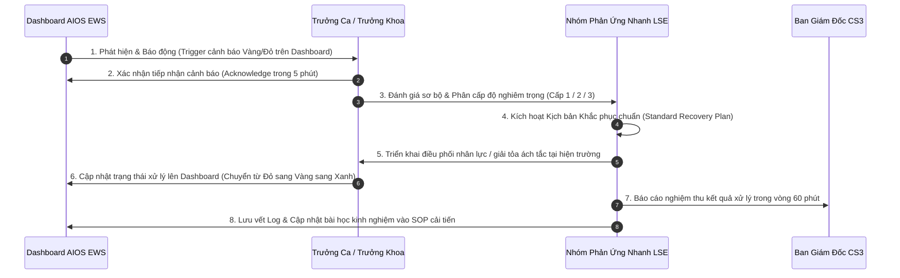
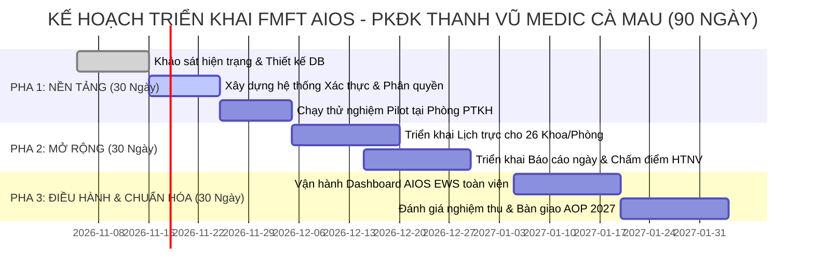
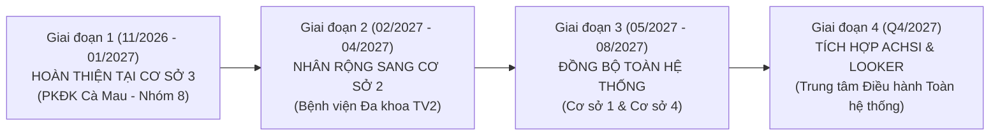

# BỘ BÀI TẬP THỰC CHIẾN FMFT AIOS/LSE — CHỦ ĐỀ 2
## ĐỀ TÀI: SỐ HÓA QUY TRÌNH QUẢN TRỊ HIỆU SUẤT, LIÊN THÔNG KPI 3 CẤP VÀ XÂY DỰNG TRUNG TÂM ĐIỀU HÀNH THÔNG MINH (FMFT AIOS)
### Đơn vị thực hiện: Nhóm 8 — PKĐK Thanh Vũ Medic Cà Mau (Cơ sở 3) & Hệ thống BVTV2
### Mã định danh quy trình: TV3-AIOS-02 | Phiên bản: 1.0.0 (Tháng 11/2026)

---

> [!NOTE]
> **BỐI CẢNH CHIẾN LƯỢC & CẶP SONG MÃ QUẢN TRỊ:**
> Đề tài này được xây dựng độc lập và song hành cùng **Chủ đề 1 (`TV3-KB-01` - Tối ưu hóa chuỗi bàn giao lâm sàng ngoại trú)**.
> - **Chủ đề 1 (Front-line):** Tối ưu hóa luồng người bệnh tại hiện trường phòng khám, giảm thời gian chờ đợi.
> - **Chủ đề 2 (Back-office):** Xây dựng nền tảng số hóa điều hành tập trung (TVM Work Management App / FMFT AIOS), giải phóng 80% thời gian báo cáo thủ công, liên thông dữ liệu KPI và kích hoạt hệ thống cảnh báo sớm (Early Warning System) hỗ trợ Ban Giám Đốc ra quyết định điều hành tức thì theo thời gian thực.
> 
> *Dữ liệu thực chứng kế thừa từ:* Đề án 26-01 (Cải tiến Hệ thống Dashboard KPI), Đề án 25-01 (Ứng dụng CNTT trong PTKH & CSKH), Đề án 26-02 (Cải tiến vận hành Báo cáo sự cố) và Hệ thống App TVM Work Management thực tế tại PKĐK Cà Mau.

---

## MỤC LỤC HỆ THỐNG BIỂU MẪU M01 – M19 (CHỦ ĐỀ 2)

- **[BUỔI 1] Biểu mẫu M01:** Phiếu xác định vấn đề phân mảnh dữ liệu và lãng phí trong quản trị vận hành thủ công
- **[BUỔI 2] Biểu mẫu M02:** Bản đồ Chuỗi giá trị thông tin (VSM Luồng dữ liệu Hiện trạng vs Tương lai AIOS)
- **[BUỔI 2] Biểu mẫu M03 & M14:** Ma trận RACI liên phòng ban & Ma trận phân quyền số hóa DOA
- **[BUỔI 3] Biểu mẫu M04:** Từ điển 7 KPI Quản trị Vận hành & Hiệu suất theo nguyên tắc Rule of 7
- **[BUỔI 3] Biểu mẫu M05:** Đặc tả Kỹ thuật Màn hình Tổng chỉ huy Dashboard AIOS EWS
- **[BUỔI 3] Biểu mẫu M06:** Báo cáo Phân tích Nguyên nhân gốc rễ (RCA 5 Whys) & Kế hoạch CAPA
- **[BUỔI 4] Biểu mẫu M07:** Khung chuẩn năng lực KSEQ cho 4 vị trí vận hành hệ thống số hóa
- **[BUỔI 4] Biểu mẫu M08:** Chu trình Phản ứng nhanh Life-Saving Engine (LSE 8 bước) trong quản trị điều hành
- **[BUỔI 4] Biểu mẫu M17:** Bảng kiểm toán định kỳ tính toàn vẹn và an toàn dữ liệu số hóa
- **[BUỔI 5] Biểu mẫu M09:** Kế hoạch Hành động Cải tiến chi tiết (Action Tracker 4 trụ cột)
- **[BUỔI 5] Biểu mẫu M10:** Kế hoạch Quản trị Thay đổi & Phân rã WBS 90 ngày
- **[BUỔI 5] Biểu mẫu M11:** Tiêu chí Nghiệm thu Cứng (Definition of Done - DoD Gate)
- **[BUỔI 5] Biểu mẫu M19:** Ma trận Leo thang Xử lý Sự cố & Lộ trình Nhân rộng toàn hệ thống (Rollout Roadmap)

---

## BUỔI 1: XÁC ĐỊNH VẤN ĐỀ VẬN HÀNH THỦ CÔNG

### Biểu mẫu M01: Phiếu Xác Định Vấn Đề (Problem Statement Form)
*Áp dụng: Quy trình Tổng hợp Báo cáo, Quản lý Lịch trực và Đánh giá KPI nội bộ tại PKĐK Thanh Vũ Medic Cà Mau.*

| Mục thông tin | Nội dung chi tiết chuẩn FMFT |
|:---|:---|
| **1. Mã quy trình & Tên vấn đề** | **TV3-AIOS-02** — Tình trạng cát cứ thông tin, phân mảnh dữ liệu vận hành trên 26 file Excel rời rạc và lãng phí thời gian báo cáo thủ công gây trễ nhịp điều hành tại Cơ sở 3. |
| **2. Đơn vị phụ trách** | Liên phòng ban: Phòng PTKH, Phòng TCNS, Phòng TCKT, Phòng KHTH, Ban Kiểm Soát & Ban Giám Đốc CS3. |
| **3. Bối cảnh & Hiện trạng thực tế** | - Quy mô: Gần 200 nhân sự trực thuộc 26 khoa/phòng/bộ phận.<br/>- **Lịch làm việc:** Quản lý bằng bảng tính Excel ma trận thủ công (>365 cột), thường xuyên phát sinh xung đột ca trực, nhân viên không tra cứu được lịch cá nhân trên điện thoại di động.<br/>- **Báo cáo hàng ngày:** Sử dụng Google Form rời rạc với hơn 70 trường thông tin, nhân viên thao tác nhầm lẫn, mất trung bình 45–60 phút/ngày để tổng hợp.<br/>- **Đánh giá KPI & HTNV:** Thực hiện thủ công trên 26 file Excel độc lập. Cuối tháng, bộ phận quản trị nhân sự và kế hoạch mất 3–5 ngày công chỉ để cộng gộp điểm số. Dữ liệu đánh giá có độ trễ lớn (chậm từ 5–7 ngày so với thực tế), thiếu tính minh chứng và dễ dẫn đến tranh cãi cảm tính. |
| **4. Các lãng phí Lean xác định (Muda)** | 1. **Lãng phí Chờ đợi (Waiting):** Ban Giám Đốc phải đợi đến ngày 05–07 tháng sau mới có báo cáo hiệu suất tổng thể của tháng trước.<br/>2. **Lãng phí Thao tác thừa (Motion/Over-processing):** Nhân viên nhập dữ liệu 2–3 lần (ghi sổ tay $\rightarrow$ nhập Google Form $\rightarrow$ chép sang Excel tổng hợp).<br/>3. **Lãng phí Sai sót (Defects):** Sai sót công thức Excel, lệch mã nhân viên, thất thoát phiếu đánh giá hoàn thành nhiệm vụ (HTNV).<br/>4. **Lãng phí Tiềm năng con người (Underutilized Talent):** Đội ngũ quản lý cấp trung (Trưởng/Phó khoa phòng) dành 20–30% quỹ thời gian để làm "hành chính sổ sách" thay vì tập trung nâng cao chuyên môn và cải tiến trải nghiệm người bệnh. |
| **5. Mục tiêu cải tiến (SMART)** | 1. **Cắt giảm 80% thời gian** tổng hợp báo cáo và tính điểm KPI hàng tháng (từ 5 ngày xuống dưới 4 giờ làm việc).<br/>2. **Tự động hóa 100%** luồng tra cứu lịch trực cá nhân và gửi báo cáo công việc trên ứng dụng di động cho gần 200 nhân sự.<br/>3. **Xây dựng Màn hình Điều hành Tổng hợp (AIOS Central Dashboard)** cung cấp dữ liệu thời gian thực (real-time) với độ trễ $\le 15$ phút, kích hoạt cảnh báo sớm khi có chỉ số vận hành trượt khỏi ngưỡng an toàn.<br/>4. **Chi phí bản quyền phần mềm: 0 đồng**, tận dụng tối đa hạ tầng Google Workspace nội bộ kết hợp xác thực bảo mật tài khoản không phụ thuộc mail doanh nghiệp, tiết kiệm ~180.000.000 đ/năm. |
| **6. Nhân sự tham gia nghiên cứu** | - **Chủ nhiệm đề án:** BS. Huỳnh Tấn Kiệt (Trưởng phòng KHTH / Phụ trách chuyên môn).<br/>- **Đồng chủ nhiệm & Điều phối:** ThS. Nguyễn Kim Nhang (Nhóm trưởng Nhóm 8).<br/>- **Hỗ trợ Kỹ thuật & Kiến trúc Dữ liệu:** Huỳnh Trường Thanh Tâm (Phó phòng PTKH · Thành viên Nhóm 8).<br/>- **Đại diện Nhân sự & Kế toán:** Trần Trúc Linh (TCNS), Vũ Phương Linh (TCKT).<br/>- **Phê duyệt:** Ban Giám Đốc PKĐK Thanh Vũ Medic Cà Mau. |

---

## BUỔI 2: CHUỖI GIÁ TRỊ VÀ PHÂN ĐỊNH TRÁCH NHIỆM

### Biểu mẫu M02: Bản Đồ Chuỗi Giá Trị Luồng Dữ Liệu (Data Value Stream Mapping - VSM)

```mermaid
flowchart TD
    subgraph HIEN_TRANG["HIỆN TRẠNG QUẢN TRỊ THỦ CÔNG (Độ trễ: 3 - 5 ngày)"]
        direction LR
        HT1["Nhân viên làm việc\n(Ghi sổ tay/nhớ việc)"] -->|Cuối ngày| HT2["Nhập Google Form\n(>70 trường, dễ sai sót)"]
        HT2 -->|Cuối tuần/tháng| HT3["Trưởng bộ phận tải Excel\n(Kiểm tra, lọc dữ liệu)"]
        HT3 -->|Ngày 30 hàng tháng| HT4["Gửi 26 file Excel về\nTCNS & KHTH tổng hợp"]
        HT4 -->|Mất 3-5 ngày công| HT5["Báo cáo Bản in/Excel\ntrình Ban Giám Đốc"]
    end

    subgraph TUONG_LAI["TƯƠNG LAI FMFT AIOS (Độ trễ: Real-time < 15 phút)"]
        direction LR
        TL1["Nhân sự đăng nhập Mobile App\n(Mã NV + Mật khẩu mã hóa)"] -->|1-Chạm| TL2["Xem Lịch trực & Check-in\nForm báo cáo theo ca trực"]
        TL2 -->|Tự động ghi nhận| TL3["Database tập trung (Cloud Sheets)\nTự động tính điểm HTNV & KPI"]
        TL3 -->|Trigger tức thì| TL4["Dashboard AIOS EWS\n(Hiển thị 3 màu Xanh - Vàng - Đỏ)"]
        TL4 -->|Cảnh báo tự động| TL5["Ban Giám Đốc & Trưởng bộ phận\nRa quyết định điều phối ngay trong ngày"]
    end
```



#### Bảng So Sánh Chỉ Số VSM Trước và Sau Cải Tiến:

| Bước chuỗi giá trị | Thời gian Hiện trạng | Thời gian Tương lai AIOS | Mức giảm lãng phí | Ghi chú kỹ thuật |
|:---|:---:|:---:|:---:|:---|
| **B1. Phân bổ & Tra cứu lịch trực** | 120 phút/khoa/tháng | 10 phút/khoa/tháng | **Giảm 91,7%** | Trưởng khoa xếp lịch trên giao diện ma trận web; nhân viên nhận thông báo ngay trên app. |
| **B2. Gửi báo cáo tác nghiệp ngày** | 20 phút/nhân sự/ngày | 3 phút/nhân sự/ngày | **Giảm 85,0%** | Biểu mẫu tự động lọc trường thông tin theo đúng chức danh và vị trí ca trực trong ngày. |
| **B3. Phê duyệt & Chấm điểm HTNV** | 180 phút/khoa/tháng | 15 phút/khoa/tháng | **Giảm 91,7%** | Hệ thống tự động tính điểm sơ bộ dựa trên dữ liệu báo cáo và Tiêu chuẩn Dịch vụ (TCDV). |
| **B4. Tổng hợp KPI toàn phòng khám** | 24 - 40 giờ làm việc (3-5 ngày) | 5 phút (Tự động) | **Giảm 99,8%** | Hàm xử lý truy vấn tự động tổng hợp từ 26 khoa phòng lên Dashboard trung tâm. |
| **B5. Phản hồi cảnh báo sự cố vận hành** | 24 - 48 giờ sau khi xảy ra | $\le 15$ phút | **Giảm 99,0%** | Bot cảnh báo sớm kích hoạt chu trình LSE khi chỉ số rơi vào vùng Vàng hoặc Đỏ. |

---

### Biểu mẫu M03: Ma Trận Trách Nhiệm RACI (Liên Phòng Ban)
*Quy chuẩn: **R** (Responsible - Thực hiện), **A** (Accountable - Chịu trách nhiệm tối hậu / Ký duyệt), **C** (Consulted - Tham vấn), **I** (Informed - Nhận thông tin).*

| Quy trình / Tác vụ quản trị | BGĐ Cơ sở 3 | Phụ trách Chuyên môn (BS. Kiệt) | Nhóm 8 (ThS. Nhang) | Hỗ trợ Kỹ thuật (Sếp Tâm) | Trưởng các Khoa/Phòng | Toàn thể Nhân viên |
|:---|:---:|:---:|:---:|:---:|:---:|:---:|
| 1. Ban hành Bộ chỉ tiêu & Ngưỡng KPI 3 cấp | **A** | R | C | C | C | I |
| 2. Thiết kế kiến trúc Hệ thống & Cơ sở dữ liệu | I | C | C | **R / A** | C | I |
| 3. Xếp lịch làm việc và Điều phối ca trực | I | C | I | I | **R / A** | I |
| 4. Báo cáo công việc hàng ngày & Báo cáo sự cố | I | I | I | I | A | **R** |
| 5. Đánh giá sơ bộ Hoàn thành nhiệm vụ (HTNV) | I | C | I | I | **R / A** | I |
| 6. Giám sát Dashboard & Xử lý cảnh báo sớm EWS | **A** | R | R | C | R | I |
| 7. Kích hoạt chu trình LSE can thiệp điểm nghẽn | **A** | R | R | I | R | I |
| 8. Kiểm toán an toàn dữ liệu & Quyền truy cập định kỳ | I | C | A | **R** | C | I |

---

### Biểu mẫu M14: Ma Trận Phân Quyền Số Hóa (Digital Delegation of Authority - DOA)

| Cấp phân quyền (Role) | Phạm vi truy cập Dữ liệu | Thẩm quyền Thao tác | Giới hạn Phê duyệt |
|:---|:---|:---|:---|
| **Cấp 1: Ban Giám Đốc** | Toàn bộ dữ liệu của 26 khoa/phòng và Dashboard tổng thể. | Xem toàn quyền, duyệt kết quả KPI chung cuộc, kích hoạt can thiệp toàn viện. | Không giới hạn thẩm quyền phê duyệt chính sách và ngân sách thưởng KPI. |
| **Cấp 2: Quản trị Hệ thống (Admin / Sếp Tâm)** | Cấu trúc hệ thống, danh mục tài khoản, bảng mã, phân quyền, log audit. | Quản lý người dùng, phân quyền, bảo trì database, tối ưu hiệu năng. **Tuyệt đối không can thiệp, sửa đổi số liệu nghiệp vụ của các khoa/phòng.** | Quyền kỹ thuật cấu hình hệ thống; không can thiệp duyệt chuyên môn. |
| **Cấp 3: Trưởng Khoa / Trưởng Phòng** | Dữ liệu nội bộ của khoa/phòng mình quản lý. | Xếp lịch trực, phân công ca, phê duyệt báo cáo ngày, chấm điểm HTNV và KPI cấp nhân viên. | Phê duyệt trong phạm vi nhân sự và hoạt động nội bộ khoa phòng. |
| **Cấp 4: Nhân viên tác nghiệp** | Lịch làm việc cá nhân, biểu mẫu báo cáo cá nhân, kết quả đánh giá cá nhân. | Xem lịch cá nhân, gửi báo cáo hàng ngày, gửi phản hồi kiến nghị, báo cáo sự cố (near-miss). | Không có quyền xem hoặc sửa dữ liệu của nhân sự khác. |

---

## BUỔI 3: HỆ THỐNG KPI, DASHBOARD VÀ QUẢN TRỊ RỦI RÔ

### Biểu mẫu M04: Từ Điển 7 KPI Quản Trị Vận Hành (Rule of 7)

Áp dụng đúng chuẩn mực FMFT: **Tối đa 7 chỉ số** trọng yếu, phân tầng thành 3 nhóm rõ rệt:

```
TỔNG THỂ BỘ KPI NỘI BỘ (RULE OF 7):
├── NHÓM LAGGING (Đo lường kết quả cuối cùng):
│   ├── KPI-01: Tỷ lệ Hoàn thành Kế hoạch Vận hành toàn Phòng khám (Target: ≥ 95%)
│   └── KPI-02: Tỷ lệ Hài lòng của Nhân sự nội bộ về Quy trình Điều hành (Target: ≥ 90%)
├── NHÓM LEADING (Dự báo xu hướng & Thúc đẩy):
│   ├── KPI-03: Tỷ lệ Nộp Báo cáo Ngày đúng hạn trước 18h00 (Target: ≥ 98%)
│   ├── KPI-04: Tỷ lệ Tuân thủ Tiêu chuẩn Dịch vụ 5 sao nội bộ (Target: ≥ 96%)
│   └── KPI-05: Tỷ lệ Báo cáo Sự cố Near-miss được ghi nhận chủ động (Target: ≥ 15 vụ/tháng)
└── NHÓM CONSTRAINT (Rào cản & Ràng buộc an toàn):
    ├── KPI-06: Thời gian Trễ hạn Tổng hợp KPI toàn viện cuối tháng (Target: ≤ 4 giờ làm việc)
    └── KPI-07: Tỷ lệ Lỗi nhầm lẫn / Xung đột ca trực trên Hệ thống (Target: 0 vụ việc)
```

#### Bảng Đặc Tả Chi Tiết 7 KPI:

| Mã KPI | Tên chỉ số | Phân loại | Công thức tính toán | Tần suất | Nguồn thu thập | Ngưỡng Xanh (Đạt) | Ngưỡng Vàng (Cảnh báo) | Ngưỡng Đỏ (Nguy cấp) |
|:---:|:---|:---:|:---|:---:|:---:|:---:|:---:|:---:|
| **KPI-01** | Tỷ lệ Hoàn thành Mục tiêu Vận hành | Lagging | $(\sum \text{Mục tiêu đạt} / \sum \text{Mục tiêu giao}) \times 100\%$ | Hàng tháng | Tổng hợp KPI | $\ge 95\%$ | $90 - 94,9\%$ | $< 90\%$ |
| **KPI-02** | Độ hài lòng Nhân sự nội bộ (eNPS) | Lagging | Khảo sát ẩn danh 5 mức độ trên WebApp | Hàng quý | Form khảo sát | $\ge 90\%$ | $80 - 89,9\%$ | $< 80\%$ |
| **KPI-03** | Tỷ lệ Nộp Báo cáo Ngày đúng hạn | Leading | $(\text{Số báo cáo trước 18h} / \text{Tổng số ca trực}) \times 100\%$ | Hàng ngày | Log hệ thống | $\ge 98\%$ | $92 - 97,9\%$ | $< 92\%$ |
| **KPI-04** | Tỷ lệ Tuân thủ Tiêu chuẩn Dịch vụ (TCDV) | Leading | Điểm chấm kiểm toán ngẫu nhiên 10 Caritas | Hàng tuần | BKS & PTKH | $\ge 96\%$ | $90 - 95,9\%$ | $< 90\%$ |
| **KPI-05** | Số lượng Báo cáo Sự cố Near-miss | Leading | Đếm tổng số phiếu ghi nhận suýt xảy ra sự cố | Hàng tháng | Phân hệ Sự cố | $\ge 15$ phiếu | $8 - 14$ phiếu | $< 8$ phiếu |
| **KPI-06** | Thời gian Tổng hợp KPI toàn viện | Constraint | Thời điểm hoàn tất trừ đi thời điểm chốt sổ tháng | Hàng tháng | Timestamp log | $\le 4$ giờ | $4,1 - 8$ giờ | $> 8$ giờ |
| **KPI-07** | Số vụ Trùng lặp/Xung đột Lịch trực | Constraint | Đếm số ca phân công 2 người/1 vị trí hoặc thiếu vị trí | Hàng tuần | Thuật toán check | $0$ vụ | $1$ vụ | $\ge 2$ vụ |

---

### Biểu mẫu M05: Đặc Tả Dashboard AIOS EWS (Early Warning System)

```
+---------------------------------------------------------------------------------------------------------+
|                                    TVM CENTRAL AIOS DASHBOARD v2.0                                     |
|                                PKĐK THANH VŨ MEDIC CÀ MAU — CƠ SỞ 3                                    |
+---------------------------------------------------------------------------------------------------------+
| [TRẠNG THÁI HỆ THỐNG]: TOÀN VIỆN HOẠT ĐỘNG BÌNH THƯỜNG (MÀU XANH) | CẬP NHẬT: 18:05:00 (REAL-TIME)     |
+---------------------------------------------------------------------------------------------------------+
| [THỐNG KÊ NHANH TRONG NGÀY]:                                                                            |
|   - Tổng số nhân sự đang trực: 182 / 195 nhân sự (93.3% quân số)                                        |
|   - Tỷ lệ hoàn thành báo cáo ngày trước 18h: 98.4% [XANH]                                               |
|   - Sự cố Near-miss ghi nhận trong ngày: 02 ca (Đã kích hoạt xử lý CAPA)                               |
+---------------------------------------------------------------------------------------------------------+
| [BẢN ĐỒ NHIỆT 26 KHOA / PHÒNG]                                                                         |
|                                                                                                         |
|  [Khoa Khám Bệnh]:    [ XANH ]  Tải bệnh: 480 ca | Chờ khám TB: 14p | Báo cáo: 100%                     |
|  [Khoa Xét Nghiệm]:   [ XANH ]  Mẫu xử lý: 320   | Trả KQ đúng hạn: 98% | Lỗi nhãn: 0                    |
|  [Khoa Chẩn Đoán HA]: [ VÀNG ]  Siêu âm dồn ứ: 18 ca chờ >25p | Bác sĩ trực: Đang điều phối thêm ca    |
|  [Phòng PTKH & CSKH]: [ XANH ]  Cuộc gọi CSKH: 145 | Hài lòng: 96.5% | Tiếp đón: Đúng chuẩn 5S          |
|  [Khoa Dược Ngoại trú]:[ XANH ] Cấp phát TB: 4.2p | Tồn kho an toàn: 100% | Lỗi toa: 0                  |
|  [Phòng KHTH & QLCL]: [ XANH ]  Giám sát SOP: 12 lượt | Xử lý phản ánh: 100% trong 30p                  |
|  [Phòng TCNS & TCKT]: [ XANH ]  Chấm công: Đầy đủ | Chốt số liệu: Sẵn sàng                             |
+---------------------------------------------------------------------------------------------------------+
| [DANH SÁCH CẢNH BÁO SỚM EWS - ĐANG KÍCH HOẠT]:                                                         |
|  1. [VÀNG] Khoa CĐHA: Thời gian chờ siêu âm phòng SA-02 vượt 25 phút lúc 09:15.                       |
|     -> Hành động LSE: Điều phối BS. Tuấn hỗ trợ buồng SA-03 từ 09:30. Trạng thái: Đã giải tỏa lúc 10:05.|
+---------------------------------------------------------------------------------------------------------+
```

---

### Biểu mẫu M06: Phân Tích Nguyên Nhân Gốc Rễ (RCA 5 Whys) & Kế Hoạch CAPA
*Tình huống kiểm toán:* Sự cố chậm trễ phát hành bảng lương và đánh giá KPI toàn viện tháng 08/2026 (trễ 4 ngày so với cam kết).



#### Kế Hoạch Khắc Phục Và Phòng Ngừa (CAPA Action Plan):

| Hành động CAPA | Mục tiêu giải quyết | Người phụ trách | Thời hạn | Tiêu chí bằng chứng (DoD) |
|:---|:---|:---:|:---:|:---|
| **C1. Đóng băng & Loại bỏ các file Excel phân mảnh** | Ngăn chặn triệt để tình trạng mỗi đơn vị dùng một phiên bản công thức riêng. | Trần Trúc Linh (TCNS) | 7 ngày | Thu hồi toàn bộ 26 file Excel cũ; ban hành thông báo ngừng tiếp nhận báo cáo giấy. |
| **C2. Xây dựng Form Báo cáo Số hóa trên WebApp** | Chuẩn hóa trường nhập liệu, tự động kiểm tra logic dữ liệu đầu vào (Validation). | Huỳnh Trường Thanh Tâm (Hỗ trợ KT) | 14 ngày | Form WebApp chỉ mở các trường đúng chức danh; khóa 100% công thức tính toán trên server. |
| **C3. Thiết lập Tự Động Hóa Tổng Hợp Số Liệu** | Dữ liệu báo cáo ngày tự động đổ về bảng điểm HTNV và KPI tổng hợp. | Huỳnh Trường Thanh Tâm (Hỗ trợ KT) | 10 ngày | Không còn bước chép tay thủ công; Dashboard tự tính điểm ngay khi duyệt báo cáo. |
| **C4. Ban hành Quy định Thời Hạn Báo Cáo Chốt Khóa (Hard Deadline)** | Tạo kỷ luật số hóa trong toàn thể cán bộ nhân viên. | BS. Huỳnh Tấn Kiệt (KHTH) & ThS. Nhang | 5 ngày | Hệ thống tự động khóa sổ lúc 18h00 ngày cuối tháng; mọi trường hợp trễ hạn phải có giải trình. |

---

## BUỔI 4: KHUNG NĂNG LỰC KSEQ VÀ VẬN HÀNH AIOS/LSE

### Biểu mẫu M07: Khung Chuẩn Năng Lực KSEQ cho Vận Hành Số Hóa
*KSEQ Framework: **K** (Knowledge - Kiến thức), **S** (Skills - Kỹ năng), **E** (Experience - Kinh nghiệm), **Q** (Quality - Phẩm chất & Đạo đức dữ liệu).*

```
                     [Q - PHẨM CHẤT & ĐẠO ĐỨC DỮ LIỆU]
                      (Trung thực - Bảo mật - Khách quan)
                                      ▲
                                      │ (Chốt chặn tối thượng)
               ┌──────────────────────┴──────────────────────┐
               │                                             │
      [K - KIẾN THỨC NỀN]                           [S - KỸ NĂNG THỰC HÀNH]
 - Hiểu rõ cấu trúc KPI 3 tầng                 - Thao tác thành thạo Mobile WebApp
 - Hiểu cơ chế VSM & Lãng phí Lean             - Xử lý xung đột lịch trực tức thì
 - Quy định bảo mật thông tin nội bộ           - Báo cáo sự cố Near-miss đúng chuẩn
               │                                             │
               └──────────────────────┬──────────────────────┘
                                      ▼
                           [E - KINH NGHIỆM THỰC CHIẾN]
                      (≥ 30 ngày vận hành không phát sinh lỗi)
```

| Vị trí tác nghiệp | Knowledge (Kiến thức) | Skills (Kỹ năng) | Experience (Kinh nghiệm) | Quality (Phẩm chất & Đạo đức) |
|:---|:---|:---|:---|:---|
| **1. Quản trị viên Hệ thống (Admin / Sếp Tâm)** | - Kiến trúc Cloud Google Workspace & AppSheet/Web Script.<br/>- Tiêu chuẩn an toàn thông tin & mã hóa mật khẩu SHA-256. | - Tối ưu hóa Database, chống quá tải bộ nhớ đệm (Cache).<br/>- Phân quyền RBAC chính xác 100%, khắc phục sự cố trong 15 phút. | - $\ge 2$ năm quản trị hệ thống dữ liệu y tế hoặc tự động hóa quy trình. | **Trung thực tuyệt đối:** Không bao giờ tiết lộ thông tin mật, không sửa đổi dữ liệu đánh giá của cá nhân vì quan hệ tình cảm. |
| **2. Trưởng Khoa / Trưởng Bộ phận** | - Khung KPI Rule of 7 và phương pháp tính điểm HTNV.<br/>- Quy trình điều phối ca trực và phân luồng nhân lực. | - Xếp lịch trực thông minh không trùng lặp.<br/>- Đọc hiểu biểu đồ Dashboard EWS, nhận diện điểm nghẽn. | - $\ge 1$ năm giữ vị trí quản lý ca kíp tại phòng khám. | **Công tâm & Minh bạch:** Đánh giá nhân sự dựa trên dữ liệu thực chứng; không cào bằng, không thiên vị. |
| **3. Nhân viên Tác nghiệp (Điều dưỡng, Bác sĩ, CSKH)** | - Tiêu chuẩn Dịch vụ (TCDV) vị trí công việc của mình.<br/>- Quy trình gửi báo cáo ngày và báo cáo sự cố (Near-miss). | - Sử dụng ứng dụng trên điện thoại di động thành thạo.<br/>- Gửi báo cáo trước 18h00 chỉ với 3 thao tác chạm. | - Hoàn thành 1 tuần thử nghiệm sử dụng hệ thống số. | **Kỷ luật & Tự giác:** Báo cáo trung thực số liệu làm việc; không báo cáo khống, không bao che sai sót. |
| **4. Ban Giám Đốc / Ban Kiểm Soát** | - Tư duy Hệ thống (System Thinking) và FMFT AIOS/LSE.<br/>- Quy chuẩn kiểm định chất lượng y tế (ACHSI & 83 Tiêu chí). | - Điều hành dựa trên Dashboard thời gian thực.<br/>- Kích hoạt quy trình LSE phản ứng nhanh khi có cảnh báo. | - Lãnh đạo điều hành hệ thống y tế đa cơ sở. | **Kiên định & Trọng lượng:** Đưa ra quyết định dựa trên số liệu thực tế; bảo vệ văn hóa chất lượng và an toàn người bệnh. |

---

### Biểu mẫu M08: Chu Trình Phản Ứng Nhanh LSE (8 Bước Điều Hành Vận Hành)
*Áp dụng khi Dashboard AIOS EWS phát hiện chỉ số vận hành chuyển sang vùng VÀNG hoặc ĐỎ.*



---

### Biểu mẫu M17: Bảng Kiểm Toán Tính Toàn Vẹn & An Toàn Dữ Liệu Số Hóa

| Tiêu chuẩn kiểm toán (SOP Audit Item) | Phương pháp kiểm tra | Tiêu chuẩn đạt chuẩn | Kết quả kiểm toán định kỳ | Biện pháp xử lý nếu trượt chuẩn |
|:---|:---|:---:|:---:|:---|
| **1. Mã hóa & Bảo mật mật khẩu** | Quét ngẫu nhiên database tài khoản người dùng. | 100% mật khẩu được băm một chiều (Hash SHA-256), không lưu văn bản thuần (plain-text). | **ĐẠT** | Khóa tài khoản ngay lập tức và tạo lại mã hash bảo mật. |
| **2. Phân vùng truy cập dữ liệu (RBAC)** | Đăng nhập thử nghiệm tài khoản Nhân viên để xem dữ liệu khoa khác. | 0% khả năng truy cập chéo dữ liệu không thuộc phạm vi phân quyền. | **ĐẠT** | Kiểm tra lại logic lọc ở tầng server-side script. |
| **3. Sao lưu dự phòng dữ liệu (Auto-backup)** | Kiểm tra thư mục Backup tự động hàng ngày lúc 23h59. | Đầy đủ bản snapshot 30 ngày gần nhất trên Google Drive riêng biệt. | **ĐẠT** | Cấu hình lại trigger tự động sao lưu của Apps Script. |
| **4. Tính toàn vẹn công thức tính KPI** | Đối chiếu tính toán thủ công 10 nhân viên ngẫu nhiên với kết quả hệ thống. | Độ lệch kết quả bằng 0 (chính xác tuyệt đối). | **ĐẠT** | Rà soát hàm tính toán và khóa quyền chỉnh sửa cấu trúc sheet. |

---

## BUỔI 5: KẾ HOẠCH HÀNH ĐỘNG, QUẢN TRỊ THAY ĐỔI VÀ NHÂN RỘNG

### Biểu mẫu M09: Kế Hoạch Hành Động Cải Tiến (Action Tracker)

| STT | Trụ cột hành động | Nội dung công việc cụ thể | Người chủ trì | Thời hạn | Chỉ số đầu ra cam kết (Output KPI) |
|:---:|:---|:---|:---:|:---:|:---|
| **A1** | **Xác thực & Danh mục Tài khoản** | Xây dựng phân hệ xác thực nội bộ độc lập (Username/Password), cấp phát tài khoản cho 195 nhân sự tại CS3. | Huỳnh Trường Thanh Tâm (Hỗ trợ KT) | 10/11/2026 | 100% nhân sự đăng nhập thành công; tiết kiệm 180 triệu đ chi phí mail bản quyền. |
| **A2** | **Số hóa Phân hệ Lịch làm việc** | Xây dựng công cụ xếp lịch ma trận trực quan cho 26 khoa phòng và giao diện xem lịch cá nhân trên điện thoại. | Trần Trúc Linh (TCNS) & Sếp Tâm | 20/11/2026 | Không còn xung đột ca trực; thời gian xếp lịch giảm từ 120p xuống 10p. |
| **A3** | **Tự động hóa Báo cáo & Điểm HTNV** | Thiết lập biểu mẫu báo cáo thông minh theo ca trực, tích hợp tiêu chuẩn dịch vụ (TCDV) và tự động tính điểm. | ThS. Nguyễn Kim Nhang & Nhóm 8 | 30/11/2026 | Tỷ lệ nộp báo cáo đúng hạn đạt $\ge 98\%$; giảm 85% thời gian nhập liệu. |
| **A4** | **Triển khai Central AIOS Dashboard** | Xây dựng màn hình tổng chỉ huy thời gian thực (EWS 3 màu) phục vụ Ban Giám Đốc điều hành hàng ngày. | BS. Huỳnh Tấn Kiệt & Nhóm 8 | 15/12/2026 | Cung cấp góc nhìn toàn cảnh về hiệu suất; cảnh báo tức thì dưới 15 phút. |

---

### Biểu mẫu M10: Kế Hoạch Quản Trị Thay Đổi & WBS 90 Ngày



---

### Biểu mẫu M11: Tiêu Chí Nghiệm Thu Cải Tiến Cứng (Definition of Done - DoD Gate)

Một đề án chỉ được Ban Giám Đốc ký nghiệm thu hoàn tất khi thỏa mãn **toàn bộ 5 tiêu chí cứng** sau:

1. **Gate 1 - Tỷ lệ Phủ sóng Nhân sự:** Đạt $\ge 95\%$ tổng số nhân viên (ít nhất 185/195 nhân sự) sử dụng thành thạo WebApp để xem lịch và gửi báo cáo hàng ngày.
2. **Gate 2 - Tốc độ Xử lý Báo cáo:** Thời gian tổng hợp và phát hành báo cáo KPI toàn viện cuối tháng giảm xuống dưới **4 giờ làm việc** (so với 3–5 ngày trước cải tiến).
3. **Gate 3 - Tính Toàn vẹn & An toàn Dữ liệu:** Không có bất kỳ sự cố rò rỉ dữ liệu cá nhân hoặc lỗi công thức tính điểm (0 lỗi logic phát sinh trong 30 ngày vận hành liên tục).
4. **Gate 4 - Độ Hài lòng của Nhân sự Nội bộ:** Kết quả khảo sát ẩn danh đạt $\ge 90\%$ nhân sự đánh giá hệ thống mới tiện lợi, minh bạch hơn cách làm cũ bằng giấy/Excel.
5. **Gate 5 - Năng lực Tự chủ & SOP Hoàn chỉnh:** 100% Trưởng khoa/phòng đạt chuẩn KSEQ về vận hành phân hệ của mình; ban hành bộ Quy trình thao tác chuẩn (SOP) lưu trữ trong Thư viện Tri thức.

---

### Biểu mẫu M19: Ma Trận Leo Thang Xử Lý Sự Cố & Lộ Trình Nhân Rộng Hệ Thống

#### 1. Ma Trận Leo Thang Sự Cố Vận Hành Số Hóa:

| Cấp độ sự cố | Dấu hiệu nhận diện | Trách nhiệm xử lý | Thời hạn can thiệp | Thẩm quyền quyết định |
|:---:|:---|:---:|:---:|:---|
| **Cấp 1 (Nhẹ)** | Nhân viên quên mật khẩu, không gửi được báo cáo cá nhân trước giờ chốt sổ. | Trưởng bộ phận & Admin kỹ thuật | Trong vòng 15 phút | Cấp lại mật khẩu tạm thời hoặc cho phép gửi bổ sung kèm lý do. |
| **Cấp 2 (Trung bình)** | Lỗi đồng bộ dữ liệu giữa Form báo cáo và Sheet tổng của 1 khoa phòng. | Quản trị viên Kỹ thuật (Sếp Tâm) | Trong vòng 60 phút | Kích hoạt script sửa lỗi đồng bộ; khôi phục từ bản backup gần nhất. |
| **Cấp 3 (Nghiêm trọng)** | Dashboard AIOS EWS bị treo hoặc báo động Đỏ tại hơn 3 khoa phòng cùng lúc. | Nhóm phản ứng nhanh LSE & BS. Kiệt | Trong vòng 30 phút | Họp khẩn điều phối nhân lực tại hiện trường; kích hoạt phương án dự phòng. |
| **Cấp 4 (Khẩn cấp)** | Tê liệt hệ thống hạ tầng dữ liệu hoặc nghi ngờ có lỗ hổng bảo mật rò rỉ dữ liệu. | Ban Giám Đốc & Chủ nhiệm đề án | Ngay lập tức | Tạm dừng truy cập public, cô lập hệ thống, điều tra an ninh thông tin. |

#### 2. Lộ Trình Nhân Rộng Toàn Hệ Thống Thanh Vũ Medic (Rollout Roadmap):



---

## KẾT LUẬN & ĐỀ XUẤT CỦA NHÓM 8
Chủ đề 2 **"Số hóa Quy trình Quản trị Hiệu suất, Liên thông KPI 3 cấp và Xây dựng Trung tâm Điều hành Thông minh (FMFT AIOS)"** là mảnh ghép hoàn hảo kết hợp cùng Chủ đề 1.

Sự kết hợp này giúp Cơ sở 3 (PKĐK Thanh Vũ Medic Cà Mau) vừa giải quyết triệt để bài toán **trải nghiệm người bệnh ngoại trú tại hiện trường**, vừa xây dựng được **hạ tầng quản trị số hóa tinh gọn, chi phí 0 đồng** làm hình mẫu tiêu biểu để Ban Giám Đốc xem xét nhân rộng toàn hệ thống trong buổi làm việc ngày 02/11/2026.
