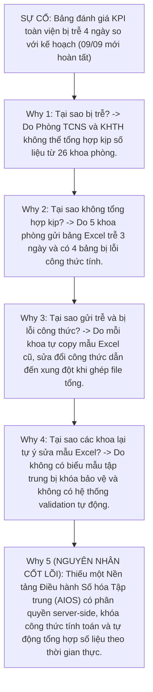
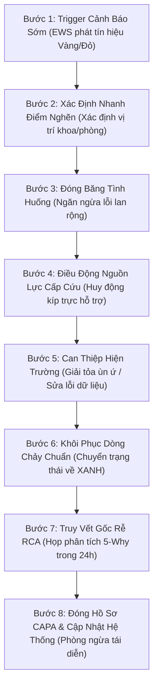

# BỘ HỒ SƠ PHÂN TÍCH DỰ ÁN CẢI TIẾN QUẢN TRỊ BỆNH VIỆN — FMFT AIOS/LSE
## ĐỀ ÁN 2: SHIN AIOS DASHBOARD — TRUNG TÂM ĐIỀU HÀNH THÔNG MINH, LIÊN THÔNG KPI 3 CẤP & CẢNH BÁO SỚM (EWS)
### Đơn vị thực hiện: Hệ thống Y tế Thanh Vũ Medic — Cơ sở 3 — PKĐK Thanh Vũ Medic Cà Mau
### Mã định danh dự án: TV3-AIOS-02 | Phiên bản: 2.0 (Tháng 11/2026)

---

> [!NOTE]
> **TÍNH TƯƠNG HỖ CHIẾN LƯỢC TRONG CẶP SONG MÃ QUẢN TRỊ:**
> - **Đề án 1 (`TV3-KB-01` - Front-line):** Tối ưu hóa hiện trường luồng bệnh ngoại trú, giảm thời gian chờ đợi.
> - **Đề án 2 (`TV3-AIOS-02` - Back-office):** Xây dựng Trung tâm Điều hành Thông minh (Shin AIOS Dashboard), giải phóng 80% thời gian báo cáo thủ công, liên thông dữ liệu KPI 3 cấp và kích hoạt Hệ thống Cảnh báo Sớm (Early Warning System - EWS) giúp Ban Giám Đốc và các Trưởng khoa/phòng ra quyết định điều hành tức thì theo thời gian thực (Real-time).
> - *Dữ liệu kế thừa thực chứng từ:* Đề án 26-01 (Cải tiến Hệ thống Dashboard KPI), Đề án 25-01 (Ứng dụng CNTT trong PTKH & CSKH), và Ứng dụng Quản lý Vận hành TVM Work Management đang áp dụng thực tế tại Cơ sở 3 Cà Mau.

---

## M01. PHIẾU XÁC ĐỊNH VẤN ĐỀ VÀ CHỌN ƯU TIÊN

| Trường theo biểu mẫu | Nội dung chi tiết cho Cơ sở 3 (PKĐK Thanh Vũ Medic Cà Mau) |
|:---|:---|
| **Tên bệnh viện và nhóm** | - **Hệ thống Y tế Thanh Vũ Medic**<br/>- **Cơ sở thực hiện:** Cơ sở 3 — Phòng khám Đa khoa Thanh Vũ Medic Cà Mau.<br/>- **Thành phần tham gia:** Liên phòng ban: Phòng PTKH, Phòng TCNS, Phòng TCKT, Phòng KHTH, Ban Kiểm Soát & Ban Giám Đốc CS3. |
| **Quy trình và phạm vi vận hành** | - Quy trình xếp lịch làm việc, quản lý chấm công, gửi và phê duyệt báo cáo tác nghiệp ngày của 26 khoa/phòng/bộ phận.<br/>- Quy trình tổng hợp, tính điểm Hoàn thành nhiệm vụ (HTNV) và đánh giá chỉ số KPI 3 cấp (Toàn viện $\rightarrow$ Khoa/Phòng $\rightarrow$ Nhân viên).<br/>- Quy trình giám sát vận hành và cảnh báo sớm sự cố/điểm nghẽn trên toàn phòng khám. |
| **Ngày lập và người chủ trì** | - **Ngày lập đề án:** Ngày 28 tháng 10 năm 2026 (Cập nhật phiên bản hoàn thiện: Ngày 04 tháng 11 năm 2026).<br/>- **Chủ nhiệm đề án:** **Huỳnh Tấn Kiệt** (KHTH CS3).<br/>- **Đồng điều phối & Kiến trúc Dữ liệu:** **Huỳnh Trường Thanh Tâm** (PTKH CS3).<br/>- **Đại diện Nhân sự & Kế toán:** **Trần Trúc Linh** (TCNS), **Nguyễn Như Ý** (TCKT). |
| **Vấn đề quan sát được, khoảng thời gian, quy mô và tác động** | - **Vấn đề quan sát được:** Tình trạng **cát cứ thông tin, phân mảnh dữ liệu vận hành trên 26 file Excel rời rạc** và lãng phí thời gian báo cáo thủ công gây trễ nhịp điều hành nghiêm trọng tại Cơ sở 3.<br/>- **Khoảng thời gian phát sinh:** Diễn ra liên tục hàng ngày (khâu báo cáo ca trực) và dồn cục bộ nghiêm trọng vào các ngày 01 đến 05 hàng tháng (khâu chốt số liệu KPI và tính lương).<br/>- **Quy mô hiện trạng thực tế:**<br/>  + Gần **200 nhân sự** trực thuộc 26 khoa/phòng/bộ phận tại Cơ sở 3.<br/>  + **Lịch làm việc:** Quản lý bằng bảng tính Excel ma trận thủ công (>365 cột), thường xuyên phát sinh xung đột ca trực, nhân viên không thể tra cứu lịch cá nhân trên điện thoại di động.<br/>  + **Báo cáo tác nghiệp ngày:** Sử dụng Google Form rời rạc với hơn 70 trường thông tin, nhân viên thao tác nhầm lẫn, mất trung bình 45–60 phút/ngày/khoa để tổng hợp.<br/>  + **Đánh giá KPI & HTNV:** Thực hiện thủ công trên 26 file Excel độc lập. Cuối tháng, bộ phận TCNS và KHTH mất **3–5 ngày công** chỉ để cộng gộp điểm số. Dữ liệu đánh giá có độ trễ lớn (chậm từ 5–7 ngày so với thực tế), thiếu tính minh chứng và dễ dẫn đến tranh cãi cảm tính.<br/>- **Các lãng phí Lean (Muda) xác định:**<br/>  1. *Lãng phí Chờ đợi (Waiting):* Ban Giám Đốc phải đợi đến ngày 05–07 tháng sau mới có báo cáo hiệu suất tổng thể của tháng trước.<br/>  2. *Lãng phí Thao tác thừa (Over-processing):* Nhân viên nhập dữ liệu 2–3 lần (ghi sổ tay $\rightarrow$ nhập Google Form $\rightarrow$ chép sang Excel tổng hợp).<br/>  3. *Lãng phí Sai sót (Defects):* Sai lệch công thức Excel, lệch mã nhân viên, thất thoát phiếu đánh giá hoàn thành nhiệm vụ (HTNV).<br/>  4. *Lãng phí Tiềm năng con người (Underutilized Talent):* Đội ngũ quản lý cấp trung (lãnh đạo các khoa/phòng) dành 20–30% quỹ thời gian để làm "hành chính sổ sách" thay vì tập trung nâng cao chuyên môn và cải tiến trải nghiệm người bệnh. |
| **Nguồn bằng chứng hiện có và giới hạn của dữ liệu** | - **Nguồn bằng chứng hiện có:**<br/>  + [Số liệu thật]: Kho lưu trữ 26 file Excel bảng đánh giá HTNV tháng 07, 08, 09/2026 của 26 khoa/phòng CS3.<br/>  + [Số liệu thật]: Lịch sử gửi báo cáo trên Google Form tháng 09/2026 ghi nhận 32 lượt nộp trễ sau 20h00 và 18 trường hợp nhập trùng dữ liệu.<br/>  + [Số liệu thật]: Nhật ký chốt bảng lương và tính thưởng KPI tháng 08/2026 bị trễ 4 ngày so với quy chế tài chính (đến ngày 09/09 mới phát hành).<br/>- **Giới hạn của dữ liệu hiện tại:**<br/>  + Không có cơ sở dữ liệu tập trung (Central Database) liên kết giữa kết quả vận hành hàng ngày và điểm số KPI cuối tháng.<br/>  + Hoàn toàn thiếu hệ thống cảnh báo sớm (Early Warning System) khi một chỉ số vận hành trượt khỏi vùng an toàn. |
| **Mục tiêu cải tiến (SMART)** | 1. **Cắt giảm 80% thời gian** tổng hợp báo cáo và tính điểm KPI hàng tháng (từ 5 ngày xuống dưới 4 giờ làm việc).<br/>2. **Tự động hóa 100%** luồng tra cứu lịch trực cá nhân và gửi báo cáo công việc trên ứng dụng di động cho gần 200 nhân sự.<br/>3. **Xây dựng Màn hình Điều hành Tổng hợp (AIOS Central Dashboard)** cung cấp dữ liệu thời gian thực (real-time) với độ trễ $\le 15$ phút, kích hoạt cảnh báo sớm (EWS) 3 màu Xanh - Vàng - Đỏ.<br/>4. **Chi phí bản quyền phần mềm: 0 đồng**, tận dụng tối đa hạ tầng Google Workspace kết hợp hệ thống xác thực tài khoản nội bộ độc lập, tiết kiệm ~180.000.000 đ/năm. |
| **Tác động nếu giữ nguyên hiện trạng** | - Ban Giám Đốc tiếp tục điều hành trong tình trạng "mù thông tin" (Information Blind Spot), chỉ nắm sự việc khi hậu quả đã xảy ra.<br/>- Đội ngũ quản lý kiệt sức vì công việc hành chính sổ sách, đánh mất vai trò dẫn dắt chuyên môn.<br/>- Tranh chấp, khiếu nại về kết quả đánh giá KPI và phân bổ thưởng cuối tháng kéo dài, làm suy giảm động lực làm việc của nhân viên. |

---

### Bảng phân tích giả thuyết nguyên nhân (RCA 5 Whys)



---

### Quyết định ưu tiên và Lựa chọn giải pháp

| Giải pháp công nghệ | Đánh giá tính khả thi & Quyết định lựa chọn |
|:---|:---|
| **Phương án A: Mua phần mềm ERP thương mại** | Chi phí đầu tư ban đầu rất cao (từ 300 - 500 triệu đồng), phí duy trì hàng năm lớn; thời gian tùy biến kéo dài 6–12 tháng; không phù hợp với đặc thù vận hành linh hoạt của PKĐK Cà Mau $\rightarrow$ **LOẠI BỎ**. |
| **Phương án B: Tiếp tục dùng 26 file Excel và Google Form** | Chi phí 0 đồng nhưng tiếp tục gánh chịu toàn bộ 4 lãng phí Lean, sai sót dữ liệu và độ trễ điều hành $\rightarrow$ **LOẠI BỎ**. |
| **Phương án C (LỰA CHỌN): Tự phát triển Shin AIOS Dashboard trên nền WebApp & Cloud Database** | **Tận dụng 100% tài nguyên Google Workspace sẵn có; chi phí phần mềm 0 đồng; triển khai nhanh trong 30 ngày; phân quyền bảo mật 4 cấp; cung cấp Dashboard thời gian thực và cảnh báo EWS tức thì $\rightarrow$ PHÊ DUYỆT TRIỂN KHAI.** |

---

## M02. BẢN ĐỒ CHUỖI GIÁ TRỊ THÔNG TIN (DATA VSM)

```mermaid
flowchart TD
    subgraph AS_IS["HIỆN TRẠNG QUẢN TRỊ THỦ CÔNG (Độ trễ: 3 - 5 ngày)"]
        direction LR
        HT1["Nhân viên làm việc\n(Ghi sổ tay/nhớ việc)"] -->|Cuối ngày| HT2["Nhập Google Form\n(>70 trường, dễ sai sót)"]
        HT2 -->|Cuối tuần/tháng| HT3["Trưởng bộ phận tải Excel\n(Kiểm tra, lọc dữ liệu)"]
        HT3 -->|Ngày 30 hàng tháng| HT4["Gửi 26 file Excel về\nTCNS & KHTH tổng hợp"]
        HT4 -->|Mất 3-5 ngày công| HT5["Báo cáo Bản in/Excel\ntrình Ban Giám Đốc"]
    end

    subgraph TO_BE["TƯƠNG LAI SHIN AIOS (Độ trễ: Real-time < 15 phút)"]
        direction LR
        TL1["Nhân sự đăng nhập Mobile App\n(Mã NV + Mật khẩu mã hóa)"] -->|1-Chạm| TL2["Xem Lịch trực & Check-in\nForm báo cáo theo ca trực"]
        TL2 -->|Tự động ghi nhận| TL3["Database tập trung (Cloud Sheets)\nTự động tính điểm HTNV & KPI"]
        TL3 -->|Trigger tức thì| TL4["Dashboard AIOS EWS\n(Hiển thị 3 màu Xanh - Vàng - Đỏ)"]
        TL4 -->|Cảnh báo tự động| TL5["Ban Giám Đốc & Trưởng bộ phận\nRa quyết định điều phối ngay trong ngày"]
    end
```



### Bảng So Sánh Chỉ Số VSM Trước và Sau Cải Tiến:

| Bước chuỗi giá trị | Thời gian Hiện trạng (AS-IS) | Thời gian Tương lai (TO-BE) | Mức giảm lãng phí | Ghi chú kỹ thuật giải pháp |
|:---|:---:|:---:|:---:|:---|
| **B1. Phân bổ & Tra cứu lịch trực** | 120 phút / khoa / tháng | 10 phút / khoa / tháng | **Giảm 91,7%** | Trưởng khoa xếp lịch trên giao diện ma trận web; nhân viên nhận thông báo ngay trên app di động. |
| **B2. Gửi báo cáo tác nghiệp ngày** | 20 phút / nhân sự / ngày | 3 phút / nhân sự / ngày | **Giảm 85,0%** | Biểu mẫu tự động lọc trường thông tin theo đúng chức danh và vị trí ca trực trong ngày. |
| **B3. Phê duyệt & Chấm điểm HTNV** | 180 phút / khoa / tháng | 15 phút / khoa / tháng | **Giảm 91,7%** | Hệ thống tự động tính điểm sơ bộ dựa trên dữ liệu báo cáo và Tiêu chuẩn Dịch vụ (TCDV). |
| **B4. Tổng hợp KPI toàn phòng khám** | 24 - 40 giờ công (3-5 ngày) | 5 phút (Tự động) | **Giảm 99,8%** | Hàm xử lý truy vấn tự động tổng hợp từ 26 khoa phòng lên Dashboard trung tâm. |
| **B5. Phản hồi cảnh báo sự cố vận hành** | 24 - 48 giờ sau khi xảy ra | $\le 15$ phút | **Giảm 99,0%** | Bot cảnh báo sớm kích hoạt chu trình LSE khi chỉ số rơi vào vùng Vàng hoặc Đỏ. |

---

## M03. MA TRẬN TRÁCH NHIỆM RACI & PHÂN QUYỀN SỐ HÓA DOA

### 1. Ma trận trách nhiệm RACI liên phòng ban

| Quy trình / Tác vụ quản trị | BGĐ Cơ sở 3 | Chuyên môn (Tấn Kiệt) | TCNS CS3 (Trúc Linh) | Kiến trúc AIOS (Thanh Tâm) | Trưởng các Khoa/Phòng | Toàn thể Nhân viên |
|:---|:---:|:---:|:---:|:---:|:---:|:---:|
| 1. Ban hành Bộ chỉ tiêu & Ngưỡng KPI 3 cấp | **A** | R | C | C | C | I |
| 2. Thiết kế kiến trúc Hệ thống & Cơ sở dữ liệu | I | C | C | **R / A** | C | I |
| 3. Xếp lịch làm việc và Điều phối ca trực | I | C | I | I | **R / A** | I |
| 4. Báo cáo công việc hàng ngày & Báo cáo sự cố | I | I | I | I | A | **R** |
| 5. Đánh giá sơ bộ Hoàn thành nhiệm vụ (HTNV) | I | C | I | I | **R / A** | I |
| 6. Giám sát Dashboard & Xử lý cảnh báo sớm EWS | **A** | R | R | C | R | I |
| 7. Kích hoạt chu trình LSE can thiệp điểm nghẽn | **A** | R | R | I | R | I |
| 8. Kiểm toán an toàn dữ liệu & Quyền truy cập định kỳ | I | C | A | **R** | C | I |

---

### 2. Ma trận phân quyền số hóa (DOA - Digital Delegation of Authority)

| Cấp phân quyền (Role) | Phạm vi truy cập Dữ liệu | Thẩm quyền Thao tác | Giới hạn Quyền lực & Ranh giới |
|:---|:---|:---|:---|
| **Cấp 1: Ban Giám Đốc** | Toàn bộ dữ liệu của 26 khoa/phòng và Dashboard tổng thể toàn viện. | Xem toàn quyền, duyệt kết quả KPI chung cuộc, kích hoạt can thiệp toàn viện. | Không giới hạn thẩm quyền phê duyệt chính sách và ngân sách thưởng KPI. |
| **Cấp 2: Quản trị Hệ thống (Admin / Thanh Tâm)** | Cấu trúc hệ thống, danh mục tài khoản, bảng mã, phân quyền, log audit. | Quản lý người dùng, phân quyền, bảo trì database, tối ưu hiệu năng. **Tuyệt đối không can thiệp, sửa đổi số liệu nghiệp vụ của các khoa/phòng.** | Quyền kỹ thuật cấu hình hệ thống; không can thiệp duyệt chuyên môn. |
| **Cấp 3: Lãnh đạo Khoa / Phòng** | Dữ liệu nội bộ của khoa/phòng mình quản lý. | Xếp lịch trực, phân công ca, phê duyệt báo cáo ngày, chấm điểm HTNV và KPI cấp nhân viên. | Phê duyệt trong phạm vi nhân sự và hoạt động nội bộ khoa phòng. |
| **Cấp 4: Nhân viên tác nghiệp** | Lịch làm việc cá nhân, biểu mẫu báo cáo cá nhân, kết quả đánh giá cá nhân. | Xem lịch cá nhân, gửi báo cáo hàng ngày, gửi phản hồi kiến nghị, báo cáo sự cố (near-miss). | Không có quyền xem hoặc sửa dữ liệu của nhân sự khác. |

---

## M04. TỪ ĐIỂN 7 KPI QUẢN TRỊ VẬN HÀNH (RULE OF 7)

Áp dụng đúng chuẩn mực FMFT Institute: **Tối đa 7 chỉ số trọng yếu**, phân tầng thành 3 nhóm rõ rệt:

```
TỔNG THỂ BỘ KPI NỘI BỘ (RULE OF 7):
├── NHÓM LAGGING (Đo lường kết quả cuối cùng):
│   ├── KPI-01: Tỷ lệ Hoàn thành Kế hoạch Vận hành toàn Phòng khám (Target: ≥ 95%)
│   └── KPI-02: Tỷ lệ Hài lòng của Nhân sự nội bộ về Quy trình Điều hành (Target: ≥ 90%)
├── NHÓM LEADING (Dự báo xu hướng & Thúc đẩy):
│   ├── KPI-03: Tỷ lệ Nộp Báo cáo Ngày đúng hạn trước 18h00 (Target: ≥ 98%)
│   ├── KPI-04: Tỷ lệ Tuân thủ Tiêu chuẩn Dịch vụ 5 sao nội bộ (Target: ≥ 96%)
│   └── KPI-05: Tỷ lệ Báo cáo Sự cố Near-miss được ghi nhận chủ động (Target: ≥ 15 vụ/tháng)
└── NHÓM CONSTRAINT (Rào cản & Ràng buộc an toàn):
    ├── KPI-06: Thời gian Trễ hạn Tổng hợp KPI toàn viện cuối tháng (Target: ≤ 4 giờ làm việc)
    └── KPI-07: Tỷ lệ Lỗi nhầm lẫn / Xung đột ca trực trên Hệ thống (Target: 0 vụ việc)
```

### Bảng Đặc Tả Chi Tiết 7 KPI Quản Trị Vận Hành:

| Mã KPI | Tên chỉ số | Phân loại | Công thức tính toán | Tần suất | Nguồn thu thập | Ngưỡng Xanh (Đạt) | Ngưỡng Vàng (Cảnh báo) | Ngưỡng Đỏ (Nguy cấp) |
|:---:|:---|:---:|:---|:---:|:---:|:---:|:---:|:---:|
| **KPI-01** | Tỷ lệ Hoàn thành Mục tiêu Vận hành | Lagging | $(\sum \text{Mục tiêu đạt} / \sum \text{Mục tiêu giao}) \times 100\%$ | Hàng tháng | Tổng hợp KPI toàn viện | $\ge 95\%$ | $90 - 94,9\%$ | $< 90\%$ |
| **KPI-02** | Độ hài lòng Nhân sự nội bộ (eNPS) | Lagging | Khảo sát ẩn danh 5 mức độ trên WebApp | Hàng quý | Form khảo sát nội bộ | $\ge 90\%$ | $80 - 89,9\%$ | $< 80\%$ |
| **KPI-03** | Tỷ lệ Nộp Báo cáo Ngày đúng hạn | Leading | $(\text{Số báo cáo trước 18h} / \text{Tổng số ca trực}) \times 100\%$ | Hàng ngày | Log hệ thống AIOS | $\ge 98\%$ | $92 - 97,9\%$ | $< 92\%$ |
| **KPI-04** | Tỷ lệ Tuân thủ Tiêu chuẩn Dịch vụ (TCDV) | Leading | Điểm chấm kiểm toán ngẫu nhiên 10 Caritas | Hàng tuần | BKS & PTKH | $\ge 96\%$ | $90 - 95,9\%$ | $< 90\%$ |
| **KPI-05** | Số lượng Báo cáo Sự cố Near-miss | Leading | Đếm tổng số phiếu ghi nhận suýt xảy ra sự cố | Hàng tháng | Phân hệ Báo cáo Sự cố | $\ge 15$ phiếu | $8 - 14$ phiếu | $< 8$ phiếu |
| **KPI-06** | Thời gian Tổng hợp KPI toàn viện | Constraint | Thời điểm hoàn tất trừ đi thời điểm chốt sổ tháng | Hàng tháng | Timestamp log hệ thống | $\le 4$ giờ | $4,1 - 8$ giờ | $> 8$ giờ |
| **KPI-07** | Số vụ Trùng lặp/Xung đột Lịch trực | Constraint | Đếm số ca phân công 2 người/1 vị trí hoặc thiếu vị trí | Hàng tuần | Thuật toán kiểm tra lịch | $0$ vụ | $1$ vụ | $\ge 2$ vụ |

---

## M05. ĐẶC TẢ GIAO DIỆN SHIN AIOS CENTRAL DASHBOARD

```
+---------------------------------------------------------------------------------------------------------+
|                                    TVM CENTRAL AIOS DASHBOARD v2.0                                     |
|                                PKĐK THANH VŨ MEDIC CÀ MAU — CƠ SỞ 3                                    |
+---------------------------------------------------------------------------------------------------------+
| [TRẠNG THÁI HỆ THỐNG]: TOÀN VIỆN HOẠT ĐỘNG BÌNH THƯỜNG (MÀU XANH) | CẬP NHẬT: 18:05:00 (REAL-TIME)     |
+---------------------------------------------------------------------------------------------------------+
| [THỐNG KÊ NHANH TRONG NGÀY]:                                                                            |
|   - Tổng số nhân sự đang trực: 182 / 195 nhân sự (93.3% quân số)                                        |
|   - Tỷ lệ hoàn thành báo cáo ngày trước 18h: 98.4% [XANH]                                               |
|   - Sự cố Near-miss ghi nhận trong ngày: 02 ca (Đã kích hoạt xử lý CAPA)                               |
+---------------------------------------------------------------------------------------------------------+
| [BẢN ĐỒ NHIỆT 26 KHOA / PHÒNG]                                                                         |
|                                                                                                         |
|  [Khoa Khám Bệnh]:    [ XANH ]  Tải bệnh: 480 ca | Chờ khám TB: 14p | Báo cáo: 100%                     |
|  [Khoa Xét Nghiệm]:   [ XANH ]  Mẫu xử lý: 320   | Trả KQ đúng hạn: 98% | Lỗi nhãn: 0                    |
|  [Khoa Chẩn Đoán HA]: [ VÀNG ]  Siêu âm dồn ứ: 18 ca chờ >25p | Bác sĩ trực: Đang điều phối thêm ca    |
|  [Phòng PTKH & CSKH]: [ XANH ]  Cuộc gọi CSKH: 145 | Hài lòng: 96.5% | Tiếp đón: Đúng chuẩn 5S          |
|  [Khoa Dược Ngoại trú]:[ XANH ] Cấp phát TB: 4.2p | Tồn kho an toàn: 100% | Lỗi toa: 0                  |
|  [Phòng KHTH & QLCL]: [ XANH ]  Giám sát SOP: 12 lượt | Xử lý phản ánh: 100% trong 30p                  |
|  [Phòng TCNS & TCKT]: [ XANH ]  Chấm công: Đầy đủ | Chốt số liệu: Sẵn sàng                             |
+---------------------------------------------------------------------------------------------------------+
| [DANH SÁCH CẢNH BÁO SỚM EWS - ĐANG KÍCH HOẠT]:                                                         |
|  1. [VÀNG] Khoa CĐHA: Thời gian chờ siêu âm phòng SA-02 vượt 25 phút lúc 09:15.                       |
|     -> Hành động LSE: Điều phối bác sĩ trực hỗ trợ buồng SA-03 từ 09:30. Trạng thái: Đã giải tỏa lúc 10:05.|
+---------------------------------------------------------------------------------------------------------+
```

---

## M08. CHU TRÌNH PHẢN ỨNG NHANH LIFE-SAVING ENGINE (LSE 8 BƯỚC)

Khi một chỉ số rơi vào **VÙNG ĐỎ** (Nguy cấp) hoặc **VÙNG VÀNG** (Cảnh báo vượt ngưỡng 15 phút), quy trình LSE được tự động kích hoạt:



---
*Hồ sơ hoàn thiện ngày 04 tháng 11 năm 2026 bởi Tập thể Cán bộ Cơ sở 3 — PKĐK Thanh Vũ Medic Cà Mau.*
