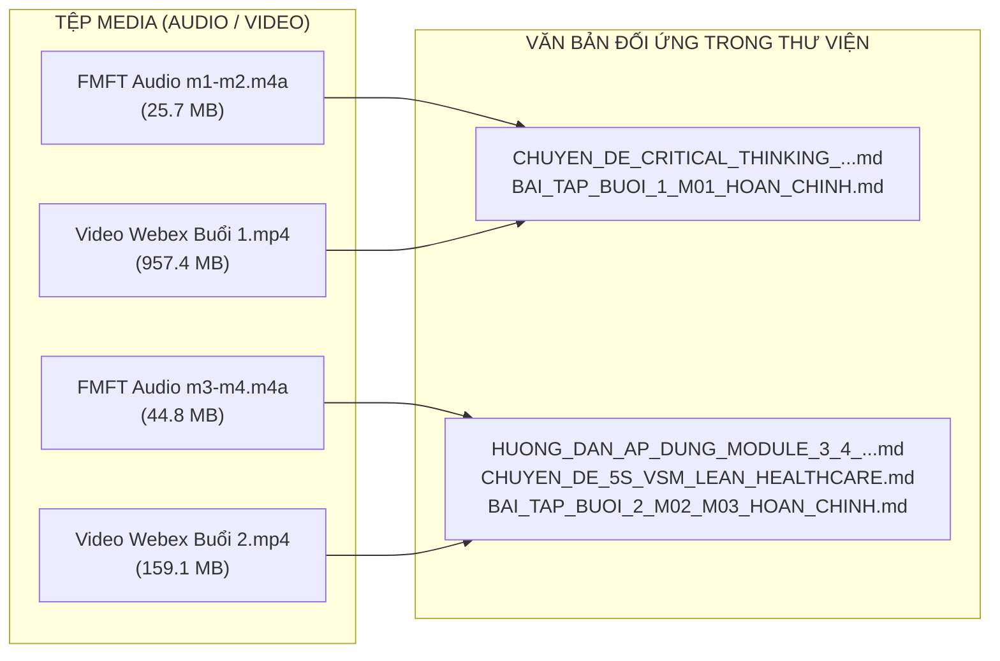

# MỤC LỤC & HƯỚNG DẪN KHAI THÁC MEDIA BÀI GIẢNG KHÓA HỌC FMFT AIOS/LSE
## HỆ THỐNG GHI ÂM (AUDIO) & GHI HÌNH (VIDEO) CÁC BUỔI ĐÀO TẠO
### Giảng viên: TS. Đoàn Hùng Dũng | Đơn vị: Hệ thống Y tế Thanh Vũ Medic

> **Đơn vị quản lý:** Nhóm 8 – Cơ sở 3 (PKĐK Thanh Vũ Medic Cà Mau)  
> **Chủ trì lưu trữ & số hóa:** Huỳnh Trường Thanh Tâm (Phó phòng PTKH / Thư ký BKS KPI) & Shin Familiar  
> **Thư mục nguồn gốc:** `D:\Hyrta-One\cmubeta2\My Drive\Thiện Phúc Cloud\Thanh Vũ Cà Mau\KPI TVM Cà Mau\FMFT\`  
> **Cập nhật ngày:** 31/10/2026

---

## 1. TỔNG HỢP DANH MỤC TỆP TIN MEDIA ĐÃ ĐỒNG BỘ

| STT | Tên tệp tin media | Định dạng & Dung lượng | Thời điểm cập nhật | Nội dung chuyên đề tương ứng | Đường dẫn truy cập trực tiếp |
|:---:|---|:---:|:---:|---|:---:|
| **1** | **FMFT-QUAN TRI BENH VIEN (m1-m2).m4a** | Audio M4A **25.7 MB** | 31/10/2026 18:30 | **Buổi 1 (Module 1 & 2):** Tư duy hệ thống, Tư duy phản biện trong y tế, Tránh bẫy đầu tư thiết bị triệu đô, Nhận diện lãng phí, Hướng dẫn điền phiếu M01. | [Mở file Audio](file:///D:/Hyrta-One/cmubeta2/My%20Drive/Thi%E1%BB%87n%20Ph%C3%BAc%20Cloud/Thanh%20V%C5%A9%20C%C3%A0%20Mau/KPI%20TVM%20C%C3%A0%20Mau/FMFT/FMFT-QUAN%20TRI%20BENH%20VIEN%20(m1-m2).m4a) |
| **2** | **FMFT-QUAN TRI BENH VIEN (m3-m4).m4a** | Audio M4A **44.8 MB** | 31/10/2026 18:30 | **Buổi 2 (Module 3 & 4):** Chuỗi giá trị bệnh viện, Luồng người bệnh (M02), Bàn giao 2 chiều có hiệu lực, Ma trận RACI (M03) với nguyên tắc 1A Tối thượng, Phân quyền DOA (M14) & Tuyến leo thang. | [Mở file Audio](file:///D:/Hyrta-One/cmubeta2/My%20Drive/Thi%E1%BB%87n%20Ph%C3%BAc%20Cloud/Thanh%20V%C5%A9%20C%C3%A0%20Mau/KPI%20TVM%20C%C3%A0%20Mau/FMFT/FMFT-QUAN%20TRI%20BENH%20VIEN%20(m3-m4).m4a) |
| **3** | **Quản trị Bệnh viện.mp4** | Video MP4 **957.4 MB** | 28/10/2026 10:00 | **Video ghi hình Webex Buổi 1:** Toàn cảnh buổi giảng trực tuyến đầu tiên giữa TS. Đoàn Hùng Dũng và 202 cán bộ quản lý 4 cơ sở thuộc Hệ thống Thanh Vũ Medic. | [Mở file Video](file:///D:/Hyrta-One/cmubeta2/My%20Drive/Thi%E1%BB%87n%20Ph%C3%BAc%20Cloud/Thanh%20V%C5%A9%20C%C3%A0%20Mau/KPI%20TVM%20C%C3%A0%20Mau/FMFT/Qu%E1%BA%A3n%20tr%E1%BB%8B%20B%E1%BB%87nh%20vi%E1%BB%87n.mp4) |
| **4** | **Quản trị Bệnh viện-20261028 1415-1.mp4** | Video MP4 **159.1 MB** | 31/10/2026 18:31 | **Video ghi hình Webex Buổi 2:** Toàn cảnh buổi giảng trực tuyến thứ hai, phân tích tình huống thực tế, nhận diện nút thắt tại phòng khám và khoa cấp cứu, thảo luận với các nhóm học viên. | [Mở file Video](file:///D:/Hyrta-One/cmubeta2/My%20Drive/Thi%E1%BB%87n%20Ph%C3%BAc%20Cloud/Thanh%20V%C5%A9%20C%C3%A0%20Mau/KPI%20TVM%20C%C3%A0%20Mau/FMFT/Qu%E1%BA%A3n%20tr%E1%BB%8B%20B%E1%BB%87nh%20vi%E1%BB%87n-20261028%201415-1.mp4) |

---

## 2. ÁNH XẠ NỘI DUNG MEDIA VỚI HỆ THỐNG TÀI LIỆU VĂN BẢN

---

## 3. HƯỚNG DẪN KHAI THÁC HIỆU QUẢ DÀNH CHO NHÓM 8 & CS3 CÀ MAU

1. **Ôn tập lý thuyết qua Audio khi di chuyển:**
   - Các file audio `.m4a` có dung lượng nhẹ (25 MB – 45 MB), âm thanh trong trẻo, có thể nghe trực tiếp trên điện thoại di động hoặc máy tính mà không tốn nhiều băng thông.
   - Thích hợp để Sếp và các thành viên Nhóm 8 nghe lại các đoạn Thầy Dũng giải thích nguyên lý "Bàn giao 2 chiều", "Nguyên tắc 1A Tối thượng trong RACI" và "Phân tách 5 khâu độc lập chống xung đột lợi ích".

2. **Xem lại Video Webex khi cần đối chiếu slide:**
   - Tệp `.mp4` ghi hình lại chính xác màn hình chia sẻ của Thầy, các slide biểu mẫu và các câu hỏi vấn đáp trực tiếp của các Trưởng khoa, Bác sĩ trong toàn Hệ thống Thanh Vũ Medic.

3. **Tích hợp vào Cổng Portal (`index.html`):**
   - Đã được liên kết trực tiếp trên giao diện Cổng Web Quản trị để Sếp và các thành viên có thể vừa đọc biểu mẫu vừa mở nghe giảng lại bất cứ lúc nào.
