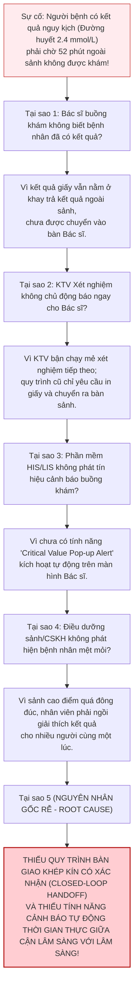

# BỘ TỔNG HỢP TOÀN DIỆN BÀI TẬP KHÓA HỌC FMFT AIOS/LSE – NHÓM 8
## CHƯƠNG TRÌNH ĐÀO TẠO QUẢN TRỊ BỆNH VIỆN HIỆN ĐẠI – TS. ĐOÀN HÙNG DŨNG
### HỆ THỐNG Y TẾ THANH VŨ MEDIC – CƠ SỞ 3: PHÒNG KHÁM ĐA KHOA CÀ MAU

> **Đơn vị thực hiện:** Nhóm 8 (Đại diện: Cơ sở 3 - PKĐK Thanh Vũ Medic Cà Mau)  
> **Nhóm trưởng:** CN. Nguyễn Kim Nhang (Phó phòng TCNS CS2)  
> **Chủ trì kỹ thuật & vận hành CS3:** Huỳnh Trường Thanh Tâm (Phó phòng PTKH / Thư ký BKS KPI) & BS. Huỳnh Tấn Kiệt (Trưởng phòng KHTH)  
> **Hỗ trợ chuyên trách công nghệ & FMFT:** Nguyễn Hoàng Duy (Phó phòng CNTT CS2)  
> **Giám sát kiểm soát:** Lục Thị Yến Nhi (Chuyên viên Ban Kiểm Soát KPI)  
> **Phiên bản:** v1.9.0 (Cập nhật ngày 30/10/2026)

---

## MỤC LỤC BÀI TẬP CÁC BUỔI

- [PHẦN I: DANH SÁCH THÀNH VIÊN VÀ PHÂN CÔNG NHÓM 8](#phần-i-danh-sách-thành-viên-và-phân-công-nhóm-8)
- [PHẦN II: BÀI TẬP BUỔI 1 – M01 PHIẾU XÁC ĐỊNH VẤN ĐỀ VÀ CHỌN ƯU TIÊN](#phần-ii-bài-tập-buổi-1--m01-phiếu-xác-định-vấn-đề-và-chọn-ưu-tiên)
  - [1. Nội dung xác định vấn đề luồng ngoại trú CS3](#1-nội-dung-xác-định-vấn-đề-luồng-ngoại-trú-cs3)
  - [2. Bảng phân tích 3 giả thuyết nguyên nhân gốc rễ](#2-bảng-phân-tích-3-giả-thuyết-nguyên-nhân-gốc-rễ)
  - [3. Quyết định can thiệp và cam kết chất lượng](#3-quyết-định-can-thiệp-và-cam-kết-chất-lượng)
- [PHẦN III: BÀI TẬP BUỔI 2 – CHUỖI GIÁ TRỊ VÀ PHÂN ĐỊNH TRÁCH NHIỆM](#phần-iii-bài-tập-buổi-2--chuỗi-giá-trị-và-phân-định-trách-nhiệm)
  - [M02: Bản đồ Chuỗi giá trị và Bàn giao (VSM & Handoff Matrix)](#m02-bản-đồ-chuỗi-giá-trị-và-bàn-giao-vsm--handoff-matrix)
  - [M03: Ma trận Trách nhiệm & Thẩm quyền (RACI & DOA)](#m03-ma-trận-trách-nhiệm--thẩm-quyền-raci--doa)
- [PHẦN IV: BÀI TẬP BUỔI 3 (SƠ THẢO) – KPI, DASHBOARD & QUẢN TRỊ AN TOÀN](#phần-iv-bài-tập-buổi-3-sơ-thảo--kpi-dashboard--quản-trị-an-toàn)
  - [M04: Từ điển Chỉ số KPI theo nguyên tắc Rule of 7](#m04-từ-điển-chỉ-số-kpi-theo-nguyên-tắc-rule-of-7)
  - [M05: Đặc tả Dashboard Điều hành Thời gian thực AIOS EWS](#m05-đặc-tả-dashboard-điều-hành-thời-gian-thực-aios-ews)
  - [M06: Phiếu Phân tích Rủi ro RCA (5 Whys) và Kế hoạch CAPA](#m06-phiếu-phân-tích-rủi-ro-rca-5-whys-và-kế-hoạch-capa)
- [PHẦN V: ĐẶC TẢ TRANG WEB TƯƠNG TÁC QUẢN TRỊ BÀI TẬP (PORTAL)](#phần-v-đặc-tả-trang-web-tương-tác-quản-trị-bài-tập-portal)

---

# PHẦN I: DANH SÁCH THÀNH VIÊN VÀ PHÂN CÔNG NHÓM 8
*(Căn cứ theo Danh sách phân nhóm lớp học do Ban Giám Đốc Hệ thống Y tế Thanh Vũ Medic phê duyệt ngày 28/10/2026)*

| STT | Họ và tên | Chức danh công tác | Cơ sở trực thuộc | Vai trò trong Nhóm 8 | Đầu mối biểu mẫu phụ trách |
|:---:|---|---|---|---|---|
| **1** | **Nguyễn Kim Nhang** | Phó phòng Tổ chức - Nhân sự | Cơ sở 2 | **Nhóm trưởng** | Điều phối chung & Bảo vệ trước Thầy |
| **2** | **Nguyễn Hoàng Duy** | Phó phòng Công nghệ thông tin | Cơ sở 2 | **Hỗ trợ Nhóm trưởng** | Kỹ thuật tích hợp hệ thống, Ban FMFT |
| **3** | **Lục Thị Yến Nhi** | Chuyên viên Ban Kiểm Soát | Cơ sở 2 | **Giám sát kiểm soát** | Thẩm tra tính độc lập & Kiểm soát KPI |
| **4** | **Huỳnh Tấn Kiệt** | Trưởng phòng Kế hoạch tổng hợp | Cơ sở 3 (Cà Mau) | **Chủ trì Kỹ thuật Lâm sàng** | Đầu mối quy trình KHTH & RACI (M02, M03) |
| **5** | **Huỳnh Trường Thanh Tâm**| Phó phòng PTKH / Thư ký BKS | Cơ sở 3 (Cà Mau) | **Chủ trì Điều hành & Dữ liệu**| Thiết kế giải pháp, VSM, KPI & Web Portal |
| **6** | **Tạ Minh Phước** | Tổ trưởng Tổ PTKH (CSKH) | Cơ sở 3 (Cà Mau) | Thành viên vận hành | Điều phối luồng sảnh chờ & Check-in $T_0$ |
| **7** | **Lê Minh Mẫn** | Trưởng phòng Xét nghiệm | Cơ sở 3 (Cà Mau) | Thành viên Cận lâm sàng | Chuẩn hóa trả kết quả liên tục (M01, M02) |
| **8** | **Mai Duy Linh** | Phó phòng Xét nghiệm | Cơ sở 3 (Cà Mau) | Thành viên Cận lâm sàng | Rà soát thời gian chạy mẫu LIS |
| **9** | **Đào Văn Khuynh** | Bác sĩ phụ trách Phòng Nội soi | Cơ sở 3 (Cà Mau) | Thành viên Chuyên môn | Ràng buộc thời gian khám lâm sàng $\ge 7$p |
| **10**| **Lê Như Ý** | Điều dưỡng Khoa Nội soi | Cơ sở 3 (Cà Mau) | Thành viên Chuyên môn | Khảo sát luồng bàn giao thủ thuật CLS |
| **11**| **Nguyễn Như Ý** | Trưởng phòng Tài chính - Kế toán| Cơ sở 3 (Cà Mau) | Thành viên Quản trị chi phí| Tối ưu hóa nguồn lực tài chính, KPI F1 |
| **12**| **Nguyễn Thúy Kiều** | Tổ trưởng Tổ Thu ngân | Cơ sở 3 (Cà Mau) | Thành viên Dịch vụ | Tối ưu hóa khâu thanh toán cuối luồng |
| **13**| **Bùi Mỹ Diện** | Điều dưỡng Tổ Tiêm ngừa | Cơ sở 3 (Cà Mau) | Thành viên Điều dưỡng | Phân luồng đối tượng ưu tiên tiêm chủng |
| **14**| **Lữ Phú Sinh** | Trưởng phòng Quản trị tòa nhà | Cơ sở 3 (Cà Mau) | Thành viên Hạ tầng | Bố trí mặt bằng sảnh, ghế chờ, bảng điện tử |
| **15**| **Trần Trúc Linh** | Trưởng phòng Tổ chức - Nhân sự | Cơ sở 3 (Cà Mau) | Thành viên Nhân sự | Điều động nhân sự ca kíp cao điểm |

---

# PHẦN II: BÀI TẬP BUỔI 1 – M01 PHIẾU XÁC ĐỊNH VẤN ĐỀ VÀ CHỌN ƯU TIÊN

*Thuộc Chuyên đề 1 & 2: Tư duy phản biện, Tư duy hệ thống và Nhận diện lãng phí trong Quản trị Bệnh viện.*

## 1. Nội dung xác định vấn đề luồng ngoại trú CS3

- **Tên đơn vị và nhóm:** Hệ thống Y tế Thanh Vũ Medic – **NHÓM 8** (Cơ sở trọng điểm: PKĐK Thanh Vũ Medic Cà Mau - CS3).
- **Quy trình và phạm vi khảo sát:** Luồng người bệnh ngoại trú từ khi làm xong các chỉ định Cận lâm sàng đến khi Bác sĩ bắt đầu khám kết luận tại tầng trệt (Khung giờ cao điểm: 07h00 – 10h00 sáng).
- **Vấn đề quan sát được:** Tình trạng dồn ứ cục bộ người bệnh tại sảnh chờ buồng khám Bác sĩ sau khi đã có kết quả Cận lâm sàng (Xét nghiệm, Siêu âm, X-quang). Khoảng thời gian từ lúc có đủ kết quả đến khi được gọi vào buồng khám kết luận bị kéo dài, gây ức chế tâm lý cho người bệnh và quá tải cho Bác sĩ.
- **Quy mô định lượng (Phân định rõ 3 tầng dữ liệu theo chuẩn FMFT):**
  - **[Số liệu thật]:** Lượt khám ngoại trú đạt 450 – 550 lượt/ngày. Kế hoạch năm 2026 đặt mục tiêu 172.150 lượt (`C1`), doanh thu 68,8 tỷ đồng (`F1`). Khoảng **68% người bệnh** tập trung đăng ký và làm cận lâm sàng trước 09h00 sáng.
  - **[Số liệu giả định / Khảo sát mẫu]:** Thời gian chờ từ lúc hoàn tất cận lâm sàng đến khi bước vào buồng khám kết luận dao động từ **35 đến 55 phút** (chiếm 30–35% tổng thời gian lưu viện ngoại trú TAT 135 – 160 phút).
  - **[Nội dung chưa có dữ liệu]:** Hệ thống HIS hiện tại chưa có trường dữ liệu ghi nhận mốc thời gian *"Người bệnh thực tế cầm kết quả giấy quay lại nộp cho Điều dưỡng buồng khám"* (vùng mù dữ liệu - blind spot).
- **Tác động đa chiều nếu giữ hiện trạng:**
  - *Đối với người bệnh:* Mệt mỏi, bức xúc vì chờ đợi lâu khi bụng đói (nhất là bệnh nhân đái tháo đường, tim mạch cao tuổi); nảy sinh phản ánh tiêu cực về chất lượng dịch vụ.
  - *Đối với nhân viên y tế:* Bác sĩ bị dồn ép thời gian khám vào cuối buổi sáng (10h00 - 11h30), dễ mệt mỏi và tăng nguy cơ sai sót giao tiếp; Điều dưỡng và CSKH phải liên tục giải thích trấn an.
  - *Đối với cơ sở khám chữa bệnh:* Lãng phí thời gian chờ vô ích; giảm thông lượng phục vụ (Throughput); cản trở chỉ tiêu tăng trưởng doanh thu (`F1`) và tỷ lệ tái khám định kỳ (`C2 ≥ 99%`).

## 2. Bảng phân tích 3 giả thuyết nguyên nhân gốc rễ

| STT | Giả thuyết nguyên nhân gốc rễ | Dữ liệu hoặc phương thức kiểm chứng | Người và hạn xác minh |
|:---:|---|---|---|
| **1** | **Cận lâm sàng gom mẻ trả kết quả (Batch Processing):** Khoa Xét nghiệm và CĐHA có thói quen gom một lượng lớn kết quả rồi mới in và trả hàng loạt ra bàn đón tiếp thay vì trả liên tục (Continuous Flow), khiến người bệnh đổ dồn về buồng khám cùng lúc. | Trích xuất log thời gian duyệt và phát hành kết quả trên LIS/PACS theo từng block 15 phút từ 07h00 - 10h00; đối chiếu biểu đồ phân bố giờ trả kết quả thực tế. | **Lê Minh Mẫn** (Trưởng PXN) & **Mai Duy Linh** (Phó PXN)<br/>*Hạn xác minh: 05/11/2026* |
| **2** | **Đứt gãy bàn giao thông tin (Handoff Blind Spot):** Kết quả đã có trên mạng nhưng buồng khám không có tín hiệu báo hiệu; người bệnh cầm giấy đứng chờ mà không biết nộp cho ai hoặc bỏ đi ăn sáng/vệ sinh làm đứt luồng. | Khảo sát màn hình hàng đợi HIS buồng khám; đối chiếu log giờ có kết quả với log mở bệnh án; quan sát thực địa hành vi 30 người bệnh sau khi nhận kết quả. | **Huỳnh Tấn Kiệt** (KHTH), **Huỳnh Trường Thanh Tâm** (PTKH) & **Nguyễn Hoàng Duy** (CNTT)<br/>*Hạn xác minh: 05/11/2026* |
| **3** | **Chưa có luồng phân làn ưu tiên (Fast-track) cho bệnh mạn tính:** Người bệnh khám định kỳ (tăng huyết áp, đái tháo đường ổn định chỉ cần lấy máu xét nghiệm đường huyết/HbA1c và cấp đơn) phải xếp chung hàng với các ca khám mới có kỹ thuật phức tạp kéo dài. | Phân tích cơ cấu mặt bệnh ngoại trú buổi sáng; đo thời gian khám kết luận của nhóm mạn tính so với nhóm bệnh mới; kiểm tra khả năng tách buồng khám hoặc luồng ưu tiên. | **Đào Văn Khuynh** (BS Nội soi), **Tạ Minh Phước** (Tổ PTKH) & **Bùi Mỹ Diện** (ĐD Tiêm ngừa)<br/>*Hạn xác minh: 05/11/2026* |

## 3. Quyết định can thiệp và cam kết chất lượng

- **Lý do chọn ưu tiên:** Đây là điểm nghẽn dòng chảy lớn nhất của CS3 Cà Mau. Giải quyết nút thắt này sẽ tạo ra thắng lợi nhanh (Quick-win), nâng cao rõ rệt trải nghiệm người bệnh mà **không tốn ngân sách đầu tư trang thiết bị mới**, hoàn toàn dựa trên chuẩn hóa quy trình và tối ưu hóa hệ thống thông tin.
- **Can thiệp dự kiến:**
  1. *Lean/LSE:* Chuyển chế độ trả kết quả sang dòng liên tục mẻ nhỏ (Small-batch flow); thiết lập luồng Fast-track cho bệnh nhân mạn tính ổn định.
  2. *AIOS/CNTT:* Bổ sung tính năng hiển thị trạng thái trên HIS: Tự động đổi màu cảnh báo khi bệnh nhân đã có đủ 100% kết quả CLS để Điều dưỡng buồng khám bấm "Tiếp nhận"; gửi tin nhắn Zalo ZNS thông báo khi có đủ kết quả.
  3. *Nhân lực:* Áp dụng cơ chế "Đảo nhịp Sáng - Chiều" của phòng PTKH; bố trí nhân viên Lễ tân/CSKH làm nhiệm vụ điều phối luồng (Care Navigator) tại sảnh chờ.
- **Ranh giới an toàn chuyên môn (Bất khả xâm phạm):**
  - **Tối thượng:** Tuyệt đối không can thiệp chỉ định chuyên môn; duy trì thời gian Bác sĩ thăm khám lâm sàng, giải thích bệnh và tư vấn dùng thuốc tối thiểu **7 – 10 phút/ca**.
  - Tuân thủ nghiêm ngặt quy trình nhận diện đúng người bệnh (đối chiếu đủ 3 thông tin: Họ tên, Năm sinh, Mã PID).
  - Cảnh báo và xử lý lập tức các kết quả cận lâm sàng thuộc giá trị báo động nguy kịch (Critical Value Alert).
- **Mục tiêu đo lường đầu ra:**
  - Rút ngắn thời gian chờ khám lại từ **$\ge 45$ phút xuống $\le 15$ phút**.
  - Rút ngắn tổng thời gian lưu viện ngoại trú (TAT) từ **145 phút xuống dưới 90 phút**.
  - Tỷ lệ hài lòng người bệnh tại khâu khám kết luận đạt **$\ge 92\%$**.

---

# PHẦN III: BÀI TẬP BUỔI 2 – CHUỖI GIÁ TRỊ VÀ PHÂN ĐỊNH TRÁCH NHIỆM

*Thuộc Chuyên đề 3 & 4: Bản đồ Chuỗi giá trị (VSM), Chuẩn hóa Bàn giao Handoff và Ma trận Phân quyền RACI / DOA.*

## M02: Bản đồ Chuỗi giá trị và Bàn giao (VSM & Handoff Matrix)

### 1. Định nghĩa 5 mốc thời gian chuẩn hóa
- **Mốc $T_0$ (Đủ điều kiện & Sẵn sàng):** Thời điểm đồng thời thỏa mãn 2 điều kiện: Có đủ 100% kết quả CLS hợp lệ trên hệ thống VÀ xác nhận người bệnh có mặt, sẵn sàng khám lại tại sảnh chờ (lấy mốc muộn hơn).
- **Mốc $T_1$ (Phát lệnh bàn giao):** Thời điểm hệ thống HIS tự động gửi thông báo lượt khám đủ điều kiện đến màn hình Điều dưỡng buồng khám.
- **Mốc $T_2$ (Xác nhận tiếp nhận):** Thời điểm Điều dưỡng buồng khám click nút "Tiếp nhận" trên màn hình HIS (Cam kết nhận việc trong vòng $\le 5$ phút từ $T_1$).
- **Mốc $T_3$ (Mời vào buồng khám):** Thời điểm Điều dưỡng kích hoạt bảng điện tử gọi số hoặc phát loa mời người bệnh bước vào cửa phòng khám.
- **Mốc $T_4$ (Bắt đầu khám kết luận):** Thời điểm Bác sĩ thực sự bắt đầu khám lâm sàng, đọc kết quả và tư vấn cho người bệnh.
- **Thời gian chờ toàn luồng đoạn ưu tiên:** $W = T_4 - T_0$.

### 2. So sánh Bản đồ Hiện trạng (Current State) vs Bản đồ Đề xuất (Future State)

```mermaid
graph TD
    subgraph "HIỆN TRẠNG (Current State: W = 45 phút, P90 = 63 phút)"
        A1["Chờ gom in kết quả giấy<br/>(10 - 15 phút)"] --> A2["Người bệnh cầm giấy tìm phòng<br/>(8 - 12 phút)"]
        A2 --> A3["Nộp sổ vào khay buồng khám<br/>(15 - 25 phút chờ đợi vô thức)"]
        A3 --> A4["Điều dưỡng gọi tên thủ công<br/>(5 - 10 phút)"]
        A4 --> A5["Bác sĩ bắt đầu khám kết luận (T4)<br/>Tổng thời gian chờ W = 45 phút!"]
    end

    subgraph "ĐỀ XUẤT FMFT LEAN FLOW (Future State: W <= 15 phút, P90 <= 25 phút)"
        B1["LIS/PACS duyệt KQ điện tử<br/>+ Quét mã sảnh (T0)"] -->|Tự động <= 10s| B2["Gửi yêu cầu buồng khám (T1)"]
        B2 -->|Cam kết SOP <= 5p| B3["ĐD click Tiếp nhận (T2)"]
        B3 -->|Nhịp Takt Time <= 5p| B4["Gọi số tự động sảnh (T3)"]
        B4 -->|Đối chiếu 3 thông tin| B5["Bác sĩ khám kỹ lâm sàng (T4)<br/>Duy trì >= 7 phút chuyên môn!"]
    end

    style A1 fill:#ffebee,stroke:#c62828
    style A2 fill:#ffebee,stroke:#c62828
    style A3 fill:#ffcdd2,stroke:#b71c1c
    style A4 fill:#ffebee,stroke:#c62828
    style A5 fill:#ffcdd2,stroke:#b71c1c

    style B1 fill:#e8f5e9,stroke:#2e7d32
    style B2 fill:#e8f5e9,stroke:#2e7d32
    style B3 fill:#c8e6c9,stroke:#1b5e20
    style B4 fill:#e8f5e9,stroke:#2e7d32
    style B5 fill:#a5d6a7,stroke:#1b5e20
```



### 3. Bảng quy chuẩn xử lý 6 kịch bản ngoại lệ

| STT | Kịch bản ngoại lệ | Nguy cơ sai hỏng | Quy trình xử lý chuẩn hóa (SOP) | Người chịu trách nhiệm |
|:---:|---|---|---|---|
| **1** | **Thiếu kết quả hoặc chưa có mốc $T_0$** | Bác sĩ kết luận non khi chưa đủ cơ sở; tính sai lệch thời gian $W$. | Khóa quyền click gọi khám; giữ trạng thái "Chờ kết quả"; CSKH liên hệ Labo kiểm tra tiến độ. | **Lê Minh Mẫn** (Labo) & CSKH sảnh |
| **2** | **Sai định danh hoặc sai lượt khám** | Nhầm lẫn bệnh án, nguy cơ cấp sai đơn thuốc nguy hiểm. | Dừng ngay quy trình bàn giao; đối chiếu lại CCCD/vòng đeo tay và mã PID; lập biên bản suýt sự cố (Near-miss). | **ĐD. Huỳnh Thị Nga** (Khoa Khám) |
| **3** | **Trùng lặp yêu cầu khám lại** | Ảo hóa hàng đợi buồng khám, làm méo mó số liệu thời gian thực. | Hệ thống HIS tự động phát hiện mã PID trùng lặp và tự động gộp; giữ nguyên mốc $T_0$ ban đầu. | **Nguyễn Hoàng Duy** & Tổ CNTT |
| **4** | **Kết quả xét nghiệm bị chỉnh sửa sau duyệt** | Bác sĩ ra quyết định lâm sàng trên thông số cũ chưa chuẩn xác. | Hệ thống tự động khóa trạng thái; bắn pop-up cảnh báo đỏ cho Bác sĩ; chuyển sang luồng hội chẩn xác minh. | Bác sĩ điều trị & **BS. Huỳnh Tấn Kiệt** |
| **5** | **Sự cố mất kết nối mạng nội bộ HIS/LIS** | Tê liệt luồng bàn giao điện tử trên toàn cơ sở. | Kích hoạt quy trình thủ công dự phòng (Manual Fallback): Dùng sổ bàn giao giấy có ký nhận; liên lạc qua bộ đàm/nội bộ. | **Lữ Phú Sinh** & Tổ CNTT ($\le 15$p) |
| **6** | **Người bệnh vắng mặt khi được mời khám** | Chiếm dụng lượt khám, gây ùn ứ cho các bệnh nhân đến sau. | Đánh dấu "Vắng mặt tạm thời"; tự động chuyển lượt xuống vị trí thứ 3 trong hàng đợi; CSKH gọi điện thoại hỗ trợ. | Điều dưỡng buồng khám & Tổ PTKH |

---

## M03: Ma trận Trách nhiệm & Thẩm quyền (RACI & DOA)

### 1. Ma trận RACI liên khoa (8 đầu việc trọng yếu)

*Quy ước: **R** (Responsible - Người trực tiếp thực hiện) | **A** (Accountable - Người chịu trách nhiệm tối hậu, duy nhất 1 người) | **C** (Consulted - Người được tham vấn chuyên môn) | **I** (Informed - Người nhận thông tin báo cáo).*

| STT | Đầu việc trọng yếu trong chuỗi bàn giao ngoại trú | Ban Giám Đốc | Khối Bác sĩ Lâm sàng | Khối KHTH & PTKH | ĐD Khoa Khám | Khoa Xét nghiệm | Khoa CĐHA | Tổ CNTT | Ban Kiểm Soát |
|:---:|---|:---:|:---:|:---:|:---:|:---:|:---:|:---:|:---:|
| **1** | Thiết lập quy định phối hợp và cam kết thời gian bàn giao $T_1 \rightarrow T_2 \le 5$p | **A** | C | R | C | C | C | I | I |
| **2** | Trả kết quả CLS điện tử theo dòng liên tục (Continuous Flow) | I | I | C | I | **R/A** | **R/A** | C | I |
| **3** | Xác lập mốc $T_0$ (Đủ KQ + Check-in NB có mặt tại sảnh) | I | I | **R/A** | C | I | I | C | I |
| **4** | Tiếp nhận yêu cầu khám lại trên HIS trong vòng $\le 5$ phút ($T_1 \rightarrow T_2$) | I | C | I | **R/A** | I | I | C | I |
| **5** | Mời bệnh nhân vào khám theo bảng điện tử tự động ($T_3$) | I | C | C | **R/A** | I | I | I | I |
| **6** | Thăm khám lâm sàng, đọc kết quả và tư vấn đơn thuốc ($T_4 \ge 7$p) | I | **R/A** | C | C | I | I | I | I |
| **7** | Cấu hình tính năng cảnh báo màu và luồng bàn giao trên HIS/LIS | I | C | C | C | C | C | **R/A** | I |
| **8** | Kiểm toán độc lập thời gian chờ $W$, chỉ số $P90$ và xử lý vi phạm | C | I | C | I | I | I | I | **R/A** |

### 2. Phiếu Phân quyền Thẩm quyền (DOA) cho Đầu việc Trọng yếu
- **Đầu việc phân quyền:** *Điều phối phân luồng ưu tiên (Fast-track) và chuyển buồng khám kết luận linh hoạt thời gian thực.*
- **Người được ủy quyền (Chữ A):** **Huỳnh Trường Thanh Tâm** (Phó phòng PTKH / Thư ký BKS KPI) phối hợp cùng **BS. Huỳnh Tấn Kiệt** (Trưởng phòng KHTH).
- **Phạm vi thẩm quyền được quyết định tức thì:**
  1. Khi phát hiện buồng khám bất kỳ có hàng đợi $\ge 8$ bệnh nhân hoặc thời gian chờ dự kiến $> 20$ phút: Có toàn quyền điều phối chuyển bớt người bệnh sang buồng khám chuyên khoa tương đương còn trống công suất mà không cần xin ý kiến Ban Giám Đốc trước.
  2. Kích hoạt luồng Fast-track cho nhóm bệnh nhân mạn tính ổn định vào buồng khám ưu tiên trong khung giờ 08h00 - 09h30.
  3. Yêu cầu Tổ CNTT trích xuất dữ liệu log tức thời khi phát hiện có độ lệch bàn giao $> 15$ phút để lập biên bản kiểm tra tại chỗ.
- **Giới hạn thẩm quyền (Không được phép):** Tuyệt đối không can thiệp vào chuyên môn điều trị, chỉ định thuốc hoặc thay đổi kết luận chẩn đoán của Bác sĩ.

---

# PHẦN IV: BÀI TẬP BUỔI 3 (SƠ THẢO) – KPI, DASHBOARD & QUẢN TRỊ AN TOÀN

*Thuộc Chuyên đề 5 & 6: Từ điển KPI (Rule of 7), Dashboard Điều hành Thời gian thực (AIOS EWS) và Quản trị Rủi ro RCA / CAPA.*

## M04: Từ điển Chỉ số KPI theo nguyên tắc Rule of 7

*Nguyên tắc FMFT: Tối đa 7 chỉ số, phân bổ cân bằng: Leading 30% (3 chỉ số quá trình) – Lagging 40% (2 chỉ số kết quả) – Constraint 30% (2 chỉ số ràng buộc an toàn/chuyên môn) nhằm tránh hiện tượng tối ưu hóa cục bộ.*

| STT | Mã KPI | Tên chỉ số & Nhóm phân loại | Công thức tính toán & Đơn vị | Nguồn dữ liệu | Tần suất đo | Chủ sở hữu (Chữ A) | Ngưỡng Xanh (Đạt) | Ngưỡng Vàng (Cảnh báo) | Ngưỡng Đỏ (Nguy hiểm) |
|:---:|---|---|---|---|:---:|---|:---:|:---:|:---:|
| **1** | `KPI-01` | **Tỷ lệ xác nhận bàn giao đúng hạn**<br/>*(Leading - 10%)* | $\frac{\text{Số lượt } T_2 - T_1 \le 5\text{p}}{\text{Tổng lượt gửi } T_1} \times 100\%$ | Log tự động HIS | Hàng ngày | **ĐD. Huỳnh Thị Nga** (Khoa Khám) | $\ge 95\%$ | $90\% - 94.9\%$ | $< 90\%$ |
| **2** | `KPI-02` | **Tỷ lệ trả kết quả CLS dòng liên tục**<br/>*(Leading - 10%)* | $\frac{\text{Số mẻ trả KQ } \le 15\text{p/đợt}}{\text{Tổng số mẻ trả ca sáng}} \times 100\%$ | Nhật ký xuất LIS/PACS | Hàng ngày | **CN. Lê Minh Mẫn** (Trưởng Labo) | $\ge 90\%$ | $80\% - 89.9\%$ | $< 80\%$ |
| **3** | `KPI-03` | **Tỷ lệ định vị NB tại sảnh chờ**<br/>*(Leading - 10%)* | $\frac{\text{Số NB quét mã check-in } T_0}{\text{Tổng NB hoàn tất CLS}} \times 100\%$ | Phân hệ Lễ tân/CSKH | Hàng ngày | **Tạ Minh Phước** (Tổ PTKH) | $\ge 98\%$ | $95\% - 97.9\%$ | $< 95\%$ |
| **4** | `KPI-04` | **Thời gian chờ khám lại trung bình ($W$)**<br/>*(Lagging - 20%)* | Trung bình $W = T_4 - T_0$ của các lượt khám hợp lệ trong ngày (Phút) | Dữ liệu HIS tự động | Hàng ngày | **BS. Huỳnh Tấn Kiệt** (Trưởng KHTH) | $\le 15$ phút | $16 - 25$ phút | $> 25$ phút |
| **5** | `KPI-05` | **Chỉ số thời gian chờ phân vị 90 ($P90$)**<br/>*(Lagging - 20%)* | Giá trị thời gian $W$ tại phân vị thứ 90 trong ngày (`PERCENTILE.INC`) | Dữ liệu HIS tự động | Hàng tuần | **Huỳnh Trường Thanh Tâm** (BKS KPI) | $\le 25$ phút | $26 - 40$ phút | $> 40$ phút |
| **6** | `KPI-06` | **Thời gian Bác sĩ khám lâm sàng & tư vấn**<br/>*(Constraint - 15%)* | Thời gian Bác sĩ trực tiếp thăm khám, giải thích bệnh cho 01 ca (Phút) | Bấm giờ mẫu & log HIS hoàn thành ca | Hàng tuần | **BS. CKII. Nguyễn Văn Dũng** (GĐ Chuyên môn) | $\ge 7$ phút | $5 - 6.9$ phút | $< 5$ phút *(Cảnh báo ép tốc độ)* |
| **7** | `KPI-07` | **Tỷ lệ tuân thủ đối chiếu 3 định danh**<br/>*(Constraint - 15%)* | $\frac{\text{Số lượt đối chiếu đủ Tên, Năm sinh, PID}}{\text{Tổng số ca bắt đầu khám } T_4} \times 100\%$ | Camera buồng khám & Giám sát QLCL | Hàng tháng | **Tổ Quản lý Chất lượng** (QLCL) | **100%** | $98\% - 99.9\%$ | $< 98\%$ |

---

## M05: Đặc tả Dashboard Điều hành Thời gian thực AIOS EWS

### 1. Kiến trúc chỉ báo 3 trạng thái màu (Visual Management)
- 🟢 **Xanh lá (Trạng thái dòng chảy thông suốt - Flowing):** Hàng chờ buồng khám $\le 5$ bệnh nhân; thời gian chờ trung bình $W \le 15$ phút; tỷ lệ bàn giao đúng hạn $\ge 95\%$. Hệ thống hoạt động hoàn hảo theo nhịp.
- 🟡 **Vàng (Trạng thái cảnh báo sớm - Watchful):** Hàng chờ buồng khám $6 - 10$ bệnh nhân; thời gian chờ $W$ từ $16 - 25$ phút; xuất hiện yêu cầu bàn giao quá 5 phút chưa bấm $T_2$.  
  $\rightarrow$ *Phản ứng kích hoạt:* Gửi thông báo đến điện thoại Điều dưỡng trưởng Khoa Khám và CSKH sảnh để rà soát điều phối phân làn ngay.
- 🔴 **Đỏ (Trạng thái báo động nút thắt - Bottleneck Alert):** Hàng chờ buồng khám $> 10$ bệnh nhân; thời gian chờ $W > 25$ phút; hoặc phát hiện ca có kết quả nguy kịch (Critical Value) chưa được tiếp nhận quá 3 phút.  
  $\rightarrow$ *Phản ứng khẩn cấp:* Telegram Bot kích hoạt cảnh báo tức thì tới Ban Giám Đốc và Trưởng KHTH; kích hoạt mở buồng khám dự phòng số 4; tăng cường 02 nhân sự CSKH vào sảnh hỗ trợ điều phối.

### 2. Mô hình giao diện giám sát thời gian thực

```
========================================================================================================
🏥 AIOS REAL-TIME OPERATIONS DASHBOARD - THANH VU MEDIC CA MAU (CS3)
========================================================================================================
[ TỔNG LƯỢT ĐĂNG KÝ: 412 ]   [ ĐANG CHỜ KHÁM LẠI: 18 ]   [ TAT NGOẠI TRÚ TB: 82 PHÚT ]   [ P90: 24.5 PHÚT ]
--------------------------------------------------------------------------------------------------------
📍 BUỒNG KHÁM NỘI 1          📍 BUỒNG KHÁM NỘI 2          📍 BUỒNG KHÁM NỘI 3          📍 BUỒNG FAST-TRACK (MẠN TÍNH)
Trạng thái: 🟢 XANH          Trạng thái: 🟡 VÀNG          Trạng thái: 🔴 ĐỎ            Trạng thái: 🟢 XANH
Hàng chờ: 3 ca (TB 8 phút)   Hàng chờ: 7 ca (TB 18 phút)  Hàng chờ: 12 ca (TB 32 phút) Hàng chờ: 4 ca (TB 6 phút)
ĐD xác nhận: 100% đúng hạn   ĐD xác nhận: 91% đúng hạn    CẢNH BÁO: Tắc nghẽn bàn giao! ĐD xác nhận: 100% đúng hạn
--------------------------------------------------------------------------------------------------------
🔬 TIẾN ĐỘ CẬN LÂM SÀNG: Labo Xét nghiệm: Đang chạy 22 mẫu | Siêu âm: Chờ 6 ca | X-Quang: Chờ 3 ca
⚠️ CẢNH BÁO NGUY KỊCH: 01 ca Đường huyết thấp (2.4 mmol/L) -> ĐÃ BÀN GIAO ƯU TIÊN VÀO BUỒNG CẤP CỨU (1.5p)
========================================================================================================
```

---

## M06: Phiếu Phân tích Rủi ro RCA (5 Whys) và Kế hoạch CAPA

### 1. Sự cố mô phỏng phân tích nguyên nhân gốc rễ
- **Tình huống sự cố:** Bệnh nhân N.V.A (65 tuổi, bệnh nhân ngoại trú theo dõi đái tháo đường type 2) có kết quả xét nghiệm đường huyết lúc đói hạ nghiêm trọng (Glycemia = 2.4 mmol/L - Giá trị báo động nguy kịch). Bệnh nhân ngồi chờ tại sảnh 52 phút mà Bác sĩ buồng khám không hay biết do chưa được bàn giao hồ sơ.
- **Hậu quả tiềm tàng:** Bệnh nhân rơi vào hôn mê do hạ đường huyết ngay tại sảnh chờ đông đúc; đe dọa trực tiếp an toàn tính mạng người bệnh và gây khủng hoảng truyền thông.



### 2. Kế hoạch Hành động Khắc phục và Phòng ngừa (CAPA Plan)

| STT | Hành động cụ thể (CAPA) | Loại hình can thiệp | Người thực hiện chính | Người giám sát (A) | Thời hạn hoàn thành | Bằng chứng nghiệm thu (DoD) |
|:---:|---|---|---|---|:---:|---|
| **1** | **Xử trí cấp cứu & Chuyển luồng tức thì:** Khi LIS phát hiện giá trị nguy kịch, KTV lập tức gọi điện thoại hotline cho Bác sĩ buồng khám và Điều dưỡng sảnh; CSKH tiếp cận bệnh nhân phát bánh/sữa ngọt và chuyển xe lăn vào buồng cấp cứu/khám ngay. | Hành động khắc phục tức thời (Immediate Action) | **CN. Lê Minh Mẫn** & ĐD Sảnh | **BS. Huỳnh Tấn Kiệt** | Hoàn thành ngay (Áp dụng từ 01/11) | Sổ theo dõi ca báo động đỏ & Biên bản bàn giao khẩn cấp |
| **2** | **Cấu hình Pop-up cảnh báo đỏ tự động trên HIS:** Khi Labo duyệt kết quả nguy kịch, màn hình Bác sĩ và Điều dưỡng buồng khám tự động nhấp nháy pop-up đỏ kèm chuông báo động ngắt quãng cho đến khi người dùng bấm xác nhận tiếp nhận. | Giải pháp công nghệ (AIOS / Tech) | **Nguyễn Hoàng Duy** & Võ Lê Chương | **Huỳnh Trường Thanh Tâm** | 08/11/2026 | Biên bản nghiệm thu kiểm thử tính năng phần mềm HIS |
| **3** | **Đảo nhịp nhân sự PTKH và Care Navigator tại sảnh:** Điều động 02 nhân sự CSKH tăng cường cho khung giờ 07h00 - 09h30, trực tiếp theo dõi bảng hiển thị hàng chờ, chủ động tiếp cận bệnh nhân cao tuổi/mệt mỏi. | Tối ưu hóa quy trình (Lean / SOP) | **Tạ Minh Phước** (Tổ trưởng PTKH) | **Huỳnh Trường Thanh Tâm** | 03/11/2026 | Lịch phân công ca kíp & Bảng chấm công đảo nhịp |
| **4** | **Kiểm toán tuân thủ định kỳ của Ban Kiểm Soát:** Rà soát hàng tuần 100% các ca có kết quả cận lâm sàng báo động nguy kịch; đo lường thời gian từ lúc duyệt kết quả đến lúc Bác sĩ bắt đầu xử trí ($\le 5$ phút). | Đo lường & Kiểm soát (Audit / LSE) | **Lục Thị Yến Nhi** (BKS CS2) | **Thư ký BKS CS3** | Hàng tuần | Báo cáo kiểm toán định kỳ gửi trực tiếp Ban Giám Đốc |

---

# PHẦN V: ĐẶC TẢ TRANG WEB TƯƠNG TÁC QUẢN TRỊ BÀI TẬP (PORTAL)

Nhằm hiện thực hóa định hướng của Sếp Tâm: *"Gom bài tập vô một trang web có thể góp ý (công khai) hoặc chỉnh sửa được (khi có key).. các bài tập sau cứ đưa lên đó là ổn"*, hệ thống được đóng gói thành một trang Web App tương tác toàn diện:

1. **Vị trí tệp tin nguồn:** `31_FMFT_AIOS_LSE/index.html` (chạy độc lập trực tiếp trên mọi trình duyệt web, không phụ thuộc backend, có thể deploy Vercel trong 30 giây).
2. **Kiến trúc trải nghiệm:**
   - **Tab Chuyên đề:** Tổng quan, Buổi 1 (M01), Buổi 2 (M02 & M03), Buổi 3 (M04, M05 & M06), và Khung chờ sẵn cho Buổi 4 & 5.
   - **Hệ thống Bình luận Góp ý Công khai (Public Feedback):** Bất kỳ thành viên nào cũng có thể gửi nhận xét, góp ý theo từng biểu mẫu; dữ liệu lưu trữ trên LocalStorage và có nút xuất JSON / Markdown.
   - **Chế độ Chỉnh sửa Bảo mật (Admin Mode với Secret Key):**
     - Nhập Secret Key mặc định: `septam1993` (hoặc cấu hình tùy ý).
     - Mở khóa chế độ chỉnh sửa trực tiếp nội dung các bảng biểu, phiếu M01-M06.
     - Tính năng "Lưu thay đổi", "Khôi phục dữ liệu gốc", và "Xuất file Markdown cập nhật".
   - **In ấn & Xuất bản:** Hỗ trợ phím tắt in ấn chuẩn A4 (Print to PDF) đẹp mắt, ẩn thanh công cụ khi in.
