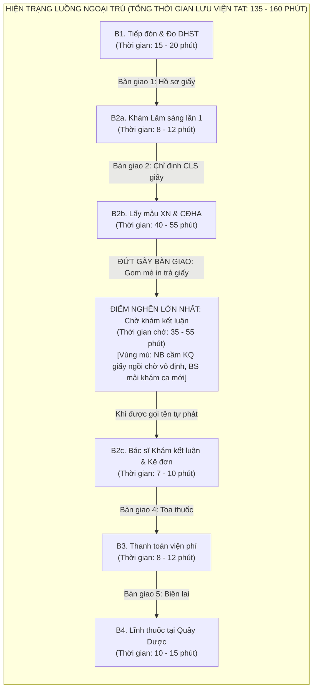
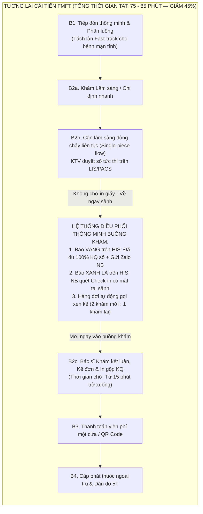

# BỘ HỒ SƠ PHÂN TÍCH DỰ ÁN CẢI TIẾN QUẢN TRỊ BỆNH VIỆN — FMFT AIOS/LSE
## ĐỀ ÁN 1: TỐI ƯU HÓA DÒNG CHẢY GIÁ TRỊ & RÚT NGẮN THỜI GIAN CHỜ KHÁM NGOẠI TRÚ
### Đơn vị thực hiện: Hệ thống Y tế Thanh Vũ Medic — Cơ sở 3 — PKĐK Thanh Vũ Medic Cà Mau
### Mã định danh dự án: TV3-KB-01 | Phiên bản: 2.0 (Tháng 11/2026)

---

> [!IMPORTANT]
> **RANH GIỚI BẤT KHẢ XÂM PHẠM VỀ Y KHOA:**
> - Dự án cải tiến này **tuyệt đối chỉ tối ưu hóa quy trình luồng vận hành, loại bỏ lãng phí chờ đợi và chuẩn hóa bàn giao thông tin**; tuyệt đối **không can thiệp chuyên môn y khoa**, không cắt bớt thời gian thăm khám lâm sàng, giải thích bệnh và tư vấn dùng thuốc của Bác sĩ (duy trì tối thiểu 7 – 10 phút/ca).
> - Nghiêm ngặt tuân thủ 03 yếu tố nhận diện người bệnh (Họ tên, Năm sinh, Mã số người bệnh) tại mọi điểm chạm.

---

## M01. PHIẾU XÁC ĐỊNH VẤN ĐỀ VÀ CHỌN ƯU TIÊN

| Trường theo biểu mẫu | Nội dung chi tiết cho Cơ sở 3 (PKĐK Thanh Vũ Medic Cà Mau) |
|:---|:---|
| **Tên bệnh viện và nhóm** | - **Hệ thống Y tế Thanh Vũ Medic**<br/>- **Cơ sở thực hiện:** Cơ sở 3 — Phòng khám Đa khoa Thanh Vũ Medic Cà Mau.<br/>- **Nhóm phối hợp liên chuyên khoa:** Phòng Kế hoạch tổng hợp (KHTH), Khoa Khám bệnh, Phòng Phát triển khách hàng (PTKH), Khoa Xét nghiệm, Khoa Chẩn đoán hình ảnh (CĐHA), Phòng Tổ chức nhân sự (TCNS), Phòng Tài chính kế toán (TCKT), Quản trị tòa nhà & Tổ CNTT. |
| **Quy trình và phạm vi người bệnh** | - **Quy trình:** Toàn bộ luồng tiếp nhận, đo sinh hiệu, khám lâm sàng ban đầu, thực hiện cận lâm sàng (Xét nghiệm, CĐHA), bàn giao kết quả và khám kết luận, thanh toán viện phí, cấp phát thuốc ngoại trú.<br/>- **Căn cứ pháp lý & quy chuẩn:** Đối chiếu Quyết định 1313/QĐ-BYT ngày 22/04/2013 của Bộ Y tế về quy trình khám bệnh ngoại trú và Tiêu chuẩn chất lượng ACHSI.<br/>- **Phạm vi trọng tâm:** Khung giờ cao điểm sáng từ **07h30 đến 09h45** các ngày làm việc trong tuần (cao điểm nhất: Thứ Hai, Thứ Bảy và Chủ Nhật). |
| **Ngày lập và người chủ trì** | - **Ngày lập dự án:** Ngày 28 tháng 10 năm 2026 (Cập nhật phiên bản hoàn thiện: Ngày 04 tháng 11 năm 2026).<br/>- **Người chủ trì đề án:** **Huỳnh Trường Thanh Tâm** (PTKH CS3) & **Huỳnh Tấn Kiệt** (KHTH CS3).<br/>- **Đồng chủ trì chuyên môn:** **Đào Văn Khuynh** (Nội soi CS3) & **Lê Thị Mỹ Phương** (KHTH CS3). |
| **Vấn đề quan sát được, khoảng thời gian, quy mô và tác động** | - **Vấn đề quan sát được:** Tình trạng **dồn ứ cục bộ người bệnh tại sảnh chờ Bác sĩ khám kết luận** sau khi đã hoàn thành các chỉ định cận lâm sàng (Xét nghiệm máu, Siêu âm, X-quang). Khoảng thời gian từ lúc có đầy đủ kết quả CLS trên phần mềm đến khi người bệnh được Bác sĩ bắt đầu khám kết luận bị kéo dài, gây quá tải sảnh tầng trệt.<br/>- **Khoảng thời gian phát sinh:** Tập trung từ **07h30 đến 09h45** sáng.<br/>- **Quy mô số liệu:**<br/>  + *[Số liệu thật]:* Lượt khám ngoại trú trung bình đạt **450 – 550 lượt/ngày** (Kế hoạch năm 2026 chỉ tiêu C1 là 172.150 lượt/năm; mục tiêu doanh thu F1 là 68,8 tỷ đồng). Khoảng **68%** tổng lượt bệnh nhân tập trung đăng ký và làm CLS trước 09h00 sáng.<br/>  + *[Số liệu khảo sát mẫu]:* Thời gian từ lúc hoàn tất xét nghiệm/CĐHA đến khi vào buồng khám kết luận dao động từ **35 đến 55 phút** (chiếm 30–35% tổng thời gian lưu viện ngoại trú TAT 135 – 160 phút).<br/>- **Tác động tiêu cực:**<br/>  + *Đối với người bệnh:* Gây căng thẳng, bức xúc, mệt mỏi (nhất là bệnh nhân cao tuổi, bệnh nhân đái tháo đường/tim mạch phải nhịn đói từ sáng sớm để lấy máu); giảm sút trải nghiệm khách hàng.<br/>  + *Đối với nhân viên:* Bác sĩ buồng khám bị dồn ứ bệnh nhân cuối ca sáng (10h00 – 11h30), tạo áp lực căng thẳng, tăng nguy cơ sai sót giao tiếp; Điều dưỡng và Lễ tân/CSKH chịu áp lực giải thích gay gắt.<br/>  + *Đối với nguồn lực & hiệu suất:* Lãng phí thời gian chờ (Muda of Waiting); cản trở tốc độ phục vụ (Throughput); giảm tỷ lệ bệnh nhân tuân thủ tái khám mạn tính (C2 đạt từ 99% trở lên). |
| **Nguồn bằng chứng hiện có và giới hạn của dữ liệu** | - **Nguồn bằng chứng hiện có:**<br/>  + *[Số liệu thật]:* Nhật ký thời gian (Timestamps) trích xuất từ HIS/LIS/PACS (mốc giờ đăng ký tiếp đón, giờ chỉ định CLS, giờ labo duyệt kết quả, giờ Bác sĩ hoàn thành kê đơn).<br/>  + *[Số liệu thật]:* Báo cáo khảo sát hài lòng người bệnh tháng 10/2026 của Phòng PTKH (chỉ số C4), ghi nhận **18,5%** ý kiến phản ánh về việc chờ đợi lâu ở khâu nhận kết quả và chờ gọi khám lại.<br/>  + *[Số liệu khảo sát mẫu]:* Kết quả bấm giờ ngẫu nhiên 50 ca ngoại trú tại sảnh khám cho thấy khoảng cách giữa giờ in kết quả trên hệ thống và giờ người bệnh được gọi vào buồng khám có độ lệch lớn (15 đến 65 phút).<br/>- **Giới hạn của dữ liệu hiện tại:**<br/>  + *[Vùng mù dữ liệu - Blind spot]:* Hệ thống HIS hiện tại chưa có mốc ghi nhận thời điểm "Người bệnh thực tế đã có mặt tại sảnh buồng khám và sẵn sàng vào khám kết luận", dẫn đến đứt gãy luồng thông tin giữa việc có kết quả trên mạng và sự hiện diện thực tế của người bệnh.<br/>  + *[Nội dung chưa có dữ liệu]:* Chưa phân tách tự động giữa thời gian chờ do "Labo chưa chạy xong mẫu", thời gian chờ do "Chờ in trả giấy kết quả bản cứng" và thời gian chờ do "Bác sĩ đang bận khám ca mới nên chưa gọi ca trả kết quả". |
| **Mục tiêu dự kiến và điều kiện an toàn cần giữ** | - **Mục tiêu dự kiến:**<br/>  + **Rút ngắn thời gian chờ khám kết luận** (từ khi có đủ kết quả CLS đến khi Bác sĩ bắt đầu khám lại) từ **45 phút trở lên xuống còn từ 15 phút trở xuống** (giảm 66,7%).<br/>  + **Rút ngắn tổng thời gian lưu viện ngoại trú (TAT)** của ca khám thông thường từ **145 phút xuống dưới 90 phút** (giảm 38% thời gian chờ lãng phí).<br/>  + **Nâng cao tỷ lệ hài lòng người bệnh** về thời gian chờ khám kết luận đạt **từ 92% trở lên**.<br/>- **Điều kiện an toàn và chất lượng cốt lõi:**<br/>  + *An toàn y khoa:* Không cắt giảm thời gian khám lâm sàng và tư vấn của Bác sĩ (7–10 phút/ca).<br/>  + *Chính xác định danh:* Tuân thủ đối chiếu 3 thông tin nhận diện trước khi kết luận và kê đơn.<br/>  + *Cảnh báo báo động:* Đảm bảo 100% kết quả xét nghiệm/CĐHA có giá trị nguy hiểm (Critical Values) phải được phát tín hiệu cảnh báo đỏ trực tiếp đến Bác sĩ điều trị trong vòng 5 phút trở xuống. |
| **Tác động nếu giữ nguyên hiện trạng** | - **Người bệnh:** Mệt mỏi, mất niềm tin vào chất lượng dịch vụ y tế tư nhân Thanh Vũ Medic; bỏ về giữa chừng hoặc chuyển dịch sang các cơ sở khám chữa bệnh đối thủ tại địa bàn TP. Cà Mau.<br/>- **Nhân viên:** Kiệt sức cuối ca sáng; phát sinh xung đột nội bộ giữa khối Lâm sàng và Cận lâm sàng; Điều dưỡng và CSKH trở thành nơi hứng chịu phàn nàn.<br/>- **Nguồn lực & Tài chính:** Buổi sáng quá tải cục bộ nhưng buổi chiều trống buồng khám; khó đạt mục tiêu doanh thu 68,8 tỷ đồng/năm (chỉ số F1); lãng phí công suất trang thiết bị. |

---

### Bảng phân tích giả thuyết nguyên nhân (Root Cause Hypotheses)

| STT | Giả thuyết nguyên nhân (Chưa kết luận) | Dữ liệu hoặc phương pháp kiểm chứng | Người phụ trách và thời hạn xác minh |
|:---:|:---|:---|:---|
| **1** | **Chờ in và trả kết quả giấy bản cứng (Paper Handover Delay):** Bệnh nhân phải ngồi chờ tại cửa phòng Xét nghiệm/CĐHA để nhận kết quả giấy rồi mới cầm về buồng khám, trong khi bác sĩ hoàn toàn có thể xem trực tiếp kết quả điện tử trên màn hình HIS/PACS ngay khi vừa duyệt. | Thống kê độ trễ từ thời điểm KTV duyệt kết quả số trên phần mềm đến khi in và phát giấy tận tay người bệnh; đối chiếu với thời gian người bệnh cầm giấy về tới phòng khám. | **Lê Minh Mẫn** (Xét nghiệm CS3) & **Mai Duy Linh** (Xét nghiệm CS3)<br/>*Hạn hoàn thành: 05/11/2026* |
| **2** | **Xung đột hàng đợi và đứt gãy thông tin buồng khám (Queue Conflict & Blind Spot):** Khi bệnh nhân có đủ kết quả quay lại, buồng khám không biết bệnh nhân đã có mặt ở sảnh; đồng thời Bác sĩ vẫn đang ưu tiên gọi khám các ca bệnh mới đến (B2a), khiến các ca chờ kết luận bị đẩy lùi về cuối buổi sáng. | Khảo sát giao diện hàng đợi HIS tại buồng khám; bấm giờ thời gian chờ của ca đã đủ kết quả; quan sát tỷ lệ gọi xen kẽ giữa ca khám mới và ca đọc kết quả của Bác sĩ. | **Huỳnh Tấn Kiệt** (KHTH CS3), **Huỳnh Trường Thanh Tâm** (PTKH CS3) & **Võ Lê Chương** (Tổ CNTT - PTPM CS3)<br/>*Hạn hoàn thành: 05/11/2026* |
| **3** | **Chưa phân luồng ưu tiên (Fast-track) cho bệnh mạn tính:** Người bệnh khám định kỳ (tăng huyết áp, đái tháo đường ổn định chỉ cần xét nghiệm đường huyết/máu cơ bản và cấp đơn) phải xếp chung hàng chờ kết luận với các ca bệnh mới có nhiều kỹ thuật chuyên sâu (nội soi, CT, tầm soát phức tạp). | Thống kê cơ cấu mặt bệnh ngoại trú buổi sáng; đo lường thời gian khám kết luận của nhóm bệnh mạn tính ổn định so với nhóm bệnh mới; kiểm tra khả năng phân tách buồng khám hoặc luồng ưu tiên. | **Đào Văn Khuynh** (Nội soi CS3), **Tạ Minh Phước** (PTKH CS3) & **Bùi Mỹ Diện** (Tiêm chủng CS3)<br/>*Hạn hoàn thành: 05/11/2026* |

---

### Quyết định ưu tiên (Priority Decision)

| Trường theo biểu mẫu | Nội dung giải pháp can thiệp |
|:---|:---|
| **Lý do chọn phạm vi này** | - Nút thắt lớn nhất ảnh hưởng trực tiếp đến 70% người bệnh ngoại trú tại Cơ sở 3 Cà Mau.<br/>- Đem lại hiệu quả tức thì (Quick-win), nâng cao rõ rệt trải nghiệm người bệnh mà **không đòi hỏi chi phí đầu tư mua sắm máy móc đắt tiền**, hoàn toàn dựa trên tối ưu hóa quy trình bàn giao, chuẩn hóa thông tin và điều phối nguồn lực theo phương pháp FMFT AIOS/LSE. |
| **Can thiệp dự kiến và điều kiện chưa đáp ứng** | - **Can thiệp dự kiến tập trung vào khâu chờ khám kết luận:**<br/>  1. *Quy trình không chờ giấy (Paperless Flow):* Ngay khi Labo và CĐHA duyệt kết quả số trên LIS/PACS, dữ liệu truyền tức thời về màn hình Bác sĩ buồng khám; bệnh nhân không cần đứng chờ lấy giấy kết quả mà được hướng dẫn quay về sảnh buồng khám ngay. Giấy kết quả sẽ được in gộp cùng Đơn thuốc sau khi Bác sĩ kết luận xong.<br/>  2. *Cơ chế đèn chỉ báo 2 trạng thái và Check-in có mặt:* Trên phần mềm HIS buồng khám hiển thị 2 trạng thái: **Màu VÀNG** (Đã đủ 100% kết quả CLS trên phần mềm) và **Màu XANH LÁ** (Người bệnh đã quét mã Check-in báo có mặt tại cửa buồng khám).<br/>  3. *Quy tắc xếp hàng gọi khám xen kẽ chuẩn hóa (Thuật toán 2:1):* Quy định bắt buộc hệ thống và Điều dưỡng buồng khám tự động gọi xen kẽ: Cứ sau 2 ca khám mới (B2a) phải gọi ngay 1 ca khám kết luận (B2c) để giải phóng dòng chảy, không để dồn ứ cuối ca.<br/>  4. *Thông báo tự động & Điều phối viên (Care Navigator):* Tự động gửi tin nhắn Zalo ZNS/SMS báo cho người bệnh khi đủ kết quả; nhân sự Care Navigator tại sảnh dùng máy quét cầm tay hỗ trợ người cao tuổi check-in nhanh.<br/>- **Điều kiện chưa đáp ứng:** Cần Tổ CNTT nâng cấp thuật toán hàng đợi và màu sắc hiển thị trên HIS; Ban Giám đốc ban hành Quy định gọi khám xen kẽ bắt buộc. |
| **Chủ tài trợ / Chủ quy trình** | - **Chủ tài trợ (Sponsor):** Ban Giám đốc PKĐK Thanh Vũ Medic Cà Mau (CN. Trần Thiện Phúc - Giám đốc điều hành, BS. CKII. Nguyễn Văn Dũng - Giám đốc chuyên môn).<br/>- **Chủ quy trình (Process Owner):** Huỳnh Trường Thanh Tâm (PTKH CS3) phối hợp cùng Huỳnh Tấn Kiệt (KHTH CS3) và Lê Minh Mẫn (Xét nghiệm CS3). |
| **Kết quả báo cáo Ban điều hành** | - Bộ hồ sơ M01–M04 hoàn thiện kèm sơ đồ chuỗi giá trị AS-IS và TO-BE.<br/>- Báo cáo kết quả thử nghiệm Before – After trên 200 ca bệnh nhân đối chứng sau cải tiến.<br/>- Bảng chỉ số đo lường TAT ngoại trú, thời gian chờ khám kết luận và điểm hài lòng C4. |

---

## M02. BẢN ĐỒ CHUỖI GIÁ TRỊ VÀ BÀN GIAO (VSM & HANDOVER)

### 1. Thông tin chung về luồng giá trị
- **Tên luồng quy trình:** Luồng khám chữa bệnh ngoại trú có thực hiện Cận lâm sàng tại Cơ sở 3 Cà Mau.
- **Điểm đầu luồng:** Người bệnh lấy số thứ tự và đăng ký tiếp đón tại Quầy Lễ tân tầng trệt.
- **Điểm cuối luồng:** Hoàn tất nhận thuốc tại Quầy Dược ngoại trú và ra về (hoặc nhận giấy hẹn tái khám/nhập viện).
- **Phạm vi loại trừ:** Các ca cấp cứu khẩn cấp (đi thẳng vào Phòng Cấp cứu); người bệnh khám sức khỏe đoàn (có luồng riêng).
- **Nhánh ưu tiên:** Nhánh **Fast-track cho người bệnh mạn tính ổn định** (Tăng huyết áp, Đái tháo đường tái khám định kỳ).

---

### 2. Bản đồ hiện trạng AS-IS (Phân rã điểm nghẽn và vùng mù bàn giao)



#### Bảng Phân Tích Công Đoạn AS-IS Tại Cơ Sở 3:

| Bước | Đơn vị phụ trách | Đầu vào -> Đầu ra | Thời gian xử lý (VA) | Thời gian chờ (NVA) | Rủi ro & Đứt gãy bàn giao |
|:---:|:---|:---|:---:|:---:|:---|
| **B1** | Tiếp đón & Điều dưỡng | Người bệnh đến -> Hồ sơ khám, số thứ tự, phiếu sinh hiệu | 3 – 5 phút | 10 – 15 phút | Giờ cao điểm đông, nhập thông tin trùng lặp giữa giấy và phần mềm. |
| **B2a**| Bác sĩ Khoa Khám | Phiếu khám + NB -> Khám sơ bộ, phiếu chỉ định CLS | 7 – 10 phút | 5 – 10 phút | Chưa phân loại mặt bệnh; ca mạn tính đơn giản xếp chung ca bệnh mới phức tạp. |
| **B2b**| Khoa XN & CĐHA | NB + Phiếu chỉ định -> Bệnh phẩm, phim, kết quả đã duyệt | 15 – 25 phút | 25 – 35 phút | Gom mẻ trả kết quả; người bệnh phải đứng chờ lấy giấy tại nhiều phòng. |
| **B2c**| **Điều dưỡng & Bác sĩ Khám** | **Kết quả CLS -> Bác sĩ kết luận, kê đơn, tư vấn điều trị** | **7 – 10 phút** | **35 – 55 phút (ĐIỂM NGHẼN)** | **Đứt gãy bàn giao nghiêm trọng: Bệnh nhân cầm giấy ngồi chờ thụ động; Bác sĩ không biết ai đã đủ kết quả; thứ tự gọi khám tùy tiện, gây bức xúc chen ngang.** |
| **B3** | Thu ngân (TCKT) | Toa thuốc + BHYT -> Hóa đơn, biên lai thanh toán | 2 – 3 phút | 6 – 9 phút | Đông cục bộ khi các buồng khám đồng loạt kết thúc lúc 10h00. |
| **B4** | Khoa Dược | Đơn thuốc đã thu viện phí -> Thuốc đã kiểm tra, hướng dẫn uống | 3 – 5 phút | 7 – 10 phút | Người bệnh mệt mỏi, dồn toa cuối ca. |

---

### 3. Bản đồ tương lai TO-BE (Luồng Giá Trị Đã Cải Tiến)



#### 4 Cải Tiến Trọng Tâm Ở Khâu Chờ Khám Kết Luận:
1. **Bàn giao số hóa không chờ giấy (Zero-paper Waiting):** Sau khi lấy máu hoặc chụp chiếu xong, người bệnh được hướng dẫn quay trở lại sảnh buồng khám ban đầu ngay mà không cần đứng đợi nhận kết quả giấy. Kết quả xét nghiệm và hình ảnh CĐHA được truyền thẳng số hóa lên màn hình Bác sĩ ngay khi KTV duyệt. Bản cứng sẽ được in gộp 1 lần duy nhất cùng Đơn thuốc khi Bác sĩ kết luận.
2. **Cơ chế đèn chỉ báo 2 mức trạng thái (Vàng -> Xanh lá):**
   - **Trạng thái VÀNG:** Hệ thống HIS tự động phát hiện bệnh nhân đã có đủ 100% kết quả CLS -> tự động gửi tin nhắn Zalo/SMS cho người bệnh: *"Kết quả kiểm tra của Quý khách đã hoàn tất, xin mời Quý khách trở lại sảnh Buồng khám số [X]"*.
   - **Trạng thái XANH LÁ:** Khi người bệnh đến sảnh buồng khám, Điều dưỡng hoặc Care Navigator quét nhanh mã Barcode trên phiếu khám (hoặc người bệnh tự quét tại cây Kiosk sảnh) -> Dòng tên bệnh nhân trên HIS chuyển sang XANH LÁ, xác nhận bệnh nhân đã có mặt thực tế và đưa ngay vào hàng đợi ưu tiên.
3. **Quy tắc xếp hàng gọi khám xen kẽ tự động (Tỷ lệ 2:1):** Phần mềm HIS buồng khám tự động khóa quyền gọi tùy tiện của Bác sĩ và áp dụng quy tắc: Cứ sau 2 lượt gọi bệnh nhân khám mới (B2a), hệ thống sẽ ưu tiên bắt buộc 1 lượt gọi bệnh nhân đã có đèn XANH LÁ khám kết luận (B2c). Cơ chế này triệt tiêu hoàn toàn tình trạng bệnh nhân có đủ kết quả phải chờ đến cuối buổi.
4. **Đội ngũ Care Navigator điều phối chủ động:** Nhân viên PTKH tại sảnh quan sát màn hình điều phối: Nếu phát hiện bệnh nhân nào đã báo VÀNG quá 10 phút mà chưa thấy quét mã chuyển XANH LÁ, nhân viên sẽ trực tiếp liên hệ hướng dẫn bệnh nhân quay lại buồng khám.

---

### 4. Quy tắc bàn giao chuẩn TO-BE (Standard Handover Procedures)

| Điểm chạm | Bên giao -> Bên nhận | Thông tin bàn giao bắt buộc | Cơ chế xác nhận hoàn tất (Sign-off) | Quy tắc xử lý khi sai lệch / bất thường |
|:---|:---|:---|:---|:---|
| **Handover 1**<br/>(Tiếp đón -> Buồng khám) | Nhân viên Tiếp đón -> Điều dưỡng buồng khám | Mã NB, Họ tên, Năm sinh, Phòng khám chỉ định, Nhãn diện ưu tiên (Mạn tính / Cấp cứu / Người già từ 75 tuổi trở lên). | Số thứ tự hiển thị trên hàng đợi HIS buồng khám. | Nếu sai thông tin: Tiếp đón lập tức đính chính trong vòng 2 phút trên hệ thống; không bắt người bệnh quay lại quầy. |
| **Handover 2**<br/>(Buồng khám -> Khối CLS) | Bác sĩ khám 1 -> Kỹ thuật viên XN / CĐHA | Mã chỉ định, danh mục kỹ thuật chỉ định, lưu ý lâm sàng đặc biệt (nhịn đói, dị ứng thuốc cản quang...). | LIS/PACS nhận diện mã vạch Barcode trên phiếu chỉ định hoặc vòng tay NB. | Nếu chỉ định thiếu thông tin hoặc sai đối tượng: KTV gọi trực tiếp buồng khám xác nhận; cấm tự ý hủy chỉ định. |
| **Handover 3**<br/>**(Khối CLS -> Buồng khám kết luận - TRỌNG TÂM CẢI TIẾN)** | **Khoa XN / CĐHA -> Bác sĩ khám kết luận** | **Kết quả kỹ thuật đã duyệt số, hình ảnh PACS, cảnh báo chỉ số nguy hiểm (Critical Values). Không chờ in bản giấy.** | **HIS kích hoạt 2 bước:<br/>1. Đổi VÀNG khi đủ 100% KQ số.<br/>2. Đổi XANH LÁ khi NB quét Check-in có mặt tại sảnh buồng khám -> Tự động đưa vào lượt gọi xen kẽ 2:1.** | **(1) Chỉ số báo động đỏ (Critical Value): KTV gọi điện trực tiếp cho BS trong vòng 5 phút trở xuống, Điều dưỡng mời NB vào khám ngay lập tức.<br/>(2) Quá 10 phút từ khi báo VÀNG mà chưa Check-in: Care Navigator chủ động tìm hoặc gọi điện hỗ trợ NB vào buồng khám.** |
| **Handover 4**<br/>(Buồng khám -> Quầy Thu ngân) | Bác sĩ khám -> Thu ngân | Đơn thuốc điện tử đã chốt, phiếu in kết quả CLS tổng hợp, chỉ định điều trị tiếp theo, mã đối tượng viện phí (BHYT/Dịch vụ). | Trạng thái "Đã kê đơn - Chờ thanh toán" hiển thị trên phân hệ Viện phí HIS. | Nếu phát hiện lỗi kê đơn hoặc trùng thuốc: Thu ngân bấm nút "Yêu cầu chỉnh sửa", Bác sĩ chỉnh sửa ngay trên máy. |
| **Handover 5**<br/>(Thu ngân -> Quầy Dược) | Thu ngân -> Dược sĩ cấp phát | Hóa đơn đã thanh toán hợp lệ, đơn thuốc điện tử tương ứng. | Phần mềm Dược nhảy số thứ tự chờ lấy thuốc tự động. | Nếu kho hết thuốc: Dược sĩ thông báo ngay cho Bác sĩ điều trị để đổi thuốc tương đương, không để người bệnh tự đi tìm bác sĩ. |

---

## M03. MA TRẬN TRÁCH NHIỆM RACI VÀ PHÂN QUYỀN THẨM QUYỀN

### 1. Ma trận RACI triển khai Đề án Cải tiến Ngoại trú CS3

| Các gói công việc trọng yếu | Ban Giám Đốc | KHTH & QLCL (Tấn Kiệt) | TCNS CS3 (Trúc Linh) | PTKH & BKS (Thanh Tâm) | Khoa Khám (Văn Khuynh) | Labo XN (Lê Minh Mẫn) | Tổ CNTT (Lê Chương) | Điều dưỡng & NV Tiếp đón |
|:---|:---:|:---:|:---:|:---:|:---:|:---:|:---:|:---:|
| 1. Phê duyệt phạm vi, mục tiêu và nguồn lực đề án | **A** | R | R | C | C | C | C | I |
| 2. Thiết lập quy tắc phân làn Fast-track bệnh mạn tính | I | **A** | C | C | R | R | C | R |
| 3. Chuyển đổi cơ chế Single-piece flow tại Labo XN/CĐHA (Duyệt số tức thì, không gom in giấy) | I | C | C | C | C | **A / R** | C | R |
| 4. Nâng cấp tính năng cảnh báo 2 trạng thái Vàng/Xanh và thuật toán gọi xen kẽ 2:1 trên HIS | I | C | I | C | C | C | **A / R** | I |
| 5. Thiết lập quy trình quét Check-in có mặt và điều phối luồng Care Navigator tại sảnh buồng khám | I | C | C | **A / R** | C | I | I | R |
| 6. Giám sát thời gian chờ và điều động buồng khám kết luận tăng cường khi quá tải | I | **A** | C | C | R | I | I | R |
| 7. Đo lường chỉ số Before - After & Khảo sát hài lòng C4 | I | C | C | **A / R** | C | C | C | R |
| 8. Đánh giá CAPA định kỳ và nghiệm thu nhân rộng | **A** | R | R | R | C | C | C | I |

*Ghi chú: **A** (Accountable - Người chịu trách nhiệm giải trình cuối cùng); **R** (Responsible - Người trực tiếp thực hiện); **C** (Consulted - Người được tham vấn chuyên môn); **I** (Informed - Người nhận thông tin).*

---

### 2. Phiếu phân quyền quyết định tại hiện trường (DOA - Delegation of Authority)

| Tình huống phát sinh tại hiện trường phòng khám | Người có thẩm quyền quyết định (A) | Hành động được phép thực hiện ngay | Giới hạn thẩm quyền & Ranh giới |
|:---|:---|:---|:---|
| **Hàng chờ buồng khám vượt quá 10 ca có đủ kết quả (Đèn Xanh)** | KHTH (Tấn Kiệt) hoặc Bác sĩ trực ca | Kích hoạt mở thêm 01 buồng khám kết luận tăng cường; điều động Bác sĩ khám sức khỏe/Bác sĩ dự phòng sang chỉ chuyên đọc kết quả và kê đơn. | Không được điều động Bác sĩ đang trực Cấp cứu hoặc đang làm thủ thuật nội soi. |
| **Phát hiện kết quả CLS có giá trị báo động đỏ (Critical Value)** | Bác sĩ/KTV Labo Xét nghiệm | Bấm nút cảnh báo đỏ trên phần mềm; gọi điện thoại trực tiếp cho Bác sĩ buồng khám; yêu cầu Điều dưỡng mời người bệnh vào buồng khám khẩn cấp ngay. | Bắt buộc ghi nhận biên bản bàn giao giá trị báo động đỏ (thời gian, người nhận, nội dung). |
| **Bệnh nhân có đủ kết quả nhưng chưa có mặt tại sảnh sau 15 phút** | Điều dưỡng buồng khám / Care Navigator | Bỏ qua lượt gọi tự động của ca này để gọi ca tiếp theo; Care Navigator gọi điện hoặc đi kiểm tra khu vực căng tin/nhà vệ sinh để nhắc người bệnh. | Không được tự ý đóng hồ sơ hoặc hủy số thứ tự của người bệnh. |
| **Lệch thông tin định danh giữa giấy chỉ định và hệ thống HIS** | Điều dưỡng buồng khám / KTV Cận lâm sàng | Tạm dừng thao tác trên bệnh nhân đó; kiểm tra CCCD/thẻ BHYT; yêu cầu quầy Tiếp đón đối soát lại dữ liệu trong vòng 3 phút trở xuống. | Tuyệt đối không tự ý sửa đổi họ tên/mã người bệnh khi chưa có xác nhận từ bộ phận Tiếp đón. |

---

## M04. TỪ ĐIỂN KPI & KẾ HOẠCH ĐÁNH GIÁ TRƯỚC – SAU (BEFORE - AFTER)

### 1. Từ điển 4 chỉ số KPI cốt lõi dự án

```
BỘ KPI CẢI TIẾN NGOẠI TRÚ CS3:
|-- KPI-01 (Leading): Thời gian chờ khám kết luận sau khi có đủ kết quả CLS (Từ 15 phút trở xuống)
|-- KPI-02 (Lagging): Tổng thời gian lưu viện ngoại trú bình quân Outpatient TAT (Từ 85 phút trở xuống)
|-- KPI-03 (Lagging): Tỷ lệ người bệnh hài lòng về thời gian chờ khám kết luận C4 (Từ 92% trở lên)
\-- KPI-04 (Constraint): Tỷ lệ tuân thủ quy tắc bàn giao thông tin và nhận diện đúng NB (100%)
```

#### Bảng Đặc Tả Chi Tiết 4 Chỉ Số:

| Thuộc tính | **KPI-01: Thời gian chờ khám kết luận sau CLS (Trọng tâm)** | **KPI-02: Tổng thời gian lưu viện ngoại trú (TAT)** | **KPI-03: Tỷ lệ hài lòng người bệnh (C4)** | **KPI-04: Tỷ lệ tuân thủ quy tắc bàn giao** |
|:---|:---|:---|:---|:---|
| **Mục đích đo lường** | Đo lường chính xác điểm nghẽn lớn nhất từ lúc hoàn tất chỉ định CLS cuối cùng đến khi được Bác sĩ khám lại. | Đo lường hiệu quả dòng chảy giá trị toàn diện từ lúc vào viện đến khi nhận thuốc ra về. | Đo lường cảm nhận và trải nghiệm thực tế của người bệnh ngoại trú. | Đảm bảo an toàn tuyệt đối, ngăn ngừa sai sót nhận diện và đứt gãy luồng thông tin. |
| **Loại chỉ số** | Chỉ số dẫn dắt (Leading Metric), đo lường quá trình. | Chỉ số kết quả (Lagging Metric), đo lường toàn viện. | Chỉ số kết quả (Lagging Metric), đo lường chất lượng dịch vụ. | Chỉ số ràng buộc an toàn (Constraint Metric). |
| **Đơn vị tính** | Phút / lượt khám. | Phút / lượt khám. | Phần trăm (%). | Phần trăm (%). |
| **Công thức tính (Dạng văn bản)** | **TAT_Wait = Giờ bắt đầu khám kết luận - Giờ hoàn tất chỉ định CLS cuối cùng trên hệ thống** | **TAT_Total = Giờ hoàn tất nhận thuốc - Giờ đăng ký tiếp đón ban đầu** | **(Số phiếu đánh giá Hài lòng và Rất hài lòng / Tổng số phiếu khảo sát hợp lệ) x 100%** | **(Số ca đối chiếu đủ 3 yếu tố và đúng quy tắc bàn giao / Tổng số ca kiểm tra kiểm toán) x 100%** |
| **Nguồn dữ liệu** | Log timestamps trích xuất tự động từ phần mềm HIS buồng khám. | Log timestamps từ phân hệ Tiếp đón đến phân hệ Dược của HIS. | Phiếu khảo sát điện tử trên máy tính bảng tại sảnh xuất viện / Quầy Dược (Phòng PTKH). | Bảng kiểm kiểm toán ngẫu nhiên của Phòng QLCL và Ban Kiểm Soát KPI. |
| **Số liệu nền (Baseline)** | **45,5 phút** (Khảo sát tháng 10/2026). | **145,2 phút** (Khảo sát tháng 10/2026). | **81,5%** (Khảo sát tháng 10/2026). | **84,2%** (Kiểm toán tháng 10/2026). |
| **Mục tiêu (Target)** | **Từ 15,0 phút trở xuống** (Giảm 67%). | **Từ 85,0 phút trở xuống** (Giảm 41,5%). | **Từ 92,0% trở lên** (Tăng 10,5 điểm phần trăm). | **100%** (Đạt chuẩn an toàn tuyệt đối). |
| **Ngưỡng kiểm soát** | - Xanh: Từ 15 phút trở xuống<br/>- Vàng: 16 - 25 phút<br/>- Đỏ: Trên 25 phút | - Xanh: Từ 85 phút trở xuống<br/>- Vàng: 86 - 105 phút<br/>- Đỏ: Trên 105 phút | - Xanh: Từ 92% trở lên<br/>- Vàng: 85 - 91,9%<br/>- Đỏ: Dưới 85% | - Xanh: 100%<br/>- Vàng: 95 - 99,9%<br/>- Đỏ: Dưới 95% |
| **Tần suất & Chủ quản** | Hàng ngày / Huỳnh Tấn Kiệt (KHTH). | Hàng tuần / Huỳnh Trường Thanh Tâm (BKS). | Hàng tuần / Phòng PTKH CS3. | Hàng tuần / Trần Trúc Linh (TCNS) & QLCL CS3. |

---

### 2. Kế hoạch đánh giá đối chứng Trước – Sau (Before - After Evaluation Plan)

| Tiêu chí so sánh | **Giai đoạn Hiện trạng (AS-IS)**<br/>*(Khảo sát 200 ca từ 15–20/10/2026)* | **Kỳ vọng Mục tiêu Cải tiến (TO-BE)**<br/>*(Mục tiêu nghiệm thu 200 ca từ 18–24/11/2026)* | Mức độ cải thiện dự kiến | Phương pháp đánh giá & Bằng chứng |
|:---|:---:|:---:|:---:|:---|
| **Thời gian chờ khám kết luận trung bình** | **45,5 phút** | **Từ 15,0 phút trở xuống (Kỳ vọng: 13,8 phút)** | **Rút ngắn 31,7 phút (Giảm 69,7%)** | Trích xuất log so sánh đối chứng trên cùng khung giờ cao điểm 07h30 – 09h45. |
| **Tổng thời gian lưu viện ngoại trú (TAT)** | **145,2 phút** | **Từ 85,0 phút trở xuống (Kỳ vọng: 82,5 phút)** | **Rút ngắn 62,7 phút (Giảm 43,2%)** | Dữ liệu hệ thống HIS ghi nhận thời điểm hoàn tất toa thuốc ra về. |
| **Tỷ lệ bệnh nhân hoàn tất khám trước 10h30** | **42,0%** | **Từ 85,0% trở lên (Kỳ vọng: 86,5%)** | **Tăng thêm 44,5 điểm phần trăm số ca giải tỏa sớm** | Giảm tải rõ rệt tình trạng dồn ứ bệnh nhân cuối buổi sáng. |
| **Tỷ lệ hài lòng về thời gian chờ (C4)** | **81,5%** | **Từ 92,0% trở lên (Kỳ vọng: 94,2%)** | **Tăng 12,7 điểm phần trăm** | Khảo sát độc lập của Phòng PTKH trên máy tính bảng sảnh chờ. |
| **Số phản ánh bức xúc tại sảnh chờ** | 14 phản ánh / tuần | **Dưới 2 phản ánh / tuần** | **Giảm trên 90% số vụ khiếu nại** | Nhật ký tiếp nhận phản hồi khách hàng của Phòng PTKH. |
| **Thời gian Bác sĩ khám lâm sàng/tư vấn (VA)** | 7,8 phút / ca | **Duy trì 8,0 – 10,0 phút / ca** | **Bảo tồn & Nâng cao chất lượng** | Giữ vững ranh giới y khoa: Bác sĩ có thêm thời gian giải thích bệnh chu đáo hơn do không bị áp lực dồn ứ hàng chờ. |

---

### 3. Kế hoạch hành động 30 ngày triển khai thực địa (Action Tracker)

| Tuần | Nội dung công việc cụ thể | Đơn vị chủ trì | Đơn vị phối hợp | Sản phẩm đầu ra bắt buộc (DoD) |
|:---:|:---|:---:|:---:|:---|
| **Tuần 1**<br/>*(04/11 - 10/11)* | - Nâng cấp màn hình buồng khám HIS: Hiển thị 2 trạng thái Vàng/Xanh và cấu hình thuật toán gọi xen kẽ 2:1.<br/>- Thiết lập quy trình duyệt số tức thời trên LIS/PACS (không chờ in giấy trả bệnh nhân). | Tổ CNTT (Lê Chương) | Xét nghiệm, CĐHA, Khoa Khám | Màn hình buồng khám hiển thị chuẩn xác 2 trạng thái; Labo bàn giao kết quả số 100%. |
| **Tuần 2**<br/>*(11/11 - 17/11)* | - Khởi động luồng Fast-track cho bệnh mạn tính tái khám sáng.<br/>- Thiết lập điểm quét Check-in có mặt tại sảnh buồng khám và bố trí 02 nhân sự Care Navigator điều phối. | PTKH (Thanh Tâm) | Tiếp đón, KHTH, Điều dưỡng | Máy quét mã hoạt động tốt tại sảnh; Care Navigator hỗ trợ người bệnh check-in thông suốt. |
| **Tuần 3**<br/>*(18/11 - 24/11)* | - Khảo sát ngẫu nhiên 200 ca thực nghiệm trong khung giờ cao điểm 07h30 - 09h45.<br/>- Họp giao ban rút kinh nghiệm nhanh 15 phút đầu giờ mỗi ngày giữa Khám bệnh - Cận lâm sàng - PTKH. | KHTH (Tấn Kiệt) | Tập thể CS3, BKS, QLCL | Bảng dữ liệu thô 200 ca đo lường đối chứng; biên bản xử lý sự cố hàng ngày. |
| **Tuần 4**<br/>*(25/11 - 30/11)* | - Tổng hợp báo cáo nghiệm thu Before - After giai đoạn thí điểm.<br/>- Chuẩn hóa thành Quy trình thao tác chuẩn (SOP liên khoa về Khám kết luận và Điều phối hàng đợi) trình BGĐ ký ban hành. | Huỳnh Trường Thanh Tâm & Huỳnh Tấn Kiệt | Tập thể Cán bộ CS3 | Bộ SOP chính thức ban hành; báo cáo nghiệm thu hoàn tất gửi Ban Giám Đốc. |

---
*Hồ sơ hoàn thiện ngày 04 tháng 11 năm 2026 bởi Tập thể Cán bộ Cơ sở 3 — PKĐK Thanh Vũ Medic Cà Mau.*
