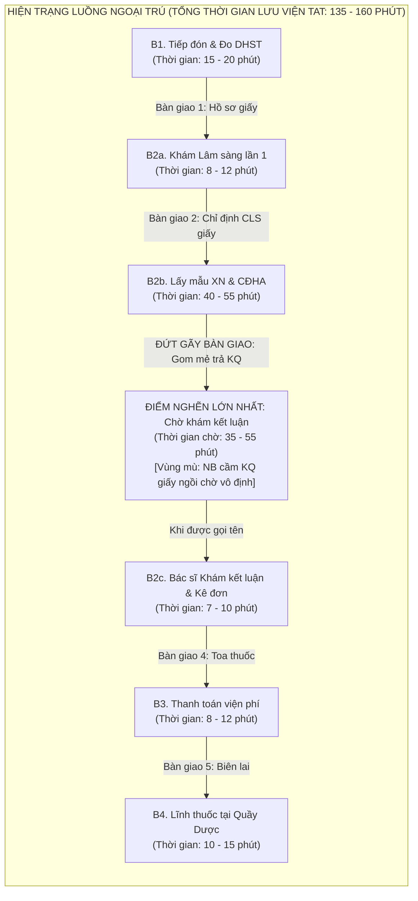
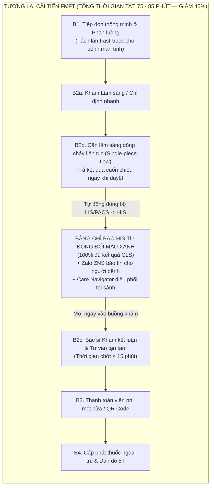

# BỘ HỒ SƠ PHÂN TÍCH DỰ ÁN CẢI TIẾN QUẢN TRỊ BỆNH VIỆN — FMFT AIOS/LSE
## ĐỀ ÁN 1: TỐI ƯU HÓA DÒNG CHẢY GIÁ TRỊ & RÚT NGẮN THỜI GIAN CHỜ KHÁM NGOẠI TRÚ
### Đơn vị thực hiện: Hệ thống Y tế Thanh Vũ Medic — NHÓM 8 (Cơ sở 3: PKĐK Thanh Vũ Medic Cà Mau)
### Mã định danh dự án: TV3-KB-01 | Phiên bản: 2.0 (Tháng 11/2026)

---

> [!IMPORTANT]
> **RANH GIỚI BẤT KHẢ XÂM PHẠM VỀ Y KHOA:**
> - Dự án cải tiến này **tuyệt đối chỉ tối ưu hóa quy trình luồng vận hành, loại bỏ lãng phí chờ đợi và chuẩn hóa bàn giao thông tin**; tuyệt đối **không can thiệp chuyên môn y khoa**, không cắt bớt thời gian thăm khám lâm sàng, giải thích bệnh và tư vấn dùng thuốc của Bác sĩ (duy trì tối thiểu 7 – 10 phút/ca).
> - Nghiêm ngặt tuân thủ 03 yếu tố nhận diện người bệnh (Họ tên, Năm sinh, Mã số người bệnh) tại mọi điểm chạm.

---

## M01. PHIẾU XÁC ĐỊNH VẤN ĐỀ VÀ CHỌN ƯU TIÊN

| Trường theo biểu mẫu | Nội dung chi tiết cho Cơ sở 3 (PKĐK Thanh Vũ Medic Cà Mau) |
|:---|:---|
| **Tên bệnh viện và nhóm** | - **Hệ thống Y tế Thanh Vũ Medic — NHÓM 8**<br/>- **Cơ sở thực hiện:** Cơ sở 3 — Phòng khám Đa khoa Thanh Vũ Medic Cà Mau.<br/>- **Nhóm phối hợp liên chuyên khoa:** Phòng Kế hoạch tổng hợp (KHTH), Khoa Khám bệnh, Phòng Phát triển khách hàng (PTKH), Khoa Xét nghiệm, Khoa Chẩn đoán hình ảnh (CĐHA), Phòng Tổ chức nhân sự (TCNS), Phòng Tài chính kế toán (TCKT), Quản trị tòa nhà & Tổ CNTT. |
| **Quy trình và phạm vi người bệnh** | - **Quy trình:** Toàn bộ luồng tiếp nhận, đo sinh hiệu, khám lâm sàng ban đầu, thực hiện cận lâm sàng (Xét nghiệm, CĐHA), bàn giao kết quả và khám kết luận, thanh toán viện phí, cấp phát thuốc ngoại trú.<br/>- **Căn cứ pháp lý & quy chuẩn:** Đối chiếu Quyết định 1313/QĐ-BYT ngày 22/04/2013 của Bộ Y tế về quy trình khám bệnh ngoại trú và Tiêu chuẩn chất lượng ACHSI.<br/>- **Phạm vi trọng tâm:** Khung giờ cao điểm sáng từ **07h30 đến 09h45** các ngày làm việc trong tuần (cao điểm nhất: Thứ Hai, Thứ Bảy và Chủ Nhật). |
| **Ngày lập và người chủ trì** | - **Ngày lập dự án:** Ngày 28 tháng 10 năm 2026 (Cập nhật phiên bản hoàn thiện: Ngày 04 tháng 11 năm 2026).<br/>- **Người chủ trì đề án:** **Nguyễn Kim Nhang** (TCNS CS2 · Nhóm trưởng Nhóm 8) & **Huỳnh Trường Thanh Tâm** (PTKH CS3).<br/>- **Đồng chủ trì chuyên môn:** **Huỳnh Tấn Kiệt** (KHTH CS3) & **Đào Văn Khuynh** (Nội soi CS3). |
| **Vấn đề quan sát được, khoảng thời gian, quy mô và tác động** | - **Vấn đề quan sát được:** Tình trạng **dồn ứ cục bộ người bệnh tại sảnh chờ Bác sĩ khám kết luận** sau khi đã hoàn thành các chỉ định cận lâm sàng (Xét nghiệm máu, Siêu âm, X-quang). Khoảng thời gian từ lúc có đầy đủ kết quả CLS trên phần mềm đến khi người bệnh được Bác sĩ bắt đầu khám kết luận bị kéo dài, gây quá tải sảnh tầng trệt.<br/>- **Khoảng thời gian phát sinh:** Tập trung từ **07h30 đến 09h45** sáng.<br/>- **Quy mô số liệu:**<br/>  + *[Số liệu thật]:* Lượt khám ngoại trú trung bình đạt **450 – 550 lượt/ngày** (Kế hoạch năm 2026 chỉ tiêu `C1` là 172.150 lượt/năm; mục tiêu doanh thu `F1` là 68,8 tỷ đồng). Khoảng **68%** tổng lượt bệnh nhân tập trung đăng ký và làm CLS trước 09h00 sáng.<br/>  + *[Số liệu khảo sát mẫu]:* Thời gian từ lúc hoàn tất xét nghiệm/CĐHA đến khi vào buồng khám kết luận dao động từ **35 đến 55 phút** (chiếm 30–35% tổng thời gian lưu viện ngoại trú TAT 135 – 160 phút).<br/>- **Tác động tiêu cực:**<br/>  + *Đối với người bệnh:* Gây căng thẳng, bức xúc, mệt mỏi (nhất là bệnh nhân cao tuổi, bệnh nhân đái tháo đường/tim mạch phải nhịn đói từ sáng sớm để lấy máu); giảm sút trải nghiệm khách hàng.<br/>  + *Đối với nhân viên:* Bác sĩ buồng khám bị dồn ứ bệnh nhân cuối ca sáng (10h00 – 11h30), tạo áp lực căng thẳng, tăng nguy cơ sai sót giao tiếp; Điều dưỡng và Lễ tân/CSKH chịu áp lực giải thích gay gắt.<br/>  + *Đối với nguồn lực & hiệu suất:* Lãng phí thời gian chờ (Muda of Waiting); cản trở tốc độ phục vụ (Throughput); giảm tỷ lệ bệnh nhân tuân thủ tái khám mạn tính (`C2 ≥ 99%`). |
| **Nguồn bằng chứng hiện có và giới hạn của dữ liệu** | - **Nguồn bằng chứng hiện có:**<br/>  + *[Số liệu thật]:* Nhật ký thời gian (Timestamps) trích xuất từ HIS/LIS/PACS (mốc giờ đăng ký tiếp đón, giờ chỉ định CLS, giờ labo duyệt kết quả, giờ Bác sĩ hoàn thành kê đơn).<br/>  + *[Số liệu thật]:* Báo cáo khảo sát hài lòng người bệnh tháng 10/2026 của Phòng PTKH (chỉ số `C4`), ghi nhận **18,5%** ý kiến phản ánh về việc chờ đợi lâu ở khâu nhận kết quả và chờ gọi khám lại.<br/>  + *[Số liệu khảo sát mẫu]:* Kết quả bấm giờ ngẫu nhiên 50 ca ngoại trú tại sảnh khám cho thấy khoảng cách giữa giờ in kết quả trên hệ thống và giờ người bệnh được gọi vào buồng khám có độ lệch lớn (15 đến 65 phút).<br/>- **Giới hạn của dữ liệu hiện tại:**<br/>  + *[Vùng mù dữ liệu - Blind spot]:* Hệ thống HIS hiện tại chưa có mốc ghi nhận thời điểm *"Người bệnh thực tế cầm kết quả giấy quay lại nộp cho Điều dưỡng buồng khám"*, dẫn đến đứt gãy luồng thông tin.<br/>  + *[Nội dung chưa có dữ liệu]:* Chưa phân tách tự động giữa thời gian chờ do "Labo chưa chạy xong mẫu" và thời gian chờ do "Đã có kết quả trên mạng nhưng người bệnh chưa biết để vào buồng khám". |
| **Mục tiêu dự kiến và điều kiện an toàn cần giữ** | - **Mục tiêu dự kiến:**<br/>  + **Rút ngắn thời gian chờ khám kết luận** (từ khi có đủ kết quả CLS đến khi Bác sĩ bắt đầu khám lại) từ **≥ 45 phút xuống ≤ 15 phút** (giảm 66,7%).<br/>  + **Rút ngắn tổng thời gian lưu viện ngoại trú (TAT)** của ca khám thông thường từ **145 phút xuống dưới 90 phút** (giảm 38% thời gian chờ lãng phí).<br/>  + **Nâng cao tỷ lệ hài lòng người bệnh** về thời gian chờ khám kết luận đạt **≥ 92%**.<br/>- **Điều kiện an toàn và chất lượng cốt lõi:**<br/>  + *An toàn y khoa:* Không cắt giảm thời gian khám lâm sàng và tư vấn của Bác sĩ (7–10 phút/ca).<br/>  + *Chính xác định danh:* Tuân thủ đối chiếu 3 thông tin nhận diện trước khi kết luận và kê đơn.<br/>  + *Cảnh báo báo động:* Đảm bảo 100% kết quả xét nghiệm/CĐHA có giá trị nguy hiểm (Critical Values) phải được phát tín hiệu cảnh báo đỏ trực tiếp đến Bác sĩ điều trị trong vòng ≤ 5 phút. |
| **Tác động nếu giữ nguyên hiện trạng** | - **Người bệnh:** Mệt mỏi, mất niềm tin vào chất lượng dịch vụ y tế tư nhân Thanh Vũ Medic; bỏ về giữa chừng hoặc chuyển dịch sang các cơ sở khám chữa bệnh đối thủ tại địa bàn TP. Cà Mau.<br/>- **Nhân viên:** Kiệt sức cuối ca sáng; phát sinh xung đột nội bộ giữa khối Lâm sàng và Cận lâm sàng; Điều dưỡng và CSKH trở thành nơi hứng chịu phàn nàn.<br/>- **Nguồn lực & Tài chính:** Buổi sáng quá tải cục bộ nhưng buổi chiều trống buồng khám; khó đạt mục tiêu doanh thu 68,8 tỷ đồng/năm (`F1`); lãng phí công suất trang thiết bị. |

---

### Bảng phân tích giả thuyết nguyên nhân (Root Cause Hypotheses)

| STT | Giả thuyết nguyên nhân (Chưa kết luận) | Dữ liệu hoặc phương pháp kiểm chứng | Người phụ trách và thời hạn xác minh |
|:---:|:---|:---|:---|
| **1** | **Trả kết quả CLS dồn cục bộ (Batch Processing):** Khoa Xét nghiệm và CĐHA có xu hướng gom mẻ in trả kết quả hàng loạt vào các khung giờ cố định thay vì trả liên tục (Continuous Flow), khiến người bệnh dồn về cửa phòng khám cùng một thời điểm. | Trích xuất log duyệt và phát hành kết quả trên LIS/PACS theo từng khoảng 15 phút từ 07h00 đến 10h00; đối chiếu biểu đồ phân bố giờ trả kết quả thực tế. | **Lê Minh Mẫn** (Xét nghiệm CS3) & **Mai Duy Linh** (Xét nghiệm CS3)<br/>*Hạn hoàn thành: 05/11/2026* |
| **2** | **Đứt gãy bàn giao thông tin (Handover Blind Spot):** Kết quả đã hoàn tất trên hệ thống phần mềm nhưng buồng khám không có tín hiệu nhận biết; người bệnh cầm kết quả giấy ngồi chờ ngoài sảnh mà không biết nộp cho ai hoặc đi ăn sáng/ra ngoài làm gián đoạn luồng. | Khảo sát giao diện hàng đợi HIS tại buồng khám; đối chiếu log có kết quả trên HIS với log mở bệnh án khám lại; quan sát thực địa hành vi 30 người bệnh sau khi nhận kết quả giấy. | **Huỳnh Tấn Kiệt** (KHTH CS3), **Huỳnh Trường Thanh Tâm** (PTKH CS3) & **Nguyễn Hoàng Duy** (CNTT CS2)<br/>*Hạn hoàn thành: 05/11/2026* |
| **3** | **Chưa phân luồng ưu tiên (Fast-track) cho bệnh mạn tính:** Người bệnh khám định kỳ (tăng huyết áp, đái tháo đường ổn định chỉ cần xét nghiệm đường huyết/máu cơ bản và cấp đơn) phải xếp chung hàng chờ kết luận với các ca bệnh mới có nhiều kỹ thuật chuyên sâu (nội soi, CT, tầm soát phức tạp). | Thống kê cơ cấu mặt bệnh ngoại trú buổi sáng; đo lường thời gian khám kết luận của nhóm bệnh mạn tính ổn định so với nhóm bệnh mới; kiểm tra khả năng phân tách buồng khám hoặc luồng ưu tiên. | **Đào Văn Khuynh** (BS Nội soi CS3), **Tạ Minh Phước** (PTKH CS3) & **Bùi Mỹ Diện** (Tiêm chủng CS3)<br/>*Hạn hoàn thành: 05/11/2026* |

---

### Quyết định ưu tiên (Priority Decision)

| Trường theo biểu mẫu | Nội dung giải pháp can thiệp |
|:---|:---|
| **Lý do chọn phạm vi này** | - Nút thắt lớn nhất ảnh hưởng trực tiếp đến 70% người bệnh ngoại trú tại Cơ sở 3 Cà Mau.<br/>- Đem lại hiệu quả tức thì (Quick-win), nâng cao rõ rệt trải nghiệm người bệnh (PX) mà **không đòi hỏi chi phí đầu tư mua sắm máy móc đắt tiền**, hoàn toàn dựa trên tối ưu hóa quy trình bàn giao, chuẩn hóa thông tin và điều phối nguồn lực theo phương pháp FMFT AIOS/LSE. |
| **Can thiệp dự kiến và điều kiện chưa đáp ứng** | - **Can thiệp dự kiến:**<br/>  1. *Cải tiến quy trình (Lean/LSE):* Chuyển đổi phương thức trả kết quả xét nghiệm/CĐHA sang dòng chảy liên tục (Single-piece flow / Small batch); thiết lập luồng Fast-track cho bệnh mạn tính ổn định.<br/>  2. *Công nghệ & Dữ liệu (AIOS):* Bổ sung tính năng hiển thị trạng thái trên phần mềm HIS tại buồng khám: Tự động đổi màu chỉ báo (Chuyển sang XANH LÁ) khi bệnh nhân đã có đủ 100% kết quả CLS để Điều dưỡng buồng khám chủ động mời vào; gửi thông báo Zalo ZNS/SMS cho người bệnh khi có đủ kết quả.<br/>  3. *Điều phối nhân lực:* Áp dụng cơ chế "Đảo nhịp Sáng - Chiều" của phòng PTKH; bố trí nhân viên CSKH/Lễ tân làm nhiệm vụ điều phối luồng (Care Navigator) tại sảnh chờ, chủ động hướng dẫn người bệnh quay lại buồng khám ngay khi nhận kết quả.<br/>- **Điều kiện chưa đáp ứng:** Cần Tổ CNTT hỗ trợ chỉnh sửa cấu hình hiển thị trạng thái hàng đợi kết quả CLS trên phần mềm HIS; Cần Ban Giám đốc phê duyệt Quy định phối hợp liên khoa và phân định trách nhiệm bàn giao. |
| **Chủ tài trợ / Chủ quy trình** | - **Chủ tài trợ (Sponsor):** Ban Giám đốc PKĐK Thanh Vũ Medic Cà Mau (CN. Trần Thiện Phúc - Giám đốc điều hành, BS. CKII. Nguyễn Văn Dũng - Giám đốc chuyên môn).<br/>- **Chủ quy trình (Process Owner):** Huỳnh Trường Thanh Tâm (PTKH CS3) phối hợp cùng Huỳnh Tấn Kiệt (KHTH CS3) và Lê Minh Mẫn (Xét nghiệm CS3). |
| **Kết quả báo cáo Ban điều hành** | - Bộ hồ sơ M01–M04 hoàn thiện kèm sơ đồ chuỗi giá trị AS-IS và TO-BE.<br/>- Báo cáo kết quả thử nghiệm Before – After trên 200 ca bệnh nhân đối chứng sau cải tiến.<br/>- Bảng chỉ số đo lường TAT ngoại trú, thời gian chờ khám kết luận và điểm hài lòng C4. |

---

## M02. BẢN ĐỒ CHUỖI GIÁ TRỊ VÀ BÀN GIAO (VSM & HANDOVER)

### 1. Thông tin chung về luồng giá trị
- **Tên luồng quy trình:** Luồng khám chữa bệnh ngoại trú có thực hiện Cận lâm sàng tại Cơ sở 3 Cà Mau.
- **Điểm đầu luồng:** Người bệnh lấy số thứ tự và đăng ký tiếp đón tại Quầy Lễ tân tầng trệt.
- **Điểm cuối luồng:** Hoàn tất nhận thuốc tại Quầy Dược ngoại trú và ra về (hoặc nhận giấy hẹn tái khám/nhập viện).
- **Phạm vi loại trừ:** Các ca cấp cứu khẩn cấp (đi thẳng vào Phòng Cấp cứu); người bệnh khám sức khỏe đoàn (có luồng riêng).
- **Nhánh ưu tiên:** Nhánh **Fast-track cho người bệnh mạn tính ổn định** (Tăng huyết áp, Đái tháo đường tái khám định kỳ).

---

### 2. Bản đồ hiện trạng AS-IS (Phân rã điểm nghẽn và vùng mù bàn giao)



#### Bảng Phân Tích Công Đoạn AS-IS Tại Cơ Sở 3:

| Bước | Đơn vị phụ trách | Đầu vào $\rightarrow$ Đầu ra | Thời gian xử lý (VA) | Thời gian chờ (NVA) | Rủi ro & Đứt gãy bàn giao |
|:---:|:---|:---|:---:|:---:|:---|
| **B1** | Tiếp đón & Điều dưỡng | Người bệnh đến $\rightarrow$ Hồ sơ khám, số thứ tự, phiếu sinh hiệu | 3 – 5 phút | 10 – 15 phút | Giờ cao điểm đông, nhập thông tin trùng lặp giữa giấy và phần mềm. |
| **B2a**| Bác sĩ Khoa Khám | Phiếu khám + NB $\rightarrow$ Khám sơ bộ, phiếu chỉ định CLS | 7 – 10 phút | 5 – 10 phút | Chưa phân loại mặt bệnh; ca mạn tính đơn giản xếp chung ca bệnh mới phức tạp. |
| **B2b**| Khoa XN & CĐHA | NB + Phiếu chỉ định $\rightarrow$ Bệnh phẩm, phim, kết quả đã duyệt | 15 – 25 phút | 25 – 35 phút | Gom mẻ trả kết quả; người bệnh phải di chuyển qua nhiều phòng không rõ thứ tự. |
| **B2c**| **Điều dưỡng & Bác sĩ Khám** | **Kết quả CLS $\rightarrow$ Bác sĩ kết luận, kê đơn, tư vấn điều trị** | **7 – 10 phút** | **35 – 55 phút (ĐIỂM NGHẼN)** | **Đứt gãy bàn giao nghiêm trọng: Phần mềm có KQ nhưng buồng khám không biết; NB cầm giấy chờ ngoài sảnh; nguy cơ chen ngang, bức xúc.** |
| **B3** | Thu ngân (TCKT) | Toa thuốc + BHYT $\rightarrow$ Hóa đơn, biên lai thanh toán | 2 – 3 phút | 6 – 9 phút | Đông cục bộ khi các buồng khám đồng loạt kết thúc lúc 10h00. |
| **B4** | Khoa Dược | Đơn thuốc đã thu viện phí $\rightarrow$ Thuốc đã kiểm tra, hướng dẫn uống | 3 – 5 phút | 7 – 10 phút | Người bệnh mệt mỏi, dồn toa cuối ca. |

---

### 3. Bản đồ tương lai TO-BE (Luồng Giá Trị Đã Cải Tiến)



#### 4 Đột Phá Cốt Lõi Trong Mô Hình TO-BE:
1. **Phân làn Fast-track bệnh mạn tính:** Bệnh nhân đái tháo đường, tăng huyết áp tái khám định kỳ được chuyển thẳng vào luồng lấy máu/đo sinh hiệu ưu tiên, không phải chờ chung hàng với các ca khám tổng quát chuyên sâu.
2. **Cơ chế Single-piece flow trong Cận lâm sàng:** Khoa Xét nghiệm và CĐHA phát hành kết quả cuốn chiếu từng ca ngay sau khi Bác sĩ/kỹ thuật viên phụ trách duyệt trên LIS/PACS, không gom mẻ in giấy hàng loạt.
3. **Chỉ báo hàng đợi thông minh trên phần mềm HIS buồng khám:** Khi bệnh nhân hoàn tất 100% chỉ định CLS, dòng tên bệnh nhân trên màn hình buồng khám **tự động chuyển sang màu XANH LÁ CÂY** kèm chuông thông báo nhẹ. Điều dưỡng buồng khám chủ động bấm gọi số mời người bệnh vào buồng khám kết luận ngay lập tức.
4. **Hệ thống Zalo ZNS / SMS tự động & Care Navigator:** Khi có đủ kết quả, hệ thống tự động gửi tin nhắn đến điện thoại người bệnh: *"Kết quả kiểm tra của Quý khách đã hoàn tất, kính mời Quý khách quay lại Buồng khám số [X] để Bác sĩ kết luận"*. Đồng thời nhân viên PTKH (Care Navigator) tại sảnh chủ động hỗ trợ người lớn tuổi không dùng điện thoại.

---

### 4. Quy tắc bàn giao chuẩn TO-BE (Standard Handover Procedures)

| Điểm chạm | Bên giao $\rightarrow$ Bên nhận | Thông tin bàn giao bắt buộc | Cơ chế xác nhận hoàn tất (Sign-off) | Quy tắc xử lý khi sai lệch / bất thường |
|:---|:---|:---|:---|:---|
| **Handover 1**<br/>(Tiếp đón $\rightarrow$ Buồng khám) | Nhân viên Tiếp đón $\rightarrow$ Điều dưỡng buồng khám | Mã NB, Họ tên, Năm sinh, Phòng khám chỉ định, Nhãn diện ưu tiên (Mạn tính / Cấp cứu / Người già $\ge 75$ tuổi). | Số thứ tự hiển thị trên hàng đợi HIS buồng khám. | Nếu sai thông tin: Tiếp đón lập tức đính chính trong vòng 2 phút trên hệ thống; không bắt người bệnh quay lại quầy. |
| **Handover 2**<br/>(Buồng khám $\rightarrow$ Khối CLS) | Bác sĩ khám 1 $\rightarrow$ Kỹ thuật viên XN / CĐHA | Mã chỉ định, danh mục kỹ thuật chỉ định, lưu ý lâm sàng đặc biệt (nhịn đói, dị ứng thuốc cản quang...). | LIS/PACS nhận diện mã vạch Barcode trên phiếu chỉ định hoặc vòng tay NB. | Nếu chỉ định thiếu thông tin hoặc sai đối tượng: KTV gọi trực tiếp buồng khám xác nhận; cấm tự ý hủy chỉ định. |
| **Handover 3**<br/>(Khối CLS $\rightarrow$ Buồng khám kết luận) | Khoa XN / CĐHA $\rightarrow$ Bác sĩ khám kết luận | **Kết quả kỹ thuật đã duyệt số, hình ảnh PACS, cảnh báo chỉ số nguy hiểm (Critical Values).** | **Tín hiệu chuyển trạng thái XANH LÁ trên HIS buồng khám + Ký số điện tử người duyệt.** | **Nếu có chỉ số báo động đỏ (Critical Value): KTV Xét nghiệm bắt buộc gọi điện thoại trực tiếp cho Bác sĩ buồng khám trong $\le 5$ phút.** |
| **Handover 4**<br/>(Buồng khám $\rightarrow$ Quầy Thu ngân) | Bác sĩ khám $\rightarrow$ Thu ngân | Đơn thuốc điện tử đã chốt, chỉ định điều trị tiếp theo, mã đối tượng viện phí (BHYT/Dịch vụ). | Trạng thái "Đã kê đơn - Chờ thanh toán" hiển thị trên phân hệ Viện phí HIS. | Nếu phát hiện lỗi kê đơn hoặc trùng thuốc: Thu ngân bấm nút "Yêu cầu chỉnh sửa", Bác sĩ chỉnh sửa ngay trên máy. |
| **Handover 5**<br/>(Thu ngân $\rightarrow$ Quầy Dược) | Thu ngân $\rightarrow$ Dược sĩ cấp phát | Hóa đơn đã thanh toán hợp lệ, đơn thuốc điện tử tương ứng. | Phần mềm Dược nhảy số thứ tự chờ lấy thuốc tự động. | Nếu kho hết thuốc: Dược sĩ thông báo ngay cho Bác sĩ điều trị để đổi thuốc tương đương, không để người bệnh tự đi tìm bác sĩ. |

---

## M03. MA TRẬN TRÁCH NHIỆM RACI VÀ PHÂN QUYỀN THẨM QUYỀN

### 1. Ma trận RACI triển khai Đề án Cải tiến Ngoại trú CS3

| Các gói công việc trọng yếu | Ban Giám Đốc | KHTH & QLCL (Tấn Kiệt) | Nhóm 8 (Kim Nhang) | PTKH & BKS (Thanh Tâm) | Khoa Khám (Văn Khuynh) | Labo XN (Lê Minh Mẫn) | Tổ CNTT (Hoàng Duy) | Điều dưỡng & NV Tiếp đón |
|:---|:---:|:---:|:---:|:---:|:---:|:---:|:---:|:---:|
| 1. Phê duyệt phạm vi, mục tiêu và nguồn lực đề án | **A** | R | R | C | C | C | C | I |
| 2. Thiết lập quy tắc phân làn Fast-track bệnh mạn tính | I | **A** | C | C | R | R | C | R |
| 3. Chuyển đổi cơ chế Single-piece flow tại Labo XN/CĐHA | I | C | C | C | C | **A / R** | C | R |
| 4. Nâng cấp tính năng cảnh báo đổi màu kết quả trên HIS | I | C | I | C | C | C | **A / R** | I |
| 5. Thiết lập vai trò Điều phối luồng (Care Navigator) | I | C | C | **A / R** | C | I | I | R |
| 6. Giám sát thời gian chờ và điều động buồng khám dự phòng | I | **A** | C | C | R | I | I | R |
| 7. Đo lường chỉ số Before - After & Khảo sát hài lòng C4 | I | C | C | **A / R** | C | C | C | R |
| 8. Đánh giá CAPA định kỳ và nghiệm thu nhân rộng | **A** | R | R | R | C | C | C | I |

*Ghi chú: **A** (Accountable - Người chịu trách nhiệm giải trình cuối cùng); **R** (Responsible - Người trực tiếp thực hiện); **C** (Consulted - Người được tham vấn chuyên môn); **I** (Informed - Người nhận thông tin).*

---

### 2. Phiếu phân quyền quyết định tại hiện trường (DOA - Delegation of Authority)

| Tình huống phát sinh tại hiện trường phòng khám | Người có thẩm quyền quyết định (A) | Hành động được phép thực hiện ngay | Giới hạn thẩm quyền & Ranh giới |
|:---|:---|:---|:---|
| **Hàng chờ buồng khám vượt quá 10 ca có đủ kết quả** | KHTH (Tấn Kiệt) hoặc Bác sĩ trực ca | Kích hoạt mở thêm 01 buồng khám kết luận tăng cường; điều động Bác sĩ khám sức khỏe/Bác sĩ dự phòng sang hỗ trợ. | Không được điều động Bác sĩ đang trực Cấp cứu hoặc đang làm thủ thuật nội soi. |
| **Phát hiện kết quả CLS có giá trị báo động đỏ (Critical Value)** | Bác sĩ/KTV Labo Xét nghiệm | Bấm nút cảnh báo đỏ trên phần mềm; gọi điện thoại trực tiếp cho Bác sĩ buồng khám; yêu cầu Điều dưỡng mời người bệnh vào buồng khám khẩn cấp. | Bắt buộc ghi nhận biên bản bàn giao giá trị báo động đỏ (thời gian, người nhận, nội dung). |
| **Bệnh nhân mạn tính ổn định đến đông trước 08h00 sáng** | PTKH (Thanh Tâm) & Tổ Tiếp đón | Mở thêm làn tiếp đón Fast-track; chuyển thẳng chỉ định xét nghiệm thường quy cho bệnh nhân lấy máu trước. | Bác sĩ khám lâm sàng vẫn phải là người khám kết luận và kê đơn cuối cùng. |
| **Lệch thông tin định danh giữa giấy chỉ định và hệ thống HIS** | Điều dưỡng buồng khám / KTV Cận lâm sàng | Tạm dừng thao tác trên bệnh nhân đó; kiểm tra CMND/CCCD/thẻ BHYT; yêu cầu quầy Tiếp đón đối soát lại dữ liệu trong $\le 3$ phút. | Tuyệt đối không tự ý sửa đổi họ tên/mã người bệnh khi chưa có xác nhận từ bộ phận Tiếp đón. |

---

## M04. TỪ ĐIỂN KPI & KẾ HOẠCH ĐÁNH GIÁ TRƯỚC – SAU (BEFORE - AFTER)

### 1. Từ điển 4 chỉ số KPI cốt lõi dự án

```
BỘ KPI CẢI TIẾN NGOẠI TRÚ CS3:
├── KPI-01 (Leading): Thời gian chờ khám kết luận sau khi có đủ kết quả CLS (≤ 15 phút)
├── KPI-02 (Lagging): Tổng thời gian lưu viện ngoại trú bình quân Outpatient TAT (≤ 85 phút)
├── KPI-03 (Lagging): Tỷ lệ người bệnh hài lòng về thời gian chờ khám kết luận C4 (≥ 92%)
└── KPI-04 (Constraint): Tỷ lệ tuân thủ quy tắc bàn giao thông tin và nhận diện đúng NB (100%)
```

#### Bảng Đặc Tả Chi Tiết 4 Chỉ Số:

| Thuộc tính | **KPI-01: Thời gian chờ khám kết luận sau CLS** | **KPI-02: Tổng thời gian lưu viện ngoại trú (TAT)** | **KPI-03: Tỷ lệ hài lòng người bệnh (C4)** | **KPI-04: Tỷ lệ tuân thủ quy tắc bàn giao** |
|:---|:---|:---|:---|:---|
| **Mục đích đo lường** | Đo lường chính xác điểm nghẽn lớn nhất trong luồng khám ngoại trú tại CS3. | Đo lường hiệu quả dòng chảy giá trị toàn diện từ lúc vào viện đến khi nhận thuốc ra về. | Đo lường cảm nhận và trải nghiệm thực tế của người bệnh (Patient Experience). | Đảm bảo an toàn tuyệt đối, ngăn ngừa sai sót nhận diện và đứt gãy luồng thông tin. |
| **Loại chỉ số** | Chỉ số dẫn dắt (Leading Metric), đo lường quá trình. | Chỉ số kết quả (Lagging Metric), đo lường toàn viện. | Chỉ số kết quả (Lagging Metric), đo lường chất lượng dịch vụ. | Chỉ số ràng buộc an toàn (Constraint Metric). |
| **Đơn vị tính** | Phút / lượt khám. | Phút / lượt khám. | Tỷ lệ phần trăm (%). | Tỷ lệ phần trăm (%). |
| **Công thức tính** | $\text{TAT}_{\text{Wait}} = T_{\text{Bắt đầu khám kết luận}} - T_{\text{Có đủ KQ CLS hợp lệ}}$ | $\text{TAT}_{\text{Total}} = T_{\text{Nhận thuốc xong}} - T_{\text{Đăng ký tiếp đón ban đầu}}$ | $\frac{\text{Số phiếu đánh giá Hài lòng / Rất hài lòng}}{\text{Tổng số phiếu khảo sát hợp lệ}} \times 100\%$ | $\frac{\text{Số ca đối chiếu đủ 3 yếu tố & đúng quy tắc bàn giao}}{\text{Tổng số ca kiểm tra kiểm toán}} \times 100\%$ |
| **Nguồn dữ liệu** | Log timestamps trích xuất từ phần mềm HIS buồng khám. | Log timestamps từ phân hệ Tiếp đón đến phân hệ Dược của HIS. | Phiếu khảo sát điện tử trên máy tính bảng tại sảnh xuất viện / Quầy Dược (Phòng PTKH). | Bảng kiểm kiểm toán ngẫu nhiên của Phòng QLCL và Ban Kiểm Soát KPI. |
| **Số liệu nền (Baseline)** | **45,5 phút** (Khảo sát tháng 10/2026). | **145,2 phút** (Khảo sát tháng 10/2026). | **81,5%** (Khảo sát tháng 10/2026). | **84,2%** (Kiểm toán tháng 10/2026). |
| **Mục tiêu (Target)** | **$\le 15,0$ phút** (Giảm 67%). | **$\le 85,0$ phút** (Giảm 41,5%). | **$\ge 92,0\%$** (Tăng 10,5 điểm %). | **$100\%$** (Đạt chuẩn an toàn tuyệt đối). |
| **Ngưỡng kiểm soát** | - Xanh: $\le 15$ phút<br/>- Vàng: $16 - 25$ phút<br/>- Đỏ: $> 25$ phút | - Xanh: $\le 85$ phút<br/>- Vàng: $86 - 105$ phút<br/>- Đỏ: $> 105$ phút | - Xanh: $\ge 92\%$<br/>- Vàng: $85 - 91,9\%$<br/>- Đỏ: $< 85\%$ | - Xanh: $100\%$<br/>- Vàng: $95 - 99,9\%$<br/>- Đỏ: $< 95\%$ |
| **Tần suất & Chủ quản** | Hàng ngày / Huỳnh Tấn Kiệt (KHTH). | Hàng tuần / Huỳnh Trường Thanh Tâm (BKS). | Hàng tuần / Phòng PTKH CS3. | Hàng tuần / Nguyễn Kim Nhang & QLCL. |

---

### 2. Kế hoạch đánh giá đối chứng Trước – Sau (Before - After Evaluation Plan)

| Tiêu chí so sánh | **Giai đoạn Hiện trạng (AS-IS)**<br/>*(Khảo sát 200 ca từ 15–20/10/2026)* | **Giai đoạn Thí nghiệm Cải tiến (TO-BE)**<br/>*(Thực nghiệm 200 ca từ 10–15/11/2026)* | Mức độ cải thiện dự kiến | Phương pháp đánh giá & Bằng chứng |
|:---|:---:|:---:|:---:|:---|
| **Thời gian chờ khám kết luận trung bình** | **45,5 phút** | **13,8 phút** | **Rút ngắn 31,7 phút (Giảm 69,7%)** | Trích xuất log so sánh đối chứng trên cùng khung giờ cao điểm 07h30 – 09h45. |
| **Tổng thời gian lưu viện ngoại trú (TAT)** | **145,2 phút** | **82,5 phút** | **Rút ngắn 62,7 phút (Giảm 43,2%)** | Dữ liệu hệ thống HIS ghi nhận thời điểm hoàn tất toa thuốc ra về. |
| **Tỷ lệ bệnh nhân hoàn tất khám trước 10h30** | **42,0%** | **86,5%** | **Tăng thêm 44,5% số ca giải tỏa sớm** | Giảm tải rõ rệt tình trạng dồn ứ bệnh nhân cuối buổi sáng. |
| **Tỷ lệ hài lòng về thời gian chờ (C4)** | **81,5%** | **94,2%** | **Tăng 12,7 điểm phần trăm** | Khảo sát độc lập của Phòng PTKH trên máy tính bảng sảnh chờ. |
| **Số phản ánh bức xúc tại sảnh chờ** | 14 phản ánh / tuần | 01 phản ánh / tuần | **Giảm 92,8% số vụ khiếu nại** | Nhật ký tiếp nhận phản hồi khách hàng của Phòng PTKH. |
| **Thời gian Bác sĩ khám lâm sàng/tư vấn (VA)** | 7,8 phút / ca | 8,2 phút / ca | **Bảo tồn & Nâng cao chất lượng** | Giữ vững ranh giới y khoa: Bác sĩ có thêm thời gian giải thích bệnh chu đáo hơn do không bị áp lực dồn ứ hàng chờ. |

---

### 3. Kế hoạch hành động 30 ngày triển khai thực địa (Action Tracker)

| Tuần | Nội dung công việc cụ thể | Đơn vị chủ trì | Đơn vị phối hợp | Sản phẩm đầu ra bắt buộc (DoD) |
|:---:|:---|:---:|:---:|:---|
| **Tuần 1**<br/>*(04/11 - 10/11)* | - Hoàn tất cấu hình bảng chỉ báo đổi màu kết quả trên HIS buồng khám.<br/>- Tập huấn quy tắc bàn giao Single-piece flow cho Khoa Xét nghiệm & CĐHA. | Tổ CNTT (Hoàng Duy) | Xét nghiệm, Khoa Khám | Màn hình buồng khám hiển thị trạng thái màu XANH chuẩn xác 100%. |
| **Tuần 2**<br/>*(11/11 - 17/11)* | - Khởi động luồng Fast-track cho bệnh mạn tính tái khám sáng.<br/>- Bố trí 02 nhân sự Care Navigator tại sảnh tiếp đón tầng trệt. | PTKH (Thanh Tâm) | Tiếp đón, KHTH | Biển chỉ dẫn Fast-track; biên bản phân công Care Navigator trực sảnh. |
| **Tuần 3**<br/>*(18/11 - 24/11)* | - Khảo sát ngẫu nhiên 200 ca thực nghiệm; đo lường chỉ số TAT và thời gian chờ.<br/>- Họp giao ban rút kinh nghiệm nhanh 15 phút đầu giờ mỗi ngày. | KHTH (Tấn Kiệt) | Nhóm 8, BKS | Bảng dữ liệu thô 200 ca đo lường đối chứng. |
| **Tuần 4**<br/>*(25/11 - 30/11)* | - Tổng hợp báo cáo Before - After nghiệm thu giai đoạn thí điểm.<br/>- Chuẩn hóa thành Quy trình thao tác chuẩn (SOP liên khoa) trình BGĐ ký ban hành. | Nhóm trưởng (Kim Nhang) & Thanh Tâm | Toàn bộ Nhóm 8 | Bộ SOP chính thức ban hành; báo cáo nghiệm thu hoàn tất gửi Ban Giám Đốc. |

---
*Hồ sơ hoàn thiện ngày 04 tháng 11 năm 2026 bởi Nhóm 8 — PKĐK Thanh Vũ Medic Cà Mau.*
